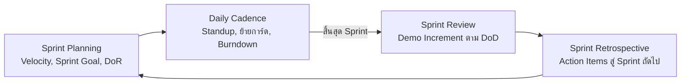

# Project Django (CN331)

คู่มือสำหรับสมาชิกทีม: กระบวนการ Agile/Scrum, การใช้ Git/GitHub, สถาปัตยกรรมและมาตรฐานโค้ด Django และเกณฑ์ส่งงาน (DoR/DoD)
อ่านให้จบก่อนเปิด Pull Request ครั้งแรก

**แหล่งอ้างอิงหลัก:** [`_docs/lecture-notes/`](./_docs/lecture-notes/README.md) ของวิชา CN331 (สัปดาห์ที่ 7 และ 10) คือแกนของคู่มือนี้ ส่วนเนื้อหาสัปดาห์ที่ 1–6 สรุปไว้ในหัวข้อมาตรฐานโค้ด
- **กระบวนการ Agile และ Git/GitHub** ทำตาม lecture-notes ([05 Agile Scrum](./_docs/lecture-notes/05-agile-scrum-sprints.md))
- **สถาปัตยกรรมและ logic ของโค้ด** ทำตามเอกสารของโปรเจค ([`_docs/database-design.md`](./_docs/database-design.md), [ADR](./_docs/adr/)) โดยมีหลักจาก lecture-notes ([03 Architecture](./_docs/lecture-notes/03-software-architecture-and-decomposition.md), [04 Service Layer](./_docs/lecture-notes/04-django-service-layer-and-transactions.md), [01 ORM](./_docs/lecture-notes/01-django-orm-queries-and-optimization.md), [02 CBV](./_docs/lecture-notes/02-django-class-based-views.md)) เป็นแกน
- **Requirements / Product Backlog** อยู่ที่ [`_docs/requirements.md`](./_docs/requirements.md)

> Setup, Sync, Project Structure และ Branch Strategy: ดูที่ [README.md](./README.md)

## สารบัญ
1. [Scrum ของทีมเรา](#scrum-ของทีมเรา)
2. [Product Backlog และ User Story](#product-backlog-และ-user-story)
3. [เกณฑ์คุณภาพ: DoR และ DoD](#เกณฑ์คุณภาพ-dor-และ-dod)
4. [Sprint Planning](#sprint-planning)
5. [GitHub Projects และ Issues](#github-projects-และ-issues)
6. [Workflow ระหว่าง Sprint](#workflow-ระหว่าง-sprint)
7. [Daily Standup และ Burndown](#daily-standup-และ-burndown)
8. [Sprint Review และ Retrospective](#sprint-review-และ-retrospective)
9. [Git ที่ต้องรู้](#git-ที่ต้องรู้)
10. [Commit Message Convention](#commit-message-convention)
11. [Pull Request และ Code Review](#pull-request-และ-code-review)
12. [สถาปัตยกรรมและการจัดวางโค้ด](#สถาปัตยกรรมและการจัดวางโค้ด)
13. [มาตรฐานโค้ด Django](#มาตรฐานโค้ด-django)
14. [Testing และการใช้ AI](#testing-และการใช้-ai-ช่วยเขียนโค้ด)
15. [Checklist ก่อนเปิด PR](#checklist-ก่อนเปิด-pr)
16. [Database และ Models](#database-และ-models)

---

## Scrum ของทีมเรา

### ทีมและบทบาท
| บทบาท | ใคร | หน้าที่ |
|---|---|---|
| **Product Owner (PO)** | อาจารย์ผู้สอน | จัดลำดับ Product Backlog, ตรวจรับงานใน Sprint Review |
| **Scrum Master (SM)** | สมาชิกในทีม **หมุนเวียนทุก Sprint** | ดูแลกระบวนการ Scrum, ช่วยกำจัด blocker, นำประชุม, ดูแล Burndown |
| **Developers** | ทุกคน (ทีมละ 5 คน) | ออกแบบ เขียน Model/Service/View/Template/Test ร่วมกัน ไม่แบ่งงานแบบไซโล (ไม่มี "คน DB" หรือ "คน HTML" คนเดียว) |

### วงรอบของ Sprint (1–2 สัปดาห์ ตามวันใน Milestone)


| กิจกรรม | ทำอะไร | ผลลัพธ์ |
|---|---|---|
| **Sprint Planning** | คำนวณ Velocity, ตั้ง Sprint Goal, ดึง story ที่ผ่าน DoR เข้า Sprint (แต้มรวม ≤ Velocity) | Sprint Goal + Sprint Backlog บน GitHub |
| **Daily Standup** (15 นาที) | ตอบ 3 คำถาม (เมื่อวาน / วันนี้ / ติดอะไร) | แผนวันนี้ + blocker |
| **Sprint Review** | Live demo ซอฟต์แวร์ที่ merge แล้ว ตรวจกับ PO ตาม AC และ DoD | Backlog ที่ปรับลำดับแล้ว |
| **Sprint Retrospective** | Start/Stop/Continue หรือ 4Ls แบบ Blameless | Action Items 1–2 ข้อ + `_docs/sprintN_retro.md` |

### แผน 3 Sprint (ร่าง ปรับทุก Sprint Planning ตาม Velocity จริง)
| Sprint | เนื้อหาหลัก | สิ่งที่ส่งมอบ |
|---|---|---|
| **Sprint 1** | Authentication, Core Models, อัปโหลด/อนุมัติ/ค้นหาขั้นแรก | Increment ที่รันได้จริง, Backlog บน GitHub |
| **Sprint 2** | Business Logic (Service Layer), Unit Testing, CI | ฟีเจอร์หลัก, **coverage > 80%**, CI, Refactoring Stories (**≥ 20% ของแต้ม**) |
| **Sprint 3** | Security (OWASP), Cloud Deploy | ระบบที่ปลอดภัยและ deploy บน Cloud Server |
| **Final** | Demo สัปดาห์ที่ 14 | Live Demo, Agile Metrics (Velocity, Burndown), ประเมินเพื่อนร่วมกลุ่ม |

ร่าง Sprint Goal ของแต่ละรอบอยู่ใน [`_docs/requirements.md`](./_docs/requirements.md#8-roadmap-ร่าง--ปรับทุก-sprint-planning-ตาม-velocity-จริง) คะแนนประเมินจากงานที่ส่งมอบจริงบน GitHub ในแต่ละ Sprint

---

## Product Backlog และ User Story

Product Backlog คือรายการ requirement ที่**มีชีวิต**: PO จัดลำดับใหม่ได้ตลอด ทุกคนเสนอ story ได้ และ story จะละเอียดขึ้นเมื่อใกล้ถูกดึงเข้า Sprint ภาพรวม (Vision, Epic, story ที่ยังไม่เปิด issue) อยู่ที่ [`_docs/requirements.md`](./_docs/requirements.md) ส่วน story ที่เปิด issue แล้วให้ถือ issue เป็นแหล่งความจริง

### User Story
```
As a <บทบาท>,
I want <สิ่งที่ต้องการทำ>,
So that <ประโยชน์/คุณค่าที่ได้>
```
ตรวจคุณภาพด้วย **INVEST**: Independent, **Negotiable** (คุยต่อได้ ไม่ใช่สัญญา), Valuable, Estimable, Small (จบใน 1 Sprint), Testable

**Acceptance Criteria (AC)** 3–5 ข้อต่อ story เขียนได้ 2 แบบ
```
# แบบ Checklist
- [ ] ไฟล์ที่ไม่ใช่ PDF ถูกปฏิเสธพร้อมข้อความชัดเจน
- [ ] อัปโหลดสำเร็จแล้วไฟล์มีสถานะ "รออนุมัติ"

# แบบ Given-When-Then (แปลงเป็น automated test ได้ตรงๆ)
Given นักศึกษาภาค CN ล็อกอินแล้ว
When  ส่งคำขออัปโหลดเข้าภาค ME
Then  ระบบตอบ 403 และไม่สร้างเอกสาร
```

### Vertical Slicing
ซอย story ให้**ตัดผ่านทุกชั้น** (Template → View → Service/Selector → Model → Test) เพื่อให้ทุก story ที่ Done เป็น Working Increment ที่ demo ได้
- ✓ Story A: ค้นหาชีทตามรหัสวิชาและแสดงผล · Story B: อัปโหลดชีทเข้ารุ่นของตัวเอง
- ✗ "Sprint นี้ทำ Model ทั้งหมด" / "ทำ HTML ทั้งหมด" (ถ้าหมดเวลากลางทางจะไม่มีอะไร demo ได้เลย)

### Technical Story: งาน Refactoring และ Tech Debt
หนี้ทางเทคนิค (Technical Debt) ต้องอยู่บนบอร์ดให้เห็น ไม่ซุกไว้ใต้พรม ใช้ template **Tech Debt / Refactoring Story**
- **Title:** `Refactor: Extract document upload into materials/services.py`
- **Value:** ลดโค้ดซ้ำ และทำให้ทดสอบ Unit Test ได้
- **Points:** ประเมินเหมือน Feature ปกติ
- **AC ตัวอย่าง:** ย้าย logic ออกจาก view ไป `services.py` · ครอบด้วย `@transaction.atomic` · view เหลือไม่เกิน ~20 บรรทัด · พฤติกรรมบนหน้าเว็บเหมือนเดิม 100% (Regression-free)

ตั้งแต่ Sprint 2 ทุก Sprint ต้องจัดแต้ม **อย่างน้อย 20%** ให้งาน Track = Tech Debt

### จัดลำดับความสำคัญ (MoSCoW)
- **Must** ขาดไม่ได้ / **Should** ควรมี / **Could** มีก็ดี เลื่อนได้ / **Won't** ไม่ทำรอบนี้
- Sprint แรกเน้น Must ให้เสร็จจริงก่อน ดีกว่ารับ Should/Could มาแล้วไม่มีอะไร Done

### ประเมินขนาดงานด้วย Story Points
- ใช้ลำดับ Fibonacci: `1, 2, 3, 5, 8, 13, 20, 40, 100` (Story Points คือขนาดสัมพัทธ์ ไม่ใช่ชั่วโมง และเทียบข้ามทีมไม่ได้)
- Story ที่ได้ **13 แต้มขึ้นไป ใหญ่เกินไป** ต้องแตกก่อนเข้า Sprint
- Reference Stories ของทีม: 1 แต้ม = เพิ่ม checkbox บนฟอร์มเดิม, 3 แต้ม = Form + View + Template พื้นฐาน, 5 แต้ม = logic ข้ามหลายส่วน (เช่น Register + Auth)
- **Planning Poker:** PO อธิบาย story → ทีมซักถาม → ทุกคนเปิดการ์ดพร้อมกัน → คนที่ให้สูง/ต่ำสุดอธิบายเหตุผล → โหวตซ้ำจนได้ข้อสรุป

---

## เกณฑ์คุณภาพ: DoR และ DoD

| | Definition of Ready (DoR) | Definition of Done (DoD) |
|---|---|---|
| **ตรวจเมื่อ** | ก่อนดึงงานเข้า Sprint | ก่อนย้ายการ์ดเป็น **Done** |
| **คำถาม** | งานชัดพอจะเริ่มเขียนโค้ดหรือยัง? | งานมีคุณภาพพร้อมส่งมอบจริงหรือยัง? |
| **ป้องกัน** | รับงานคลุมเครือเข้ามา | ส่งมอบงานที่มีบั๊กแฝง |

### Definition of Ready (DoR)
Story จะถูกดึงเข้า Sprint ได้ต่อเมื่อ
- [ ] เขียนเป็น User Story ครบ (As a / I want / So that) หรือ Technical Story ครบ (Title / Value)
- [ ] ผ่านเกณฑ์ INVEST (มีคุณค่า และเล็กพอจบใน Sprint: ไม่เกิน 8 แต้ม)
- [ ] มี Acceptance Criteria ชัดเจน 3–5 ข้อ
- [ ] ทีมประเมิน Story Points ร่วมกันแล้ว
- [ ] มี Mockup UI หรือรายการฟิลด์ข้อมูลที่ตกลงกันแล้ว (ถ้าแตะ Model ให้อ้าง `_docs/database-design.md`)
- [ ] dependency เสร็จแล้ว หรืออยู่ใน Sprint เดียวกัน

### Definition of Done (DoD)
การ์ดจะย้ายเป็น **Done** ได้ต่อเมื่อครบทุกข้อ ("It works on my machine" ไม่นับว่าเสร็จ)
- [ ] ผ่าน Acceptance Criteria ครบทุกข้อของ story
- [ ] มี Automated Tests (โดยเฉพาะ service และกฎสิทธิ์) และรันผ่านทั้งหมด
- [ ] เปิด PR ผ่าน Peer Code Review และได้ **Approve อย่างน้อย 1 คน**
- [ ] Merge เข้า `develop` แล้ว ไม่มี merge conflict และไม่ทำให้ migration พัง
- [ ] **View บาง:** business logic อยู่ใน `services.py` การอ่านข้อมูลอยู่ใน `selectors.py` ไม่มี Fat View และไม่มี side-effect ภายนอกใน `Model.save()`
- [ ] **ไม่มี N+1 query** และ**ไม่มี circular import** (ทิศทาง dependency ตาม [ADR 0001](./_docs/adr/0001-modular-monolith-and-app-boundaries.md))
- [ ] ผ่าน security พื้นฐาน (CSRF, escape output, ตรวจสิทธิ์และความเป็นเจ้าของฝั่ง server)
- [ ] โค้ดตาม PEP 8 มี docstring ไม่มี debug code
- [ ] ทดสอบบนเครื่อง local (และ staging เมื่อมี) และรันบนเครื่องอื่นในทีมได้
- [ ] อัปเดตเอกสารที่เกี่ยวข้อง: README (setup เปลี่ยน), `_docs/database-design.md` (Model เปลี่ยน), ADR (ตัดสินใจเชิงสถาปัตยกรรม)

> งานที่เสร็จ 99% = **0 Story Points** จนกว่าจะผ่าน DoD ครบทุกข้อ งานมีแค่สองสถานะคือ Done กับ Not Done

---

## Sprint Planning

### 1. ปรับเทียบ Velocity จากข้อมูลจริง
- **Velocity** = ผลรวม Story Points ของ story ที่ **Done ตาม DoD 100%** ใน Sprint ที่ผ่านมา (story 5 แต้มที่เสร็จ 90% แต่ยังไม่ merge = 0 แต้ม)
- วางแผน Sprint ถัดไปโดยแต้มรวม**ไม่เกิน Velocity อ้างอิง** (เผื่อได้เล็กน้อย เช่น Velocity 20 → วางแผนไม่เกิน 20–22)
- Sprint 1 ยังไม่มีข้อมูล Velocity อย่ารับงานเกินตัว (ตัวอย่างในวิชา: ประมาณ 15–20 แต้มรวมทั้งทีม)
- *Predictability over Speed:* ส่งมอบสม่ำเสมอ 20 แต้มทุกรอบ ดีกว่าสัญญา 50 แต่ส่งได้ 15

### 2. ตั้ง Sprint Goal (1 ประโยค)
คุณค่าหลักที่ทีมจะส่งมอบในรอบนี้ ไม่ใช่รายการงาน
- ✗ *"ทำ issue #24–#31 ให้เสร็จ"*
- ✓ *"นักศึกษา CN อัปโหลดชีทเข้ารุ่นของตัวเองได้ และค้นหาชีทที่ Moderator อนุมัติแล้วได้"*

เกณฑ์: **User-Centric** (สิ่งที่ผู้ใช้ทำได้จริง) · **Testable** (demo ได้ใน Sprint Review) · **Achievable** (แต้มรวม ≤ Velocity)

### 3. Checklist ในที่ประชุม
- [ ] สรุป **Actual Velocity** ของ Sprint ก่อน (นับเฉพาะงานที่ Done จริง)
- [ ] กำหนด **Sprint Goal** 1 ประโยค
- [ ] ดึง story จาก Product Backlog ตามลำดับ แต้มรวมไม่เกิน Velocity
- [ ] ใส่ **Refactoring / Tech Debt Story** อย่างน้อย 1–2 รายการ (≥ 20% ของแต้ม ตั้งแต่ Sprint 2)
- [ ] ใส่ **Action Items จาก Retrospective** รอบก่อนเป็น issue
- [ ] ตรวจว่าทุก story ผ่าน **DoR**

### 4. Checklist บน GitHub
- [ ] Milestone `Sprint N` มีวันเริ่ม/วันปิดรอบ และใส่ Sprint Goal ในคำอธิบาย
- [ ] ผูกทุก issue ที่เลือกเข้ากับ Milestone `Sprint N`
- [ ] ใส่ค่า **Story Points** และ **Track** ครบทุก issue บน Project
- [ ] ปักหมุด Sprint Goal ไว้ใน README/คำอธิบายของ GitHub Project
- [ ] มอบหมาย Assignee ของงานชิ้นแรกที่จะเริ่ม
- [ ] ตรวจ Branch Protection ของ `main` และ `develop` ยังเปิดอยู่ (ดู [README](./README.md#branch-strategy))

---

## GitHub Projects และ Issues

> **Single Source of Truth:** งานที่ไม่อยู่บน GitHub Project ถือว่าไม่มีอยู่จริงในการประเมินผลของวิชา

### Project Board
| View | แสดงอะไร |
|---|---|
| **Product Backlog** (Table) | issue ที่ยังไม่ผูก Milestone เรียงตามลำดับความสำคัญ |
| **Sprint Board** (Board, กรอง `milestone:"Sprint N"`) | งานของ Sprint ปัจจุบัน แบ่งตามคอลัมน์สถานะ |

คอลัมน์สถานะ (ฟิลด์ **Status**)
| คอลัมน์ | ความหมาย | ย้ายเข้าเมื่อ |
|---|---|---|
| **Todo** | อยู่ใน Sprint นี้ ผ่าน DoR แล้ว ยังไม่เริ่ม | Sprint Planning เสร็จ |
| **In Progress** | กำลังทำ (เปิด branch แล้ว มี Assignee) | เริ่มเขียนโค้ด |
| **In Review** | เปิด PR รอเพื่อนตรวจ | เปิด PR |
| **Done** | ผ่าน DoD และ merge แล้ว | merge PR |

- จำกัดงานที่ทำพร้อมกัน (WIP): แต่ละคนมีการ์ดใน **In Progress** ไม่เกิน 1–2 ใบ ปิดงานเก่าก่อนเปิดงานใหม่ (กันกราฟ Burndown ราบ)

### Custom Fields
| ฟิลด์ | ชนิด | ค่า |
|---|---|---|
| **Story Points** | Number | 1, 2, 3, 5, 8 (แทน label `pts:N` แบบเดิม) |
| **Track** | Single select | `Feature` / `Tech Debt` |

### Issue
- เปิดด้วย template ใน `.github/ISSUE_TEMPLATE/`: **Feature Story** (`[US-X]`), **Tech Debt / Refactoring Story** (`[TD-X]`), **Bug Report** (`[Bug]`) ส่วนงานสำรวจใช้ `[SP-X]`
- ตั้ง Label: ประเภท (`story` / `spike` / `tech-debt` / `bug`), MoSCoW (`must` / `should` / `could`), ฝั่งงาน (`backend` / `frontend`)
- ผูก Milestone `Sprint N` เมื่อถูกเลือกเข้า Sprint (ยังไม่เลือก = อยู่ใน Product Backlog)

---

## Workflow ระหว่าง Sprint

### 1. หยิบงาน
- เลือกการ์ดบนสุดในคอลัมน์ **Todo** ที่ช่วยให้ถึง Sprint Goal
- Assign ตัวเอง แล้วย้ายเป็น **In Progress**

### 2. สร้าง Branch จาก `develop`
**ทุกคนสร้าง branch ใหม่ทุกครั้งที่เริ่มงาน ห้ามทำงานตรงบน `develop` หรือ `main` และห้ามใช้ branch ร่วมกับคนอื่น**

ตั้งชื่อตาม **เลข issue** เพื่อให้สืบย้อนกลับได้:
```
feature/issue-<เลข>-<ชื่อสั้น>     เช่น feature/issue-29-upload-sheet
refactor/issue-<เลข>-<ชื่อสั้น>    เช่น refactor/issue-45-selectors
bugfix/issue-<เลข>-<ชื่อสั้น>      เช่น bugfix/issue-51-null-email
spike/issue-<เลข>-<ชื่อสั้น>       เช่น spike/issue-23-erd
docs/issue-<เลข>-<ชื่อสั้น>        เช่น docs/issue-60-c4-diagram
hotfix/<ชื่อสั้น>                   เช่น hotfix/prod-crash (แตกจาก main)
```
```bash
git switch develop
git pull origin develop
git switch -c feature/issue-29-upload-sheet
```
> Branch ที่เปิดไปแล้วด้วยชื่อแบบเดิม (`feat/US-X-...`) ใช้ต่อจน merge ได้ ไม่ต้องเปลี่ยนชื่อ

### 3. พัฒนาและ Commit
- Commit บ่อยๆ เป็นก้อนเล็กที่มีความหมาย (1 commit = 1 เรื่อง) ตาม [Commit Message Convention](#commit-message-convention)
- ดู `git diff --staged` และรัน `python manage.py test` ก่อน commit ทุกครั้ง
- Pull `develop` เข้า branch ตัวเองบ่อยๆ อย่ารอรวมโค้ดวันสุดท้าย

### 4. Push และเปิด Pull Request
```bash
git push -u origin feature/issue-29-upload-sheet
```
- เปิด PR เข้า `develop` (**base = develop, compare = branch ของเรา**) กรอกตาม PR template และเขียน **`Closes #29`**
- ย้ายการ์ดเป็น **In Review**
- PR เล็ก รีวิวง่าย (ถ้าเกิน ~400–500 บรรทัด ให้พิจารณาแตก story)

### 5. Code Review
- ต้องได้ **Approve อย่างน้อย 1 คน** ก่อน merge ห้าม self-merge
- แก้ตาม comment แล้ว push เพิ่มใน branch เดิม

### 6. Merge
- ใช้ **Squash and Merge** หรือ **Merge commit** ตามที่ทีมตกลง แล้วลบ branch
- `Closes #N` จะปิด issue อัตโนมัติเพราะ default branch คือ `develop` ตรวจว่าการ์ดย้ายไป **Done** จริง
- ทุกคนรัน [Sync](./README.md#ทุกครั้งที่-pull-โค้ดใหม่-sync-ก่อนเริ่มงาน) หลังมีคน merge

### 7. ปิด Sprint
- Demo จาก `develop` ที่ merge แล้วเท่านั้น (ไม่ demo จากเครื่องส่วนตัว)
- หลัง Sprint Review เปิด PR `develop` → `main` เพื่อปล่อย Increment ของ Sprint นั้น

---

## Daily Standup และ Burndown

### Daily Standup (15 นาที)
1. **What did I do yesterday?** — เมื่อวานทำอะไรเสร็จที่ช่วยให้ถึง Sprint Goal
2. **What will I do today?** — วันนี้จะทำอะไรต่อ
3. **Any blockers?** — มีอะไรขวางอยู่

**กฎ:** จำกัด 15 นาที · ไม่ใช่การรายงานหัวหน้า แต่เป็นการประสานงานกันเองในทีม · **ไม่แก้ปัญหาในที่ประชุม** ถ้าเจอ blocker ให้จดไว้แล้วคุยต่อหลังจบเฉพาะคนที่เกี่ยวข้อง (16th Minute) · ไม่มาสาย · ไม่ปกปิดปัญหา

### Burndown Chart
- **แกน X** = วันใน Sprint · **แกน Y** = Story Points ที่**ยังเหลือ** · เส้น Ideal ลากตรงจากยอดรวมถึง 0 · เส้น Actual ลดลง**เฉพาะเมื่องานผ่าน DoD**
- ใช้ Insights ของ GitHub Project (หรือสเปรดชีตที่ SM อัปเดตทุกวัน)

| รูปแบบกราฟ | อาการ | แก้อย่างไร |
|---|---|---|
| **เส้นราบ (Flat Line)** | หลายวันไม่มีงานปิด | story ใหญ่เกิน แตกให้เล็กลง / ทุกคนเปิดงานใหม่โดยไม่ปิดของเก่า ให้เคารพ WIP limit |
| **ดิ่งวันสุดท้าย (Late Drop)** | งานค้างทั้งสัปดาห์แล้วปิดทีเดียว | อัปเดตบอร์ดทุกวัน และ merge ทีละ story ไม่รอรวมตอนท้าย |
| **เส้นชันขึ้น (Scope Creep)** | แต้มรวมเพิ่มกลาง Sprint | งานใหม่เข้า Product Backlog รอ Sprint หน้า ถ้าจำเป็นจริงต้องตกลงเอางานเดิมออกเท่ากัน |

---

## Sprint Review และ Retrospective

| | Focus | ใครเข้าร่วม |
|---|---|---|
| **Sprint Review** | **WHAT** — สร้างอะไรสำเร็จ (Product) | ทีม + PO/ผู้มีส่วนได้ส่วนเสีย |
| **Sprint Retrospective** | **HOW** — ทำงานร่วมกันอย่างไร (Process & People) | ทีม Scrum เท่านั้น |

### Sprint Review
- ✓ **Live Demo** บนเบราว์เซอร์ตามขั้นตอนของ User Story จากโค้ดที่ merge เข้า `develop` แล้ว
- ✓ ตรวจกับ PO ว่าแต่ละ story ผ่าน AC และ DoD ครบ
- ✓ ปรับลำดับ Product Backlog ตามสิ่งที่เรียนรู้ (*Inspect & Adapt*) และอัปเดต [`_docs/requirements.md`](./_docs/requirements.md)
- ✗ เปิดสไลด์อธิบายโค้ดแทนการใช้งานจริง / demo จากเครื่องตัวเองที่ยังไม่ merge / อ้างว่าเสร็จทั้งที่ไม่ผ่าน DoD

### Sprint Retrospective
ยึด **Prime Directive**: *"เราเชื่อว่าทุกคนทำเต็มที่แล้ว ด้วยความรู้ ทักษะ และทรัพยากรที่มีในตอนนั้น"* (Blameless มองหากระบวนการที่ต้องแก้ ไม่จับผิดคน)

เลือกกรอบใดกรอบหนึ่ง
- **Start / Stop / Continue** — อะไรควรเริ่มทำ / หยุดทำ / ทำต่อ
- **4Ls** — Liked / Learned / Lacked / Longed For

สรุปเป็น **Action Items ที่จับต้องได้ 1–2 ข้อ** เปิดเป็น issue ใน Sprint ถัดไป แล้วบันทึกที่ `_docs/sprintN_retro.md` (เช่น `_docs/sprint1_retro.md`):
```markdown
# Sprint N Retrospective

- **วันที่:** YYYY-MM-DD · **Scrum Master:** ... · **กรอบที่ใช้:** Start/Stop/Continue | 4Ls

## ตัวเลขของ Sprint
- Sprint Goal: "..." → สำเร็จ / ไม่สำเร็จ
- Planned: X pts · Done ตาม DoD: Y pts → **Velocity = Y**

## Start / Stop / Continue (หรือ Liked / Learned / Lacked / Longed For)
- **Start:** ...
- **Stop:** ...
- **Continue:** ...

## Action Items (1–2 ข้อ)
- [ ] ... → #<issue ใน Sprint ถัดไป>
```

---

## Git ที่ต้องรู้

### ก่อน commit
```bash
git status
git diff                 # แก้อะไรไปบ้าง (Working Dir vs Staging)
git diff --staged        # สิ่งที่กำลังจะถูก commit จริง
```
ดู diff ก่อนเสมอ เพื่อไม่เผลอ commit ไฟล์ส่วนเกิน, รหัสผ่าน หรือ secret key

### ยกเลิกสิ่งที่ทำผิด
```bash
git restore --staged app.py        # ถอนไฟล์ออกจาก Staging (เนื้อหาไฟล์ยังอยู่ ปลอดภัย)
git restore app.py                 # ⚠️ ทิ้งการแก้ไขที่ยังไม่ commit ทั้งหมด กู้คืนไม่ได้!
git reset --soft HEAD~1            # ยกเลิก commit ล่าสุด แต่ไฟล์ยังอยู่ใน Staging พร้อม commit ใหม่
```

### เพิ่มไฟล์ที่ลืม / แก้ message ของ commit ที่ commit ไปแล้ว
`--amend` ไม่ได้แก้ commit เดิม แต่สร้าง commit ใหม่มาแทน (hash เปลี่ยน)
```bash
# commit ล่าสุด: ไม่เปลี่ยน message
git add docs/README.md
git commit --amend --no-edit

# commit ล่าสุด: แก้ message ไปด้วย
git add docs/README.md
git commit --amend -m "docs: ..." -m "รายละเอียด"

# commit ที่เก่ากว่าตัวล่าสุด
git add docs/README.md
git commit --fixup <hash>
git rebase -i --autosquash <hash>~1   # editor เปิดขึ้นมา บันทึกแล้วปิดได้เลย
```
**ห้าม amend/rebase commit ที่ push ขึ้น remote แล้ว** เพราะ hash จะเปลี่ยนและ history ของเพื่อนในทีมจะไม่ตรงกัน ถ้า push ไปแล้วให้ทำ commit ใหม่แยก (เช่น `docs: add missing README`) แทน

### `git add` เก็บ snapshot ณ ตอนที่พิมพ์
ถ้าแก้ไฟล์เพิ่มหลัง `git add` ไฟล์นั้นจะอยู่ทั้งใน Staging (เวอร์ชันเก่า) และ Modified (เวอร์ชันใหม่) ต้อง `git add` ซ้ำก่อน commit ไม่งั้นส่วนที่แก้ทีหลังจะไม่ถูกรวม

### `fetch` vs `pull`
- `git fetch` ดึงประวัติล่าสุดมาไว้ที่ `origin/develop` โดยไม่แตะไฟล์ของเรา (ใช้ `git diff develop origin/develop` ดูก่อน merge ได้)
- `git pull` = `fetch` + `merge`

### แก้ Merge Conflict
Conflict เกิดเมื่อสองคนแก้บรรทัดเดียวกัน เป็นเรื่องปกติของงานทีม ไม่ต้องตกใจ
```
<<<<<<< HEAD
    return amount * 0.07        ← โค้ดบน branch ที่เรายืนอยู่
=======
    return amount * 0.10        ← โค้ดจาก branch ที่กำลังนำมารวม
>>>>>>> feature/issue-29-upload-sheet
```
1. เปิดไฟล์ใน VS Code เลือกโค้ดที่ถูก แล้วลบ `<<<<<<<`, `=======`, `>>>>>>>` ออกให้หมด
2. `git add <ไฟล์>`
3. `git commit -m "fix: resolve merge conflict in <ไฟล์>"`

ถ้าไม่แน่ใจว่าโค้ดฝั่งไหนถูก ให้คุยกับเจ้าของโค้ดอีกฝั่งก่อน อย่าเลือกมั่ว

---

## Commit Message Convention

ทีมใช้รูปแบบ [Conventional Commits](https://www.conventionalcommits.org/) เพื่อให้ประวัติ commit อ่านง่ายและตรวจสอบย้อนหลังได้

### รูปแบบ
```
<type>: <คำอธิบายสั้นๆ>

[รายละเอียดเพิ่มเติม (ถ้าจำเป็น)]

Refs #<เลข issue>
```

### Type ที่ใช้
| Type | ใช้เมื่อ | ตัวอย่าง |
|---|---|---|
| `feat` | เพิ่มฟีเจอร์ใหม่ | `feat: add user login page` |
| `fix` | แก้บั๊ก | `fix: correct date format in invoice` |
| `docs` | แก้ไขเอกสารเท่านั้น (README, CONTRIBUTING, ADR ฯลฯ) | `docs: add ADR for service layer` |
| `style` | ปรับ format/โค้ดสไตล์ที่ไม่กระทบการทำงาน | `style: format views.py with black` |
| `refactor` | ปรับโครงสร้างโค้ดโดยไม่เพิ่มฟีเจอร์และไม่แก้บั๊ก | `refactor: extract upload logic into service` |
| `perf` | ปรับปรุงประสิทธิภาพ | `perf: prefetch versions in document list` |
| `test` | เพิ่มหรือแก้ไข test | `test: add unit tests for upload service` |
| `chore` | งานจุกจิกที่ไม่เกี่ยวกับโค้ดหลัก | `chore: update requirements.txt` |
| `build` | เปลี่ยนแปลงระบบ build หรือ dependency ภายนอก | `build: upgrade Django to 6.1` |
| `ci` | แก้ไข CI/CD pipeline | `ci: add GitHub Actions test workflow` |
| `revert` | ย้อน commit ก่อนหน้า | `revert: revert "feat: add user login page"` |

### กฎการเขียน
- ใช้ **type เป็นตัวพิมพ์เล็กทั้งหมด** ตามด้วย `:` และเว้นวรรค 1 ครั้ง
- คำอธิบายขึ้นต้นด้วย **คำกริยา** (add, fix, update, remove ...) และไม่ต้องลงท้ายด้วยจุด
- ความยาวบรรทัดแรกไม่ควรเกิน **72 ตัวอักษร**
- **1 commit = 1 เรื่อง** อย่ารวมหลายงานไว้ใน commit เดียว
- ใส่ scope ในวงเล็บได้ เช่น `feat(auth): add password reset`
- อ้างอิง issue ในท้าย message ด้วย `Refs #12` (ส่วน `Closes #12` ให้ใส่ใน PR)

### ตัวอย่างที่ดี ✅
```
feat: add login form validation
fix(auth): prevent null email on signup
docs: add commit message convention
refactor: split views into separate modules
chore: remove unused imports
```

### ตัวอย่างที่ไม่ดี ❌
```
update                    # ไม่มี type และไม่บอกว่าแก้อะไร
fixed errors              # ไม่มี type ไม่ชัดเจน
Fix bug.                  # type ตัวพิมพ์ใหญ่, ไม่ชัดเจน, มีจุดท้ายประโยค
feat:add stuff and fix x  # ไม่เว้นวรรค และรวมหลายเรื่องใน commit เดียว
```

---

## Pull Request และ Code Review

PR template อยู่ที่ [`.github/pull_request_template.md`](./.github/pull_request_template.md) (GitHub เติมให้อัตโนมัติ) ต้องมี: ทำอะไร, วิธีทดสอบ, screenshot (UI) หรือ Before/After (refactor), checklist DoD และ **`Closes #N`**

### หน้าที่ของผู้เปิด PR (Author)
- อธิบายเจตนาของ PR และสิ่งที่แก้ให้ชัดเจน
- แนบ screenshot ถ้าแก้ UI / แสดง Before–After ถ้าเป็น refactor
- รัน automated tests ให้ผ่านทั้งหมด **ก่อน** ขอ review
- merge/rebase `develop` ล่าสุดเข้า branch ตัวเองก่อนเปิด PR
- PR เล็ก รีวิวได้ในรอบเดียว

### หน้าที่ของผู้ตรวจ (Reviewer)
- **อ่านและเข้าใจตรรกะของโค้ด** ไม่ใช่แค่กด Approve
- ตรวจความถูกต้อง เคสที่อาจเกิดบั๊ก ความปลอดภัย (input validation, สิทธิ์, CSRF, IDOR)
- ตรวจสถาปัตยกรรม: logic อยู่ถูกชั้นไหม (view บาง / service / selector), มี N+1 ไหม, import ย้อนทิศทาง dependency ไหม
- ให้คำแนะนำอย่างสร้างสรรค์และสุภาพ (Constructive Feedback)

### ขั้นตอนใน GitHub
**Author:** push branch → **Compare & pull request** → base = `develop` → กรอก template → **Create pull request** → ย้ายการ์ดเป็น **In Review**
**Reviewer:** แท็บ **Files changed** อ่าน diff → **Submit review** → **Approve** หรือ **Request changes**
เมื่อ approve ครบ กด **Merge pull request** แล้วลบ branch

---

## สถาปัตยกรรมและการจัดวางโค้ด

ภาพรวม: **Modular Monolith** — Django project เดียว แบ่ง app ตามโดเมน และแยกชั้นภายใน app ด้วย Service Layer
เหตุผลและทางเลือกที่ไม่เลือกอยู่ใน [ADR 0001](./_docs/adr/0001-modular-monolith-and-app-boundaries.md), [ADR 0002](./_docs/adr/0002-service-layer-and-selectors.md) และไดอะแกรมใน [`_docs/architecture/c4.md`](./_docs/architecture/c4.md)

### ขอบเขต App และทิศทาง Dependency
| App | รับผิดชอบ (ประโยคเดียว) | พึ่งได้ |
|---|---|---|
| `catalog` | โครงสร้างภาควิชา รุ่น รายวิชา และค่ากำหนดระบบ | — |
| `accounts` | ผู้ใช้ บทบาท และสิทธิ์ | `catalog` |
| `materials` | เอกสาร ไฟล์ และเวอร์ชัน | `catalog`, `accounts` |

- import ได้เฉพาะ**ตามทิศทางในตาราง** ห้ามย้อนทาง (กัน circular import) ถ้าเกิด circular import แปลว่าขอบเขต app เริ่มปนกัน ให้ย้าย logic ข้าม app ไปไว้ใน `services.py` ของ app ปลายทาง
- จะเพิ่ม app ใหม่ (เช่นสำหรับตาราง Sprint 2) ต้องตกลงใน Sprint Planning และเขียน ADR

### แต่ละไฟล์ทำอะไร (Where Should Code Live?)
เรียกลงล่างทางเดียว: **`views.py` → `services.py` / `selectors.py` → `models.py`**

| ไฟล์ | ใส่อะไร | ห้ามใส่อะไร |
|---|---|---|
| `views.py` | รับ request, เรียก form/service/selector, จัดการ error, render/redirect (ไม่เกิน ~20 บรรทัดต่อ view) | business logic, query ยาวๆ |
| `forms.py` | ตรวจ type, format, ความยาว, validation ของฟิลด์ | บันทึกข้อมูลข้ามตาราง, กฎธุรกิจข้ามโมเดล |
| `services.py` | การเขียนข้อมูล (create/update/delete), กฎธุรกิจและการตรวจสิทธิ์, `@transaction.atomic`, `select_for_update()`, `transaction.on_commit()` | `request`/session, HTML, query อ่านอย่างเดียว |
| `selectors.py` | query อ่านข้อมูลอย่างเดียว, `select_related`/`prefetch_related`, `annotate`/`aggregate` | การแก้ไข/ลบข้อมูล, ส่งอีเมล |
| `models.py` | schema, constraint, `clean()`/`save()` ที่ normalize และตรวจความถูกต้องของแถว, property ง่ายๆ | side-effect ภายนอก (ส่งอีเมล, เรียก API) ใน `save()` |

- service/selector เป็นฟังก์ชันธรรมดา รับ **keyword-only argument** และ**ไม่รับ `request`** (ส่ง `request.user` เข้าไปแทน)
- service แจ้งความผิดพลาดด้วย `ValidationError` / `PermissionDenied` แล้วให้ view แปลงเป็นข้อความหรือ HTTP status
- method ใน model ที่มีอยู่แล้วและดูแลความถูกต้องของข้อมูลเอง (`Document.add_version()`, `User.anonymize()`, `User.validate_student_email()`) ให้ service เรียกใช้ ไม่ต้องเขียนซ้ำ
- สร้าง `services.py` / `selectors.py` เมื่อ story แรกที่ต้องใช้มาถึง

### ตัวอย่าง (อธิบายรูปแบบเท่านั้น ไม่ใช่สเปกของ story)
```python
# materials/services.py
from django.core.exceptions import PermissionDenied
from django.db import transaction

from catalog.models import BatchCourse
from materials.models import Document


@transaction.atomic
def submit_document(*, uploader, batch_course_id, doc_type, title, description, file_meta):
    """สร้างเอกสารสถานะ pending พร้อมเวอร์ชันแรก"""
    batch_course = BatchCourse.objects.get(pk=batch_course_id)
    if batch_course.batch.department_id != uploader.department_id:
        raise PermissionDenied("อัปโหลดได้เฉพาะภาควิชาของตนเอง")
    document = Document.objects.create(
        batch_course=batch_course,
        doc_type=doc_type,
        uploader=uploader,
        title=title,
        description=description,
    )
    document.add_version(**file_meta)  # ล็อกแถวและออกเลขเวอร์ชันให้เอง
    return document
```
```python
# materials/selectors.py
from django.db.models import QuerySet

from materials.models import Document


def published_documents_for_course(*, course_code: str) -> QuerySet[Document]:
    """เอกสารที่เผยแพร่แล้วของวิชานี้จากทุกรุ่น (กัน N+1 ด้วยการ join/prefetch ล่วงหน้า)"""
    return (
        Document.objects.filter(
            status=Document.Status.PUBLISHED,
            batch_course__course__code=course_code.upper(),
        )
        .select_related("doc_type", "batch_course__batch__department", "batch_course__course")
        .prefetch_related("versions")  # Document.current_version ใช้ cache นี้
        .order_by("-created_at")
    )
```
```python
# materials/views.py
@login_required
def course_documents(request, course_code):
    documents = published_documents_for_course(course_code=course_code)
    return render(request, "materials/course_documents.html", {"documents": documents})
```

### Transaction และ Race Condition
- งานที่เขียนหลายตารางต้องครอบด้วย **`@transaction.atomic`** ที่ระดับ service (พังกลางทาง = rollback ทั้งหมด)
- งานที่ต้องอ่านแล้วเขียนตามค่าเดิมเมื่อมีคนทำพร้อมกัน (เช่น ออกเลขเวอร์ชัน, นับโควตา) ใช้ **`select_for_update()`** ภายใน transaction หรือ **`F()`** สำหรับการบวก/ลบค่าในฐานข้อมูล
- งานภายนอกที่ต้องเกิดหลังบันทึกสำเร็จเท่านั้น (ส่งอีเมลแจ้งผลอนุมัติ) ใช้ **`transaction.on_commit()`**

### ADR
ตัดสินใจเรื่องที่เปลี่ยนยากภายหลัง (เพิ่ม app, วิธีเก็บไฟล์, บริการส่งอีเมล, ที่ deploy) ให้เขียน ADR ใน [`_docs/adr/`](./_docs/adr/README.md) และส่งผ่าน PR เหมือนโค้ด

---

## มาตรฐานโค้ด Django

หลักใหญ่: **Never trust user input**, แยกหน้าที่ให้ชัดตาม[ชั้นของโค้ด](#แต่ละไฟล์ทำอะไร-where-should-code-live) และไม่เขียนซ้ำ (DRY)

### Models
- สืบทอด `models.Model` และ **เขียน `__str__()` ทุก Model** (Admin และ dropdown จะอ่านรู้เรื่อง)
- ใช้ `class Meta` กำหนด `ordering`, `verbose_name`, `verbose_name_plural` (ชื่อไทยต้องกำหนดพหูพจน์เอง ไม่งั้น Admin เติม "s" ให้)
- ฟิลด์ข้อความ **ไม่ใช้ `null=True`** ให้ใช้ `blank=True, default=""` (กัน NULL กับ "" ปนกัน) ข้อยกเว้นเดียวคือฟิลด์ที่ต้อง `unique=True` และเว้นว่างได้ เช่น `User.personal_email` ต้องเป็น `null=True` เพราะ `""` สองแถวจะชน unique กันเอง
  - `null=True` = ระดับฐานข้อมูล, `blank=True` = ระดับ validation ของ Form
- เงิน/เกรด/ค่าที่ต้องแม่นยำ ใช้ `DecimalField(max_digits=.., decimal_places=..)` **ห้ามใช้ `FloatField`**
- ตัวเลือกคงที่ใช้ `models.TextChoices`
- `ForeignKey` ต้องระบุ `on_delete` และ `related_name` เป็นพหูพจน์เสมอ
  - `CASCADE` เฉพาะข้อมูลลูกที่ผูกชีวิตกับแม่จริงๆ, `PROTECT` สำหรับข้อมูลโครงสร้าง/การเงิน, `SET_NULL` ต้องคู่กับ `null=True`
- M:N ที่ต้องเก็บข้อมูลเพิ่มของความสัมพันธ์ (วันที่, เกรด) ให้สร้างโมเดลกลางและใช้ `through=` พร้อม `UniqueConstraint` กันข้อมูลซ้ำ
- สร้าง `indexes` เฉพาะฟิลด์ที่ค้นหา/กรองบ่อย (เพิ่มความเร็ว SELECT แต่ INSERT/UPDATE ช้าลงเล็กน้อย)
- ถ้าใช้ Custom User ให้อ้างอิงผ่าน `settings.AUTH_USER_MODEL` หรือ `get_user_model()` ไม่ import `User` ตรงๆ
- `save()` ทำได้แค่ normalize และตรวจความถูกต้องของข้อมูล **ห้ามมี side-effect ภายนอก** (ส่งอีเมล, เรียก API) เพราะจะทำงานทุกครั้งที่ seed หรือแก้ใน admin

```python
class Course(models.Model):
    code = models.CharField(max_length=10, unique=True)
    title = models.CharField(max_length=100)
    description = models.TextField(blank=True, default="")
    department = models.ForeignKey(
        "Department", on_delete=models.PROTECT, related_name="courses"
    )

    class Meta:
        ordering = ["code"]
        verbose_name = "รายวิชา"
        verbose_name_plural = "รายวิชาทั้งหมด"

    def __str__(self):
        return f"{self.code} - {self.title}"
```

> โค้ดตัวอย่างด้านบนใช้อธิบายสไตล์เท่านั้น ไม่ใช่ model จริงของโปรเจค (ของจริงอยู่ใน `catalog/models.py`)

**ลำดับแปลง ERD เป็นโค้ด:** (1) Model ที่ไม่มี FK ก่อน → (2) Model ที่มี FK + `on_delete` → (3) Junction Model → (4) Constraints/Indexes

### Migrations
```bash
python manage.py makemigrations   # สร้างไฟล์ migration จากการแก้ models.py
python manage.py migrate          # รันลงฐานข้อมูลจริง
python manage.py showmigrations   # [X] = รันแล้ว, [ ] = ยังไม่รัน
python manage.py sqlmigrate <app> 0001   # ดู SQL ที่จะรัน
```
- แก้ตารางผ่าน `models.py` เท่านั้น **ไม่แก้ฐานข้อมูลด้วย SQL เอง**
- **commit ไฟล์ใน `migrations/` ขึ้น Git ทุกครั้ง** (เป็นส่วนหนึ่งของโค้ด)
- **ห้ามลบโฟลเดอร์ `migrations/` หรือลบไฟล์ฐานข้อมูลเพื่อหนีปัญหา** เพราะเพื่อนร่วมทีมจะซิงก์ประวัติต่อไม่ได้
- เพิ่มฟิลด์ใหม่ให้ตารางที่มีข้อมูลอยู่ ต้องมี `default=...` (ฟิลด์บังคับ) หรือ `null=True, blank=True` (ฟิลด์ไม่บังคับ) ไม่งั้น `makemigrations` จะหยุดถาม
- สองคนสร้าง migration เลขเดียวกันคนละ branch (เช่น `0002_add_phone` กับ `0002_add_email`) จะขึ้น *Conflicting migrations* ให้แก้ด้วย
  ```bash
  python manage.py makemigrations --merge
  python manage.py migrate
  ```
- บน server จริงรันแค่ `migrate` ไม่รัน `makemigrations`

### Query และประสิทธิภาพ (ORM)
query ทั้งหมดที่ซับซ้อนอยู่ใน `selectors.py` และต้อง**ให้ฐานข้อมูลทำงานแทน Python**
- **กัน N+1:** ทุก list ที่ template วนลูปแล้วเข้าถึงข้อมูลข้ามตาราง ต้องโหลดล่วงหน้า
  - FK / OneToOne (ชี้ตัวเดียว) → `select_related()`
  - M2M / Reverse FK (ชี้กลุ่ม) → `prefetch_related()`
- สถิติรายแถวใช้ `annotate()` สถิติทั้งตารางใช้ `aggregate()` **ไม่ดึง `.all()` มาวนลูปนับใน Python**
- เงื่อนไข OR/NOT หรือค้นหาแบบมีตัวกรองหลายตัว ใช้ `Q()` (เริ่มจาก `Q()` เปล่าแล้วต่อเงื่อนไขตามตัวกรองที่ผู้ใช้เลือก)
- อัปเดตค่าจากค่าเดิม (นับยอด, บวกลบ) ใช้ `F()` ไม่อ่านมาบวกใน Python แล้ว save (Race Condition)
- เช็กว่ามีข้อมูลไหมใช้ `.exists()` นับใช้ `.count()` ไม่ใช้ `len(qs)`
- filter ข้าม M2M แล้วได้แถวซ้ำ ให้ใส่ `.distinct()`
- ป้องกัน N+1 กลับมาด้วยเทสต์ `self.assertNumQueries(n)` ใน view/selector ที่แสดงรายการ

### URLs
- ทุก app มี `urls.py` ของตัวเอง ใช้ `include()` ใน root URLconf
- ประกาศ `app_name = '<app>'` และตั้ง `name=` ให้ทุก path
- **ห้าม hardcode URL** ใช้ `reverse('materials:document_detail', args=[pk])` ใน `.py` และ `` ใน template
- ชื่อใน converter ต้องตรงกับชื่อ argument ของ view ทุกตัวอักษร

```python
# materials/urls.py
app_name = "materials"
urlpatterns = [
    path("", views.document_list, name="document_list"),
    path("<int:pk>/", views.document_detail, name="document_detail"),   # view รับ (request, pk)
]
```

### Views
- ใช้ **Function-Based Views เป็นหลัก** ตามที่ทีมตกลง (อ่านจากบนลงล่างได้ตรงๆ เหมาะกับ flow ที่มีกฎเฉพาะ)
- ใช้ **Generic CBV** (`ListView`, `DetailView` ฯลฯ) ได้กับหน้าแสดงข้อมูลแบบ CRUD ล้วนๆ โดย
  - ใส่ Mixin ไว้**ซ้ายสุด** ตามลำดับ MRO เช่น `class DocumentListView(LoginRequiredMixin, ListView)`
  - override `get_queryset()` ให้เรียก selector ไม่เขียน query ยาวในคลาส
- ไม่ว่าแบบไหน view ต้อง**บาง**: รับ input → เรียก service/selector → ตอบ response
- ต้อง return `HttpResponse` (หรือ `render`/`redirect`/`JsonResponse`) ห้าม return `None` หรือสตริงเปล่า
- ค้นหา object ด้วย `get_object_or_404()` แทน `try/except DoesNotExist`
- อ่าน query string ด้วย `request.GET.get('key', default)` ไม่ใช้ `request.GET['key']` (จะเกิด 500 เมื่อไม่มีคีย์)
- หน้าที่ต้องล็อกอินใช้ `@login_required` / `LoginRequiredMixin` (ตั้ง `LOGIN_URL`, `LOGIN_REDIRECT_URL`, `LOGOUT_REDIRECT_URL` ใน settings)
- **ตรวจสิทธิ์และความเป็นเจ้าของข้อมูลฝั่ง server (กัน IDOR):** ผู้ใช้ A ต้องแก้ URL เป็นของ B แล้วทำอะไรไม่ได้ กฎสิทธิ์ทางธุรกิจ (เช่น อัปโหลดได้เฉพาะภาคตัวเอง) เขียนใน service แล้ว `raise PermissionDenied`
  ```python
  @login_required
  @require_POST
  def document_delete(request, pk):
      document = get_object_or_404(Document, pk=pk)
      delete_document(document=document, actor=request.user)  # service ตรวจความเป็นเจ้าของ
      messages.success(request, "ลบเอกสารแล้ว")
      return redirect("materials:document_list")
  ```
- Logout ต้องเป็น **POST** (`@require_POST`) พร้อมปุ่มฟอร์มและ ``
- แจ้งผลให้ผู้ใช้ด้วย `django.contrib.messages`
- รหัสผ่านใช้ `set_password()` / `authenticate()` ไม่เก็บหรือเทียบ plaintext เอง

### Forms
- **ไม่อ่าน `request.POST` ดิบๆ** ให้ใช้ `forms.Form` หรือ `forms.ModelForm` เสมอ (ได้ validation, type coercion, error message และกัน XSS ในตัว)
- รูปแบบมาตรฐานของ view ที่รับฟอร์ม + **Post/Redirect/Get** (สำเร็จแล้ว `redirect()` เสมอ กัน refresh แล้วส่งซ้ำ) และส่งข้อมูลที่ผ่าน validation ให้ service:
  ```python
  @login_required
  def document_create(request):
      form = DocumentUploadForm(request.POST or None, request.FILES or None)
      if request.method == "POST" and form.is_valid():
          try:
              # ชื่อฟิลด์ของฟอร์มตั้งให้ตรงกับ argument ของ service
              document = submit_document(uploader=request.user, **form.cleaned_data)
          except ValidationError as err:
              form.add_error(None, err)
          else:
              return redirect("materials:document_detail", pk=document.pk)
      return render(request, "materials/document_form.html", {"form": form})
  ```
- `ModelForm` ต้องระบุ `fields = [...]` ชัดเจน **ห้ามใช้ `fields = '__all__'`** กับฟอร์มสาธารณะ (กัน Mass Assignment)
- แก้ข้อมูลเดิมส่ง `instance=obj` ทั้งตอน POST และ GET
- `clean_<field>()` ต้อง **`return` ค่ากลับเสมอ**, ตรวจข้ามฟิลด์ใช้ `clean()` + `super().clean()` + `self.add_error(...)`
- ฟอร์มตรวจ**รูปแบบ**ของ input ส่วน**กฎธุรกิจ**ที่ต้องดูข้อมูลอื่นในระบบ (สิทธิ์ ภาค รุ่นจุดตัด) อยู่ใน service

### Templates
- ใช้ **Template Inheritance:** `base.html` เจาะช่อง ``, หน้าลูกขึ้นต้นด้วย `` เป็น **บรรทัดแรกสุดของไฟล์**
- ชิ้นส่วนที่ใช้ซ้ำแยกเป็น partial ชื่อขึ้นต้นด้วย `_` เช่น `_navbar.html`, `_document_card.html` แล้ว ``
- **ทุกฟอร์ม `method="post"` ต้องมี ``** (ขาดจะได้ 403)
- Template ใช้แสดงผลเท่านั้น ไม่ใส่ logic/การ query; เรียก method ได้เฉพาะที่ไม่มีพารามิเตอร์ และห้ามใส่ `()`
- ลูป `` ที่เข้าถึงข้อมูลข้ามตาราง ต้องได้ queryset ที่ `select_related`/`prefetch_related` มาแล้วจาก selector
- **ห้ามใช้ `|safe` กับข้อมูลที่มาจากผู้ใช้** (คอมเมนต์, ชื่อ, ค่าจากฟอร์ม) เพราะปิดระบบกัน XSS
- ไฟล์ static ใช้ `` + `` ไม่ hardcode path
- ใช้ `......` แทนการครอบ `` เอง
- UI ใช้ **Bootstrap 5** (Grid 12 คอลัมน์: `col-12 col-md-6 col-lg-4`), ใส่ class ให้ widget ของฟอร์มผ่าน `attrs` หรือ `django-crispy-forms`

### ความปลอดภัย (สรุป)
| ภัย | วิธีป้องกันในโปรเจคเรา |
|---|---|
| SQL Injection | ใช้ Django ORM เสมอ ห้ามต่อสตริงสร้าง SQL เอง |
| XSS | Auto-escaping ของ DTL, ไม่ใช้ `\|safe` กับ user input |
| CSRF | `` ทุกฟอร์ม POST |
| Broken Access Control / IDOR | `@login_required` + ตรวจสิทธิ์/ความเป็นเจ้าของใน service |
| เข้าถึงไฟล์โดยตรง | ไฟล์ PDF ส่งผ่าน view ที่ตรวจสิทธิ์ทุกครั้ง ไม่เปิด Direct URL |
| Secret รั่ว | เก็บใน `.env` ไม่ commit |

ใน Sprint 3 ทีมต้องตรวจรอบสุดท้ายตาม **OWASP Top 10**

---

## Testing และการใช้ AI ช่วยเขียนโค้ด

### Testing
```bash
python manage.py test                 # รันทั้งหมด
python manage.py test materials       # รันเฉพาะ app
```
- ทุก story ต้องมี automated test (เป็นส่วนหนึ่งของ DoD) และต้องผ่าน **100%** ก่อนเปิด PR
- **เทสต์ service และ selector โดยตรง** (ไม่ต้องผ่าน HTTP client) สำหรับกฎธุรกิจและกฎสิทธิ์ แล้วเสริมด้วยเทสต์ view สำหรับ flow หลัก
- ควรเทสต์อย่างน้อย: validation ของ Form, view ที่ต้องล็อกอิน (ไม่ล็อกอินต้อง redirect), สิทธิ์ของเจ้าของข้อมูล, กฎใน service และจำนวน query ของหน้าที่แสดงรายการ (`assertNumQueries`)
- เป้าหมาย Sprint 2: **coverage > 80%**
  ```bash
  pip install coverage
  coverage run manage.py test && coverage report
  ```
- แนวทาง TDD: เขียนเทสต์ก่อน แล้วค่อยเขียนฟังก์ชันจริง (ไม่บังคับ แต่แนะนำ)
- commit เทสต์ด้วย type `test:`

### การใช้ AI (Copilot, Cursor ฯลฯ)
AI เขียนโค้ดเร็วขึ้นมาก แต่ **คอขวดย้ายไปที่การตรวจสอบ** AI อาจสร้างข้อมูลมั่ว (hallucination) และช่องโหว่ความปลอดภัยโดยไม่รู้ตัว กฎของทีม:
1. **คุณรับผิดชอบโค้ดที่เพิ่มเข้ามา 100%** ข้อผิดพลาดของ AI คือข้อผิดพลาดของคุณ
2. **ห้ามนำโค้ดจาก AI ไปใช้โดยไม่รันชุดทดสอบ**
3. สมาชิกทุกคนต้อง **อธิบายโค้ดทุกส่วนที่ push ขึ้น GitHub ได้** แม้ AI จะเป็นคนเขียน (Peer Review จะถาม)
4. ใช้เวลากับขั้น Requirements/Design (AC ที่ชัดสั่ง AI ได้แม่นกว่า) และขั้น Test/Review ให้มากขึ้น
5. ตั้งไฟล์กฎของเครื่องมือที่ใช้ (เช่น `.cursorrules`) ในโปรเจค เพื่อให้ AI ทำตามมาตรฐานเดียวกับทีม ตัวอย่าง:
   ```
   - Python 3.12, Django 6.1, Function-Based Views เป็นหลัก, Bootstrap 5
   - business logic ใน services.py (@transaction.atomic), query ใน selectors.py, view บาง
   - กัน N+1 ด้วย select_related/prefetch_related, ห้าม import ย้อนทิศ catalog <- accounts <- materials
   - ทุก Model ต้องมี __str__ และ class Meta, ห้าม side-effect ภายนอกใน save()
   - ห้าม raw SQL, ห้าม fields='__all__', ห้าม |safe กับ user input
   - ใช้ get_object_or_404, reverse()/, ไม่ hardcode URL
   - ทุกฟอร์ม POST ต้องมี ; view ที่ต้องล็อกอินใช้ @login_required
   - เขียน unit test ประกอบทุกฟีเจอร์ commit ตาม Conventional Commits
   ```

---

## Checklist ก่อนเปิด PR

- [ ] Pull โค้ดล่าสุดจาก `develop` และ merge/rebase เข้า branch ตัวเองแล้ว
- [ ] รันโค้ดแล้วไม่มี error
- [ ] เขียน automated test ประกอบ และรันผ่านทั้งหมด
- [ ] ผ่าน Acceptance Criteria ครบทุกข้อของ issue
- [ ] logic อยู่ถูกชั้น (view บาง / `services.py` / `selectors.py`) ไม่มี N+1 และไม่ import ย้อนทิศ
- [ ] ไม่มีไฟล์ `.env`, `db.sqlite3`, หรือไฟล์ credential หลุดไปใน commit (เช็ค `git diff --staged`)
- [ ] Commit message ตรงตาม [Commit Message Convention](#commit-message-convention)
- [ ] ถ้าแก้ Model: มี migration ที่ commit แล้ว ไม่ได้ลบ/แก้ migration เก่า และอัปเดต `_docs/database-design.md`
- [ ] อัปเดต `requirements.txt` ถ้าติดตั้ง package ใหม่
- [ ] โค้ดตาม PEP 8 มี docstring และลบ debug code / print ที่ไม่จำเป็นออก
- [ ] ทุกฟอร์ม POST มี `` และหน้าที่ต้องล็อกอินมี `@login_required`
- [ ] PR มี `Closes #<เลข issue>` และย้ายการ์ดเป็น **In Review**

---

## Database และ Models

โครงสร้างตารางอ้างอิงจาก [`_docs/database-design.md`](./_docs/database-design.md) (ERD 3NF, SP-0) ถ้าจะเพิ่ม/แก้ตาราง ให้แก้ไฟล์นี้กับ `models.py` **ใน PR เดียวกัน** ไม่ให้เอกสารกับโค้ดเพี้ยนกัน

### แบ่ง app (Sprint 1)
| App | Models | Story |
|---|---|---|
| `accounts` | `User`, `Role`, `UserRole` | US-1, US-2, US-10 |
| `catalog` | `Department`, `Batch`, `Course`, `BatchCourse`, `SystemSetting` | US-3, US-4 |
| `materials` | `DocType`, `ExamPeriod`, `Document`, `ExamDetail`, `DocumentVersion` | US-5, US-7 |

- ตาราง Sprint 2 (`approval`, `download_log`, `audit_log`, `report`, `doc_type_required_role`) ยังไม่มีใน `models.py` ให้ตกลง app ปลายทางตอน Sprint 2 Planning และบันทึกเป็น ADR
- ลำดับพึ่งพา: `catalog` ไม่พึ่ง app ใดเลย → `accounts` พึ่ง `catalog` → `materials` พึ่งทั้งสอง ([ADR 0001](./_docs/adr/0001-modular-monolith-and-app-boundaries.md))
- อ้างข้าม app ด้วย **string** เช่น `"catalog.Department"` และอ้างผู้ใช้ด้วย `settings.AUTH_USER_MODEL` ถ้าจำเป็นต้อง import ข้าม app ที่หัวไฟล์ `models.py` ให้ import ได้เฉพาะ app ที่อยู่ก่อนในลำดับพึ่งพาเท่านั้น (ตอนนี้มีจุดเดียวคือ `materials/models.py` import `SystemSetting` จาก `catalog`) ห้าม import ย้อนทาง (กัน circular import)

### ข้อตกลงที่ห้ามฝ่าฝืน
- **User:** login ด้วย `email` (`USERNAME_FIELD`), ฟิลด์ `password` ของ Django คือ `password_hash` ใน ERD (เก็บเป็น hash อยู่แล้ว), `is_staff` เพิ่มเพื่อเข้า Django admin สร้างผู้ใช้ด้วย `User.objects.create_user(email, password, nickname=..., department=..., pdpa_consent_at=...)` เท่านั้น (`student_id` ระบบดึงจากหน้า @ ของอีเมลให้เอง ส่วน `pdpa_consent_at` ต้องเป็นเวลาที่ผู้ใช้กดยอมรับจริง ไม่ใส่จะ error)
- **ค่าที่คำนวณได้ห้ามเก็บเป็น column (3NF):** รหัสรุ่น `CN21` ใช้ `Batch.code`, ปีเข้าใช้ `User.entry_year`, เวอร์ชันล่าสุดใช้ `Document.current_version` ส่วนจำนวนดาวน์โหลดจะนับจาก `download_log` (Sprint 2) ด้วย `annotate(Count(...))` ใน selector
- **FK ทุกเส้นเป็น `on_delete=PROTECT`:** ลบข้อมูลที่ถูกอ้างอยู่จะเกิด `ProtectedError` ต้องดักแล้วแสดงข้อความภาษาไทย (ตรงกับ AC ของ US-3/US-4)
- **`UserRole.department`:** ใช้เฉพาะ role `moderator` (ภาคที่ดูแล) role อื่นเป็น `NULL` SQL ถือว่า `NULL ≠ NULL` จึงแยก UNIQUE เป็น 2 constraint (`uq_userrole_with_dept` / `uq_userrole_without_dept`) อย่ารวมกลับเป็นอันเดียว
- **ฟิลด์ตัวเลือก** (`vault`, `status`, `scan_status`) ใช้ `TextChoices` คู่กับ `CheckConstraint` ถ้าเพิ่มค่าใหม่ต้องแก้ **ทั้งสองที่** แล้วสร้าง migration
- `Role`, `DocType`, `ExamPeriod` ใช้ `SmallAutoField` ส่วน `ExamDetail` ใช้ `document` เป็น PK (OneToOne)

### กฎถูกบังคับที่ชั้นไหน
| บังคับที่ | กฎที่บังคับแล้ว (อย่าเขียนซ้ำ) |
|---|---|
| **DB** (UNIQUE / CHECK / PROTECT) | รุ่นซ้ำในภาคเดียวกัน, วิชาซ้ำในรุ่นเดียวกัน, เวอร์ชันซ้ำของเอกสาร, `storage_path` ซ้ำ · `size_bytes` ต้อง > 0 และ ≤ 50 MB, `status`/`vault`/`scan_status` นอกค่าที่กำหนด, `batch.number` < 1, `exam_year_be` นอก 2500–2700 · ลบ Department/Batch/Course ที่ยังถูกอ้างอยู่ไม่ได้ |
| **Model** (`save()` เช็กให้เอง) | `UserRole`: moderator ต้องมี `department` / role อื่นห้ามมี และห้ามซ้ำ · `ExamDetail`: ผูกได้เฉพาะเอกสารที่ `vault = exam` · `DocumentVersion`: ขนาดไฟล์ไม่เกิน `max_upload_mb`, `storage_path`/`sha256` ต้องปลอดภัย และล้าง `original_name` |
| **Model** (ต้องเรียก `full_clean()` หรือผ่าน ModelForm) | `User`: อีเมลต้องเป็น `@student.tu.ac.th` และดึง `student_id` จากหน้า @ (`create_user()` เช็กให้ด้วย), รูปแบบ `student_id`, ชื่อเล่นห้ามเป็นคำสงวน |
| **Service** (ต้องเขียนใน `services.py`) | ผู้ใช้อัปโหลดได้เฉพาะภาควิชาของตัวเอง (US-5), รุ่น ≤ `legacy_batch_max` ให้ Super Admin เท่านั้น, Super Admin ต้องมีอย่างน้อย 2 คน, ผู้อัปโหลดอนุมัติไฟล์ตัวเองไม่ได้ (US-6) |

### `SystemSetting` (ค่ากำหนดปรับได้โดยไม่ deploy ใหม่)
| key | ค่าเริ่มต้น | ใช้ทำอะไร |
|---|---|---|
| `legacy_batch_max` | `23` | รุ่นที่ ≤ ค่านี้ ให้ Super Admin จัดการเท่านั้น |
| `max_upload_mb` | `50` | ขนาดไฟล์สูงสุดตอนอัปโหลด |

```python
from catalog.models import SystemSetting

legacy_max = SystemSetting.get_int("legacy_batch_max", 23)   # คืนค่า default ถ้ายังไม่มีแถวนี้
```
ข้อควรระวัง: `DocumentVersion` มี CHECK ขนาดไฟล์ 50 MB แบบ**ตายตัว** (`MAX_UPLOAD_BYTES` ใน `materials/models.py`) การแก้ `max_upload_mb` ใน DB ไม่เปลี่ยน CHECK นี้ แต่ `DocumentVersion.save()` เช็กกับ `max_upload_mb` ให้อยู่แล้ว จึงลดเพดานได้ทันทีโดยไม่ต้องแก้โค้ด ถ้าจะเพิ่มเกิน 50 MB ต้องแก้ค่าคงที่และสร้าง migration

### ข้อมูลตั้งต้น (seed) ที่ระบบต้องมี
| ตาราง | ข้อมูล |
|---|---|
| `Department` | CN, CE, ME, EE (ตาม AC ของ US-3) |
| `Role` | `student`, `alumni`, `moderator`, `super_admin` |
| `DocType` | `summary`, `cheatsheet`, `slide` (vault = `lecture`) และ `exam` (vault = `exam`) |
| `ExamPeriod` | `midterm`, `final` |
| `SystemSetting` | `legacy_batch_max`, `max_upload_mb` ตามตารางด้านบน |

ตอนนี้ยังไม่มี script seed อัตโนมัติ และ `admin.py` ยังไม่ได้ register model จึงต้องใส่ผ่าน `manage.py shell` ไปก่อน (seed ภาควิชาเป็นงานของ US-3, seed รุ่น/วิชาเป็นงานของ US-4) การทำเป็น management command อยู่ใน Product Backlog แล้ว (TD-2, TD-3 ใน [`_docs/requirements.md`](./_docs/requirements.md))

### Migration ที่มีอยู่
- `0001_initial` ของ `accounts`, `catalog`, `materials` สร้างและ merge แล้ว (ล่าสุด: `accounts` 0003, `catalog` 0002, `materials` 0002) คนที่เพิ่งเข้าทีมแค่ `pull` + `migrate` **ห้ามลบแล้วสร้าง 0001 ใหม่**
  ```bash
  python manage.py migrate
  ```
- ถ้าเครื่องคุณเคย `migrate` ก่อนมี `AUTH_USER_MODEL` จะเจอ `InconsistentMigrationHistory` กรณีนี้เท่านั้นที่ให้ลบ `db.sqlite3` (ไฟล์ในเครื่องคุณ ไม่อยู่ใน Git) แล้ว `migrate` ใหม่ได้ (ต้อง seed ใหม่ด้วย) ส่วนโฟลเดอร์ `migrations/` **ยังห้ามลบ** ตามกฎด้านบน
