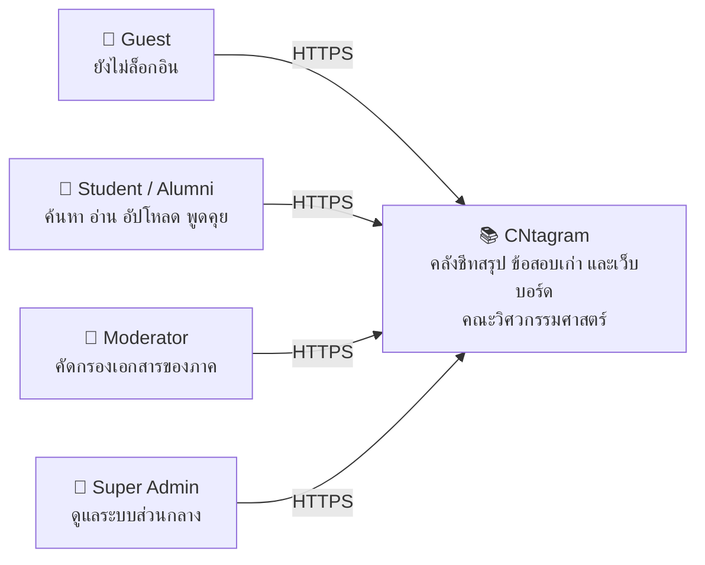
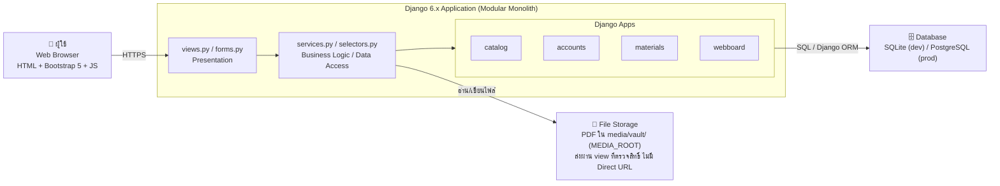
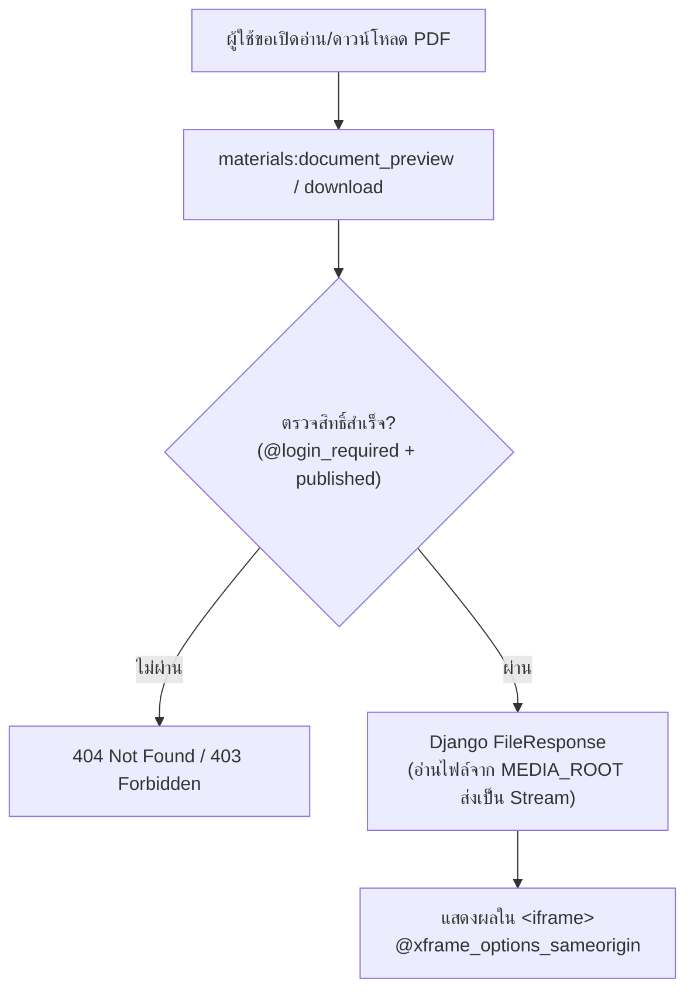
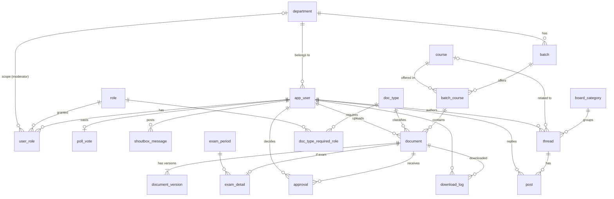

# CNtagram (CN331 Capstone)

[](https://github.com/Jupiter4428/cntagram/actions/workflows/ci.yml)

ระบบเว็บบอร์ดคลังชีทสรุปและข้อสอบเก่าสำหรับนักศึกษาคณะวิศวกรรมศาสตร์ พัฒนาด้วย Django ตาม Agile/Scrum ในรายวิชา CN331

| | |
|---|---|
| **ชื่อระบบ** | CNtagram |
| **วัตถุประสงค์** | รวมศูนย์ชีทสรุปและข้อสอบเก่า จัดตามภาควิชา / รุ่น / รายวิชา จำกัดสิทธิ์ด้วยอีเมลมหาวิทยาลัย และอนุมัติก่อนเผยแพร่ |
| **รายวิชา** | CN331 Software Engineering · ภาคเรียนที่ 1/2569 |
| **สมาชิกทีม** | 1. 6710535011 กฤตยชญ์ แก้วกำมา<br/>2. 6710535029 วุฒิศักดิ์ บุญกัน<br/>3. 6710625010 ธนกฤต โพธิมาศ<br/>4. 6810530011 ธาริกา กองหนู<br/>5. 6810610078 ดรัณภพ เรืองสิริภคกุล |

เอกสารละเอียด: [Product Backlog](./_docs/requirements.md) · [ข้อจำกัดของระบบ](./_docs/known-limitations.md) · [คู่มือทีม](./CONTRIBUTING.md) · [สรุปเอกสาร](./_docs/README.md)

---

## Live Production

**Production URL:** [https://cntagram-h195.onrender.com/](https://cntagram-h195.onrender.com/) (Render — Singapore Region)

### บัญชีทดสอบสำหรับผู้ประเมิน (Super Admin Credentials)

| รายการ | ข้อมูลเข้าสู่ระบบ |
|---|---|
| **ID (Email)** | `6710535011@student.tu.ac.th` |
| **PASS** | `CntagramAdmin2026!` |
| **บทบาท** | Super Admin / Superuser (เข้าได้ทั้งหน้าเว็บหลัก คิวอนุมัติเอกสาร จัดการภาควิชา/รุ่น/วิชา จัดการ Moderator และ `/admin/`) |

> สรุปฟังก์ชันทั้งหมดของระบบและรายการ Product Backlog ดูได้ที่ [Product Backlog (`_docs/requirements.md`)](./_docs/requirements.md)

---

## ฟีเจอร์ที่มีในระบบปัจจุบัน (Current Features)

- **ระบบยืนยันตัวตนและความปลอดภัย (`accounts`):** สมัครสมาชิกด้วยอีเมลคณะวิศวกรรมศาสตร์ (`@student.tu.ac.th` รหัสคณะ `10`), เข้าสู่ระบบ/ออกจากระบบพร้อม Two-bucket Rate Limiting (จำกัดตามบัญชีและ IP), แต่งตั้ง/ถอดถอน Moderator ประจำภาควิชา และลบบัญชีตนเองตาม PDPA (`/account/delete/` แบบ Anonymize)
- **การจัดการโครงสร้างหลักสูตร (`catalog`):** Super Admin จัดการภาควิชา (`Department`), รุ่น (`Batch`), รายวิชา (`Course`) และการผูกวิชาเข้ากับรุ่น (`BatchCourse`) พร้อมค่ากำหนดระบบ (`SystemSetting`)
- **คลังเอกสารและการคัดกรอง (`materials`):** อัปโหลดชีทสรุป/สไลด์/ข้อสอบเก่า (PDF) พร้อมตรวจ SHA-256 ป้องกันไฟล์ซ้ำ, ค้นหาและกรองเอกสารในคลัง (Vault), เปิดดูตัวอย่าง (Inline PDF Preview) และดาวน์โหลดแบบตรวจสิทธิ์พร้อมบันทึก `DownloadLog`, ระบบคิวอนุมัติแยกตามกฎ `DocTypeRequiredRole` (ชีททั่วไปใช้ Moderator หรือ Super Admin 1 คน / ข้อสอบเก่าต้องผ่านทั้งสองฝ่าย)
- **ชุมชนและเว็บบอร์ดเรโทรยุค 2000s (`webboard` & `accounts`):** กระดานสนทนาแยกหมวดหมู่ (`BoardCategory`), ตั้งกระทู้ (`Thread`) ผูกรายวิชา, ตอบกลับ (`Post`), แปลงรหัสอีโมติคอน MSN (เช่น `:D`, `(L)`) และฝังภาพ `[img]...[/img]` แบบปลอดภัย, ปักหมุด/ล็อก/ลบกระทู้และคอมเมนต์ รวมถึงวิดเจ็ตหน้าแรก (Shoutbox สดแบบ AJAX, โพลประจำสัปดาห์แบบ AJAX, ตัวนับผู้เข้าชม LCD 6 หลัก, เครื่องเล่นเพลง BGM Player ยุค 2000s)

---

## Architecture

ระบบออกแบบตามแนวคิด **Modular Monolith** บน Django แบ่งความรับผิดชอบตามโดเมนและแยกชั้นโค้ดอย่างเข้มงวด เพื่อให้ทีมสามารถพัฒนาขนานกันได้โดยไม่เกิดความซับซ้อนเกินจำเป็น

---

### 1. C4 Model — Level 1: System Context

ภาพรวมความสัมพันธ์ระหว่างผู้ใช้งานระบบกลุ่มต่างๆ



- **Guest:** เข้าดูหน้าแรก สมัครสมาชิก และเข้าสู่ระบบ (ต้องล็อกอินเพื่อเข้าใช้งานคลังเอกสารและเว็บบอร์ด)
- **Student / Alumni:** นักศึกษาและศิษย์เก่า เข้าสู่ระบบด้วยอีเมลมหาวิทยาลัย ค้นหา อ่าน ดาวน์โหลด อัปโหลดชีท/ข้อสอบ และร่วมพูดคุยในเว็บบอร์ด/วิดเจ็ตชุมชน
- **Moderator:** ผู้ตรวจคัดกรองเอกสารประจำภาควิชา ตรวจสอบความถูกต้องและอนุมัติเอกสารก่อนเผยแพร่ รวมถึงดูแลความเรียบร้อยในเว็บบอร์ด
- **Super Admin:** ผู้ดูแลระบบระดับคณะ จัดการโครงสร้างภาควิชา/รุ่น/รายวิชา แต่งตั้ง Moderator และดูแลภาพรวมระบบ

---

### 2. C4 Model — Level 2: Container

โครงสร้างภายในของระบบ คอนเทนเนอร์ และการเชื่อมต่อไปยังระบบจัดเก็บข้อมูล



---

### 3. Application Boundaries & Dependency Rule

ระบบแบ่งออกเป็น 4 Django Apps หลักตาม Bounded Context มีทิศทางการพึ่งพา (Dependency) ทางเดียว ([ADR 0001](./_docs/adr/0001-modular-monolith-and-app-boundaries.md)):

$$\text{catalog} \longleftarrow \text{accounts} \longleftarrow (\text{materials}, \text{webboard})$$

| Django App | หน้าที่และความรับผิดชอบหลัก | กฎการพึ่งพา (Dependency Rule) |
|---|---|---|
| `catalog` | โครงสร้างภาควิชา (`Department`), รุ่น (`Batch`), รายวิชา (`Course`, `BatchCourse`) และค่ากำหนดระบบ (`SystemSetting`) | **ไม่ import app อื่นเลย** เป็นรากฐานของระบบ |
| `accounts` | ผู้ใช้ (`User`), บทบาท (`Role`), สิทธิ์ตามภาควิชา (`UserRole`), ยอดสะสมผู้ใช้ (`UserCounter`), โพลและ Shoutbox หน้าแรก (`PollVote`, `ShoutboxMessage`) | import พึ่งพา `catalog` ได้ ห้าม import `materials` หรือ `webboard` |
| `materials` | เอกสาร (`Document`, `DocType`), เวอร์ชันไฟล์ (`DocumentVersion`), ข้อสอบ (`ExamDetail`, `ExamPeriod`), การอนุมัติ (`Approval`, `DocTypeRequiredRole`), สถิติการดาวน์โหลด (`DownloadLog`) | import พึ่งพาได้ทั้ง `catalog` และ `accounts` |
| `webboard` | กระดานสนทนาชุมชน: หมวดหมู่ (`BoardCategory`), กระทู้ (`Thread` ผูกรายวิชาได้), ข้อความตอบกลับ (`Post`), ตัวแปลงอีโมติคอน MSN และฝังภาพ GIF | import พึ่งพาได้ทั้ง `catalog` และ `accounts` |

- การอ้างอิง Foreign Key ข้าม app ใช้ String reference เสมอ เช่น `"catalog.BatchCourse"` และ `settings.AUTH_USER_MODEL`
- ห้าม Circular Import เด็ดขาด หากมีการอ่านข้อมูลข้าม app ให้ใช้ Selectors อ่านผ่าน Reverse Relation หรือใช้ Custom Template Tags

---

### 4. Layered Architecture (Service Layer & Selectors)

แต่ละ app แยกความรับผิดชอบตามแนวทาง **HackSoft Django Styleguide** ([ADR 0002](./_docs/adr/0002-service-layer-and-selectors.md)):

$$\text{views.py} \longrightarrow \text{services.py / selectors.py} \longrightarrow \text{models.py}$$

| เลเยอร์ | ไฟล์ | หน้าที่หลักและข้อกำหนด |
|---|---|---|
| **Presentation** | `views.py` | รับ HTTP request ตรวจสิทธิ์พื้นฐาน เรียก form / service / selector แล้วส่ง HTTP response (ความยาวไม่เกิน ~20 บรรทัดต่อ view) |
| **Validation** | `forms.py` | ตรวจสอบชนิดข้อมูล รูปแบบ ขนาด และความถูกต้องของ input ก่อนส่งต่อ |
| **Business Logic** | `services.py` | การเขียน/แก้ไขข้อมูล (Create / Update / Delete), ตรวจสิทธิ์ทางธุรกิจ, จัดการ `@transaction.atomic`, `select_for_update()`, งานเบื้องหลัง |
| **Data Access** | `selectors.py` | การอ่านข้อมูลอย่างเดียว (Read-only queries) รวบรวม `select_related` / `prefetch_related` เพื่อแก้ปัญหา N+1 queries |
| **Domain Models** | `models.py` | กำหนดโครงสร้างตาราง (Schema), Database Constraints (`CheckConstraint`, `UniqueConstraint`), Data Integrity และ Model Validation |

*ข้อกำหนดของ Service/Selector:* เขียนเป็นฟังก์ชัน Python ธรรมดา รับค่าแบบ Keyword-only arguments (`*`) และ**ห้ามรับ `request` object** เพื่อให้ทดสอบแบบ Unit Test ได้ง่ายและนำไปใช้ซ้ำใน CLI / Background Job ได้

---

### 5. Document Storage & Protected Preview Architecture

การจัดเก็บไฟล์เอกสารและมาตรการป้องกันความปลอดภัย ([ADR 0003](./_docs/adr/0003-document-storage-and-protected-preview.md)):



- **ไม่เปิด `MEDIA_URL`:** ไม่มี Direct URL สำหรับเข้าถึงโฟลเดอร์ไฟล์บนเซิร์ฟเวอร์โดยตรง
- **Private Vault:** ไฟล์เอกสารถูกจัดเก็บใน `media/vault/` (`MEDIA_ROOT`) และเข้าถึงได้ผ่าน Django View ที่ผ่านการยืนยันตัวตนและตรวจสิทธิ์เท่านั้น
- **Safe Preview:** การดูตัวอย่างเอกสารส่งผลลัพธ์ผ่าน `FileResponse` แบบ inline ภายใน `<iframe>` โดยกำหนด Header `@xframe_options_sameorigin` ป้องกัน Clickjacking

---

### 6. Database Architecture (3NF ERD)

การออกแบบฐานข้อมูลตามรูปแบบ Normalized (3NF) รองรับกฎทางธุรกิจและการตรวจสอบย้อนกลับ ([`_docs/database-design.md`](./_docs/database-design.md)):



- **Data Integrity:** Foreign Key ของตารางหลักกำหนด `on_delete=models.PROTECT` เพื่อป้องกันการลบข้อมูลโครงสร้างและเอกสารที่เชื่อมโยง (ส่วนตารางกิจกรรมชุมชนอย่าง `PollVote`, `ShoutboxMessage`, `Thread`, `Post` ใช้ `CASCADE` / `SET_NULL` ตามความเหมาะสม)
- **PDPA Anonymization:** ผู้ใช้ที่ขอลบบัญชีจะใช้วิธี Anonymize ล้างข้อมูลระบุตัวตนและปิด `is_active` แทนการลบแถว เพื่อรักษาประวัติการอัปโหลดและข้อมูลที่เชื่อมโยง
- **Flexible Approvals:** กฎการอนุมัติเอกสารกำหนดผ่านตาราง `DocTypeRequiredRole` ทำให้ปรับเปลี่ยนเกณฑ์การอนุมัติได้โดยไม่ต้องแก้โค้ด

---

### 7. Architectural Decision Records (ADRs)

บันทึกการตัดสินใจทางสถาปัตยกรรมที่สำคัญของโปรเจค ดูรายละเอียดฉบับเต็มได้ที่ [`_docs/adr/`](./_docs/adr/):

| ADR | ชื่อเรื่อง | สถานะ | สาระสำคัญ |
|---|---|---|---|
| [ADR 0001](./_docs/adr/0001-modular-monolith-and-app-boundaries.md) | Modular Monolith และขอบเขต Django Apps | Accepted | รวมศูนย์บนโปรเจคเดียว แบ่ง 4 app (`catalog` ← `accounts` ← `materials`, `webboard`) ทิศทางพึ่งพาทางเดียว |
| [ADR 0002](./_docs/adr/0002-service-layer-and-selectors.md) | Service Layer และ Selectors | Accepted | แยก Presentation, Business Logic (`services.py`), และ Data Access (`selectors.py`) ออกจากกันอย่างเด็ดขาด |
| [ADR 0003](./_docs/adr/0003-document-storage-and-protected-preview.md) | การเก็บไฟล์เอกสารและ Preview ผ่าน View ที่ตรวจสิทธิ์ | Proposed | ไม่ตั้ง `MEDIA_URL`, จัดเก็บใน vault ที่เข้าถึงได้ผ่าน view ที่ตรวจสิทธิ์เท่านั้น, preview ผ่าน iframe ปลอดภัย |
| [ADR 0004](./_docs/adr/0004-approval-tables-in-materials.md) | ตารางการอนุมัติอยู่ใน app `materials` | Proposed | จัดวาง `Approval` และ `DocTypeRequiredRole` ไว้ใน `materials` ตามกฎทิศทาง dependency |
| [ADR 0005](./_docs/adr/0005-production-deployment-and-backup.md) | การเลือกแพลตฟอร์ม Deploy, ฐานข้อมูล Production, การจัดเก็บไฟล์เอกสาร และกลยุทธ์การสำรองข้อมูล | Accepted | Deploy บน Render (Singapore) ด้วย Gunicorn + WhiteNoise + Managed PostgreSQL และกำหนดแนวทางสำรอง/กู้คืนข้อมูล |

---

## Project Structure

```text
cntagram/
├── _docs/                  # เอกสารทั้งหมดที่ไม่ใช่โค้ด (Product Backlog, ADR, C4, Database Design)
│   ├── requirements.md     # Product Backlog: Epics, User Stories, สถานะปัจจุบันและ Backlog
│   ├── database-design.md  # ออกแบบฐานข้อมูล (ERD 3NF ของตารางที่มีจริงในระบบ)
│   ├── known-limitations.md# ข้อจำกัดของระบบรุ่นปัจจุบัน
│   ├── backup-operations.md# ขั้นตอนและสถานะการสำรอง/กู้คืนข้อมูล Production
│   ├── deployment-prep-checklist.md
│   ├── adr/                # Architectural Decision Records (ADR 0001 - 0005)
│   ├── architecture/       # C4 Model diagrams
│   ├── lecture-notes/      # สรุปเนื้อหาวิชา CN331
│   ├── research/           # รายงานวิจัยและวิเคราะห์ผล
│   └── archive/            # เอกสารเดิม (SRS v1)
├── portal/                 # Django project config (settings, urls, permissions, wsgi/asgi)
├── accounts/               # ผู้ใช้, สิทธิ์, บทบาท และวิดเจ็ตหน้าแรก (User, Role, UserRole, UserCounter, PollVote, ShoutboxMessage)
├── catalog/                # โครงสร้างหลักสูตร (Department, Batch, Course, BatchCourse, SystemSetting)
├── materials/              # เอกสารและไฟล์ (Document, DocType, DocumentVersion, ExamDetail, Approval, DownloadLog)
├── webboard/               # กระดานสนทนาชุมชนเรโทร (BoardCategory, Thread, Post, MSN emoticons & GIF embeds)
├── scripts/                # สคริปต์สำรองและกู้คืนข้อมูล (backup_restore.sh)
├── media/                  # ไฟล์เอกสารอัปโหลด (MEDIA_ROOT) ไม่อยู่ใน Git และเข้าถึงผ่าน view ที่ตรวจสิทธิ์เท่านั้น
├── static/                 # CSS, JavaScript และ assets ส่วนกลาง
├── templates/              # Base templates และ shared components
├── .github/                # Workflows (CI, Daily Backup), Issue & PR templates
├── build.sh                # สคริปต์เตรียมสภาพแวดล้อม Production บน Render
├── Procfile                # คำสั่งรัน Gunicorn บน PaaS
├── manage.py
├── requirements.txt
├── CONTRIBUTING.md
└── README.md
```

โครงสร้างไฟล์ภายในแต่ละ Django App (`catalog`, `accounts`, `materials`, `webboard`) ตาม [ADR 0002](./_docs/adr/0002-service-layer-and-selectors.md):

```text
<app>/
├── models.py               # Schema, constraints, validation ระดับแถว
├── forms.py                # ตรวจสอบรูปแบบและประเภท input (Form / ModelForm)
├── services.py             # Business Logic, transactions (@transaction.atomic), การเขียนข้อมูล
├── selectors.py            # Queries อ่านข้อมูลอย่างเดียว, ป้องกัน N+1 queries
├── views.py                # รับ HTTP request เรียก form/service/selector แล้วส่ง response
├── urls.py                 # app_name + urlpatterns
├── admin.py                # Django Admin configuration
├── tests/ (หรือ tests.py)   # Automated Unit/Integration tests
├── migrations/             # Database migration history
└── templates/<app>/        # Templates เฉพาะของ app
```

---

## Local Setup

```bash
git clone https://github.com/Jupiter4428/cntagram.git
cd cntagram
git switch main && git pull origin main

python -m venv .venv
# Windows: .venv\Scripts\activate
source .venv/bin/activate

pip install -r requirements.txt
python manage.py migrate
python manage.py createcachetable
python manage.py seed_catalog
python manage.py createsuperuser
python manage.py seed_materials
python manage.py runserver
```

เปิด `http://127.0.0.1:8000/` (admin ที่ `/admin/`)

> หน้า `/admin/` ดู/แก้ตารางของทุก app ได้ (เครื่องมือภายในสำหรับ dev และ demo) แต่เพิ่มหรือลบ User ผ่าน admin ไม่ได้ (เพิ่มต้องสมัครผ่านหน้าเว็บหรือใช้ `createsuperuser` ส่วนลบต้องใช้ `anonymize()` ตาม PDPA) ประวัติอนุมัติ (`Approval`) ดูได้อย่างเดียว และเปลี่ยนสถานะเอกสารผ่าน admin ไม่ได้ ต้องผ่านหน้าตรวจเอกสารซึ่งเช็ก role ให้

รายละเอียด seed, custom user, sync หลัง pull และโครงสร้างโฟลเดอร์อยู่ที่ [CONTRIBUTING.md — Developer Setup](./CONTRIBUTING.md#developer-setup)

---

## Test & Coverage

เป้าหมาย coverage **≥ 80%** (ตั้งแต่ Sprint 2)

```bash
coverage run manage.py test
coverage report -m --fail-under=80
```

รายละเอียดการเขียนเทสต์และอ่านรายงาน: [CONTRIBUTING.md — Testing](./CONTRIBUTING.md#testing-และการใช้-ai-ช่วยเขียนโค้ด)

---

## สารบัญเอกสาร (Documentation Index)

รวมเอกสาร Markdown (`.md`) ทั้งหมดในโปรเจคเพื่อใช้อ้างอิงตามวัตถุประสงค์และการทำงาน:

### เอกสารหลักและการทำงานร่วมกัน
| ไฟล์ | เนื้อหา | อ่านเมื่อ |
|---|---|---|
| [`README.md`](./README.md) | ภาพรวมระบบ, สถาปัตยกรรม (C4 / ERD / ADR), โครงสร้างโปรเจค และวิธีติดตั้ง | เริ่มต้นใช้งานหรือทำความเข้าใจภาพรวมระบบ |
| [`CONTRIBUTING.md`](./CONTRIBUTING.md) | คู่มือการพัฒนา, ข้อตกลง Scrum, DoD/DoR, กฎ Branch/PR, แนวทางการเขียนโค้ดและเทสต์ | ก่อนเริ่มลงมือพัฒนาหรือเปิด Pull Request |
| [`AGENTS.md`](./AGENTS.md) | กฎและคู่มือทักษะการทำงานของ AI Coding Assistant | สำหรับ Agent ในการปฏิบัติตาม Workflow |

### เอกสารการออกแบบและพัฒนา (`_docs/`)
| ไฟล์ / โฟลเดอร์ | เนื้อหา | อ่านเมื่อ |
|---|---|---|
| [`_docs/requirements.md`](./_docs/requirements.md) | Product Backlog: User Story (US-x), Acceptance Criteria และลำดับความสำคัญ | วางแผนงานหรือตรวจสอบ Requirement |
| [`_docs/known-limitations.md`](./_docs/known-limitations.md) | ข้อจำกัดของระบบรุ่นที่ส่งมอบ | ตรวจสอบขอบเขตที่ยังไม่รองรับในรุ่นปัจจุบัน |
| [`_docs/database-design.md`](./_docs/database-design.md) | ออกแบบฐานข้อมูล (ERD 3NF) และเหตุผลการออกแบบตาราง | ก่อนแก้ `models.py` |
| [`_docs/architecture/c4.md`](./_docs/architecture/c4.md) | ไดอะแกรม C4 Model ระดับ 1–2 (System Context, Container) | ตรวจสอบภาพรวมระบบและ Container |
| [`_docs/adr/`](./_docs/adr/) | Architectural Decision Records (ADR 0001–0005) บันทึกเหตุผลการเลือกสถาปัตยกรรม | ก่อนเพิ่ม app หรือปรับโครงสร้างระบบ |
| [`_docs/backup-operations.md`](./_docs/backup-operations.md) | ขั้นตอนปฏิบัติการสำรองและกู้คืนข้อมูล Production (PostgreSQL & Offsite Backup) | ก่อนรันสคริปต์สำรอง/กู้คืนฐานข้อมูลจริง |
| [`_docs/deployment-prep-checklist.md`](./_docs/deployment-prep-checklist.md) | เช็กลิสต์เตรียมความพร้อมก่อน Deploy สู่ Production (Render, PostgreSQL, WhiteNoise) | ก่อนขึ้น Cloud หรือเตรียมส่งมอบระบบ |
| [`_docs/lecture-notes/`](./_docs/lecture-notes/) | สรุปเนื้อหาและทฤษฎีรายวิชา CN331 (ORM, Architecture, Testing, CI/CD, Web Security) | ศึกษาแนวทางและมาตรฐานวิศวกรรมซอฟต์แวร์ |
| [`_docs/research/`](./_docs/research/) | ร่างรายงานเล่มสมบูรณ์ (บทที่ 1–5, บรรณานุกรม, ภาคผนวก) | เขียนหรือแก้ไขเล่มรายงานโครงงาน |

### ลำดับการอ่านสำหรับผู้เริ่มต้น
1. [`_docs/requirements.md`](./_docs/requirements.md) — ระบบนี้ทำอะไร และส่งมอบคุณค่าใดให้ใคร
2. [`_docs/architecture/c4.md`](./_docs/architecture/c4.md) — ภาพรวมและส่วนประกอบของระบบ
3. [`_docs/adr/`](./_docs/adr/) — เหตุผลและกฎการแบ่งแยกชั้นโค้ดของแต่ละ App
4. [`_docs/database-design.md`](./_docs/database-design.md) — โครงสร้างและความสัมพันธ์ของข้อมูล (3NF)
5. [`CONTRIBUTING.md`](./CONTRIBUTING.md) — แนวทางขั้นตอนการทำงานและมาตรฐานการพัฒนา
