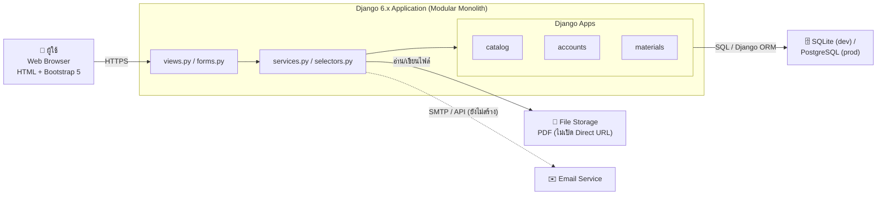

# Project Django (CN331)

ระบบเว็บบอร์ดกลางสำหรับแชร์และค้นหาเอกสารสรุป/ชีทของนักศึกษาวิศวกรรม พัฒนาด้วย Django ตามแนวทาง Agile/Scrum ในรายวิชา CN331

- **Requirements / Product Backlog:** [`_docs/requirements.md`](./_docs/requirements.md) (งานใน Sprint ดูที่ GitHub Project)
- **ข้อมูลสำหรับเขียนเล่มรายงาน:** [`_docs/research/`](./_docs/research/)
- **วิธีทำงานร่วมกัน:** [CONTRIBUTING.md](./CONTRIBUTING.md)

## สารบัญ
1. [Tech Stack](#tech-stack)
2. [Architecture](#architecture)
3. [Setup ก่อนเริ่มพัฒนา](#setup-ก่อนเริ่มพัฒนา-first-time-setup)
4. [Sync ก่อนเริ่มงานทุกครั้ง](#ทุกครั้งที่-pull-โค้ดใหม่-sync-ก่อนเริ่มงาน)
5. [Project Structure](#project-structure)
6. [Branch Strategy](#branch-strategy)
7. [For Contributing](#for-contributing)

---

## Tech Stack
- Python 3.12+
- Django 6.1 (ตาม `requirements.txt`, สถาปัตยกรรม MVT, ใช้ Function-Based Views เป็นหลัก) — models ใช้ `CheckConstraint(condition=...)` จึงต้องเป็น Django 5.1 ขึ้นไป
- Bootstrap 5 (ผ่าน CDN) สำหรับ UI
- SQLite (ตอนพัฒนา) และ PostgreSQL (production): Django ORM ทำให้สลับได้โดยไม่ต้องแก้โค้ด Model
- Git + GitHub (Pull Request, Projects, Actions)
- Automated Tests ด้วย Django `TestCase` (`python manage.py test`) และวัด coverage ด้วย Coverage.py (เป้าหมาย ≥ 80% ตั้งแต่ Sprint 2)
- CI/CD ด้วย GitHub Actions (เริ่มใน Sprint 2) และเพิ่ม Static Analysis ใน Sprint 3: Black (format), Flake8 (PEP 8 lint), Bandit (security scan)

---

## Architecture

**Modular Monolith:** Django project เดียว แบ่ง app ตามโดเมน (`catalog` ← `accounts` ← `materials` อ้างอิงทางเดียว) และในแต่ละ app แยกชั้น `views.py` → `services.py` / `selectors.py` → `models.py`



- C4 Context + Container Diagram ฉบับเต็ม: [`_docs/architecture/c4.md`](./_docs/architecture/c4.md)
- เหตุผลของการออกแบบ: [ADR 0001 Modular Monolith](./_docs/adr/0001-modular-monolith-and-app-boundaries.md), [ADR 0002 Service Layer](./_docs/adr/0002-service-layer-and-selectors.md)
- โครงสร้างฐานข้อมูล: [`_docs/database-design.md`](./_docs/database-design.md)

---

## Setup ก่อนเริ่มพัฒนา (First Time Setup)

### 0. เครื่องมือที่ต้องมี
- Python 3.12+ (ติ๊ก **Add to PATH** ตอนติดตั้ง)
- Git และบัญชี GitHub
- VS Code พร้อมส่วนเสริม **Python** และ **Git Graph**

ตั้งค่าตัวตนของ Git ครั้งแรก (ข้อมูลนี้ติดไปกับทุก commit):
```bash
git config --global user.name "ชื่อของคุณ"
git config --global user.email "you@example.com"
git config --global init.defaultBranch main
git config --list      # ตรวจสอบ
```

### 1. Clone โปรเจค
```bash
git clone <repo-url>
cd cntagram
```

**Repo นี้ default branch คือ `develop`** หลัง clone จะอยู่ที่ `develop` อยู่แล้ว ให้ pull ล่าสุดก่อนเริ่มงานทุกครั้ง (ห้ามทำงานหรือแตก branch จาก `main`):
```bash
git switch develop
git pull origin develop
```

### 2. สร้างและเปิดใช้งาน Virtual Environment
```bash
python -m venv .venv

# Windows
.venv\Scripts\activate

# macOS/Linux
source .venv/bin/activate
```

### 3. ติดตั้ง dependencies
```bash
pip install -r requirements.txt
```

### 4. ไฟล์ `.env` (ยังไม่ได้ใช้)
ตอนนี้ `portal/settings.py` ยังตั้ง `SECRET_KEY`, `DEBUG`, `ALLOWED_HOSTS` ไว้ในไฟล์ตรงๆ สำหรับเครื่อง dev และยังไม่มี `.env.example` จึง**ข้ามขั้นนี้ไปได้** (`python-decouple` อยู่ใน `requirements.txt` แล้ว แต่ยังไม่ได้เชื่อมกับ settings)

เมื่อเปลี่ยนไปอ่านค่าจาก `.env` แล้ว ค่าที่ต้องตั้งคือ:
```
SECRET_KEY=your-secret-key-here
DEBUG=True
ALLOWED_HOSTS=localhost,127.0.0.1
```

**ห้าม commit ไฟล์ `.env` ขึ้น git เด็ดขาด** (มีอยู่ใน `.gitignore` แล้ว)

### 5. Migrate ฐานข้อมูล
```bash
python manage.py migrate
```

> ⚠️ **Custom User Model:** โปรเจคใช้ `accounts.User` (สืบทอด `AbstractBaseUser` + `PermissionsMixin`) และตั้ง `AUTH_USER_MODEL = 'accounts.User'` ใน `settings.py` ไว้แล้ว **ห้ามแก้หรือลบบรรทัดนี้** เพราะต้องตั้งก่อนสั่ง `migrate` ครั้งแรกสุดของโปรเจค การเปลี่ยนย้อนหลังทำให้ฐานข้อมูลพัง (`InconsistentMigrationHistory`) อย่าสร้าง migration ของ user เอง ถ้าไม่แน่ใจให้ถามทีมก่อน (ดูรายละเอียดที่ [Database และ Models](./CONTRIBUTING.md#database-และ-models))

### 6. สร้าง superuser (สำหรับเข้า admin panel)
User ผูกกับภาควิชา (`department` ห้ามว่าง) จึงต้องมี Department อย่างน้อย 1 แถวก่อน

> หน้า `/admin/` ดู/แก้ตารางของทุก app ได้ (เครื่องมือภายในสำหรับ dev และ demo) แต่เพิ่มหรือลบ User ผ่าน admin ไม่ได้ (เพิ่มต้องสมัครผ่านหน้าเว็บหรือใช้ `createsuperuser` ส่วนลบต้องใช้ `anonymize()` ตาม PDPA) ประวัติอนุมัติ (`Approval`) ดูได้อย่างเดียว และเปลี่ยนสถานะเอกสารผ่าน admin ไม่ได้ ต้องผ่านหน้าตรวจเอกสารซึ่งเช็ก role ให้
```bash
python manage.py seed_catalog     # ภาค CN/CE/ME/EE + รุ่น CN21–CN25 + วิชาตัวอย่าง (รันซ้ำได้ ไม่สร้างซ้ำ)
python manage.py createsuperuser
python manage.py seed_materials   # ประเภทเอกสาร, ช่วงสอบ, system_setting, กฎอนุมัติ (รันซ้ำได้ ไม่เขียนทับค่าที่แก้แล้ว)
```
ระบบ login ด้วย **อีเมล** (ไม่มี username) ตอน `createsuperuser` จะถามตามลำดับ: Email, Nickname, Department code (พิมพ์ตัวย่อภาค เช่น `CN` ตัวพิมพ์เล็กก็ได้ ถ้ายังไม่มีภาคนี้จะแจ้งว่าไม่พบ), Password

ระบบไม่ถามรหัสนักศึกษา ถ้าใช้อีเมล `@student.tu.ac.th` จะดึงรหัสจากหน้า @ ให้เอง ถ้าใช้อีเมลอื่นระบบจะตั้งรหัสสำรองให้

### 7. รันเซิร์ฟเวอร์
```bash
python manage.py runserver
```
เข้าใช้งานที่ `http://127.0.0.1:8000/` (หน้า admin ที่ `/admin/`)

### 8. รันเทสต์
```bash
python manage.py test             # ทุกเทสต์ ต้องผ่านหมดก่อนเริ่มงาน
```
Django สร้างฐานข้อมูลทดสอบแยกให้เอง ไม่แตะ `db.sqlite3` คำสั่งย่อย, coverage และวิธีเขียนเทสต์ดูที่ [Testing](./CONTRIBUTING.md#testing)

---

## ทุกครั้งที่ pull โค้ดใหม่ (Sync ก่อนเริ่มงาน)

```bash
git status                        # เช็คว่าไม่มีงานค้างที่ยังไม่ได้ commit
git fetch origin                  # ดึงข้อมูลล่าสุดมาดูก่อน (ยังไม่แตะไฟล์ในเครื่อง)
git pull origin develop           # fetch + merge
pip install -r requirements.txt   # เผื่อมี package ใหม่
python manage.py migrate          # เผื่อมี migration ใหม่
```

หลังมีคน merge PR เข้า `develop` ทุกคนควรรันชุดนี้ใหม่ทันที เพื่อไม่ให้แก้ไฟล์บนโค้ดเก่าแล้วเกิด conflict ตอนท้าย

---

## Project Structure
```
cntagram/
├── _docs/           # เอกสารทั้งหมดที่ไม่ใช่โค้ด (ขึ้นต้นด้วย _ ให้อยู่บนสุดของรายการโฟลเดอร์)
│   ├── requirements.md       # Product Backlog: Vision, Epics, User Stories (แทน SRS v1)
│   ├── database-design.md    # ERD 3NF (SP-0)
│   ├── adr/                  # Architectural Decision Records
│   ├── architecture/         # C4 Model diagrams
│   ├── sprintN_retro.md      # บันทึก Retrospective ของแต่ละ Sprint (สร้างตอนจบ Sprint)
│   ├── lecture-notes/        # สรุปเนื้อหาวิชา CN331 (แกนของกระบวนการและสถาปัตยกรรม)
│   └── archive/              # SRS v1 (เลิกใช้แล้ว)
├── portal/          # Django project config (settings, urls, wsgi/asgi)
├── accounts/        # User, Role, UserRole (US-1, US-2)
├── catalog/         # Department, Batch, Course, BatchCourse, SystemSetting (US-3, US-4)
├── materials/       # DocType, ExamPeriod, Document, ExamDetail, DocumentVersion (US-5, US-7), Approval (US-6), DocTypeRequiredRole (US-9)
├── media/           # ไฟล์เอกสารที่อัปโหลด (MEDIA_ROOT) สร้างเองตอนมีไฟล์แรก อยู่ใน .gitignore และเปิดได้ผ่าน view ที่ตรวจสิทธิ์เท่านั้น (ADR 0003)
├── .github/         # Issue templates และ Pull Request template
├── manage.py
├── requirements.txt
├── CONTRIBUTING.md
└── README.md
```

ภายในแต่ละ app (เช่น `catalog/`, `accounts/`) ใช้โครงสร้างตามนี้ ([ADR 0002](./_docs/adr/0002-service-layer-and-selectors.md))
```
<app>/
├── models.py                     # schema, constraint, ความถูกต้องของข้อมูล
├── forms.py                      # Form / ModelForm (ตรวจรูปแบบ input)
├── services.py                   # เขียนข้อมูล + กฎธุรกิจ + @transaction.atomic
├── selectors.py                  # query อ่านข้อมูล (กัน N+1)
├── views.py                      # รับ request → เรียก service/selector → response
├── urls.py                       # app_name + urlpatterns
├── admin.py
├── tests.py  (ยาวแล้วแตกเป็น tests/test_models.py, test_services.py, test_views.py ...)
├── migrations/                   # commit ขึ้น Git
└── templates/<app>/              # เช่น materials/templates/materials/document_detail.html
templates/                        # base.html และ includes/_navbar.html (ส่วนกลาง)
static/                           # css, js, img ส่วนกลาง
```
ตอนนี้แต่ละ app มีแค่ `models.py`, `views.py`, `admin.py`, `apps.py`, `tests.py` และ `migrations/` ส่วน `forms.py`, `services.py`, `selectors.py`, `urls.py`, `templates/` รวมถึง `templates/` และ `static/` ส่วนกลาง ให้สร้างตามโครงสร้างนี้เมื่อเริ่มทำ story ที่ต้องใช้

## Branch Strategy
| Branch | ใช้ทำอะไร | แตกจาก → merge เข้า |
|---|---|---|
| `main` | โค้ดที่ผ่าน Sprint Review แล้ว (production) | — |
| `develop` | โค้ดล่าสุดของทีม (default branch) รวม story ที่ Done แล้ว | — |
| `feature/issue-<เลข>-<ชื่อ>` | พัฒนา User Story เช่น `feature/issue-29-upload-sheet` | `develop` → `develop` |
| `refactor/issue-<เลข>-<ชื่อ>` | Refactoring / Tech Debt Story เช่น `refactor/issue-45-selectors` | `develop` → `develop` |
| `bugfix/issue-<เลข>-<ชื่อ>` | แก้บั๊กที่ไม่เร่งด่วน | `develop` → `develop` |
| `spike/issue-<เลข>-<ชื่อ>` | งานสำรวจ/ออกแบบ | `develop` → `develop` |
| `docs/issue-<เลข>-<ชื่อ>` | แก้เอกสารอย่างเดียว | `develop` → `develop` |
| `hotfix/<ชื่อ>` | แก้บั๊กด่วนบน production | `main` → `main` และ `develop` |

- ทุก branch ตั้งชื่อตาม **เลข issue** และเปิด PR ที่มี `Closes #<เลข>`
- จบ Sprint: หลัง Sprint Review เปิด PR `develop` → `main`
- **Branch Protection** (Settings → Branches) เปิดทั้ง `main` และ `develop`: ต้องผ่าน PR, ได้ Approve อย่างน้อย 1 คน, ห้าม force push และห้ามลบ branch, ใช้กับ admin ด้วย (Include administrators) และเมื่อมี CI workflow แล้วให้เปิด **Require status checks to pass** เลือก job ของ CI (เทสต์หรือ lint ตก ปุ่ม Merge จะถูกล็อก)
- Branch ที่เปิดไปแล้วด้วยชื่อแบบเดิม (`feat/US-X-...`) ใช้ต่อจน merge ได้

---

## For Contributing
ขั้นตอน Scrum (Sprint Planning, Standup, Review, Retro), DoR/DoD, การใช้ GitHub Projects, สถาปัตยกรรมและมาตรฐานโค้ด Django, Commit Convention และการเปิด PR อยู่ใน [CONTRIBUTING.md](./CONTRIBUTING.md) อ่านให้จบก่อนเปิด Pull Request ครั้งแรก