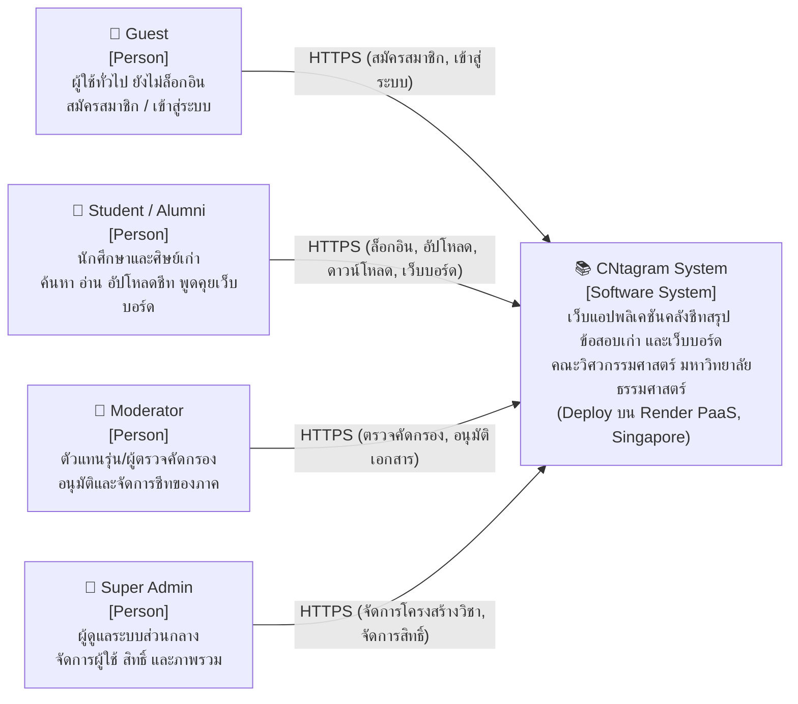

# C4 Model — CNtagram

ไดอะแกรมระดับ 1–2 ของ C4 Model ตาม [`lecture-notes/03`](../lecture-notes/03-software-architecture-and-decomposition.md#การถ่ายทอดสถาปัตยกรรมด้วยแบบจำลอง-c4-model) แสดงเฉพาะส่วนประกอบและฟังก์ชันที่มีอยู่จริงในระบบปัจจุบัน (รายการฟีเจอร์ที่ยังไม่ได้สร้างเก็บไว้ใน [`requirements.md`](../requirements.md))

---

## Level 1: System Context Diagram

แสดงขอบเขตของระบบ CNtagram และผู้ใช้งานประเภทต่างๆ ที่ระบบรองรับจริงในปัจจุบัน



### คำอธิบาย System Context (Level 1):
- **Guest**: เข้าได้เฉพาะหน้าแรก หน้าสมัครสมาชิก และหน้าเข้าสู่ระบบ หน้าอื่นทั้งหมดต้องล็อกอินก่อนเข้าใช้งานเนื่องจากระบบเปิด `LoginRequiredMiddleware`
- **Student / Alumni**: สมัครสมาชิกด้วยอีเมล `@student.tu.ac.th` และรหัสผ่าน ทำหน้าที่อัปโหลดเอกสารใหม่ ค้นหาและดาวน์โหลดไฟล์ ร่วมกิจกรรมเว็บบอร์ด/วิดเจ็ตหน้าแรก และจัดการบัญชีตนเอง (`/account/delete/`)
- **Moderator**: ตัวแทนนักศึกษาประจำภาควิชาที่ได้รับสิทธิ์ ทำหน้าที่ตรวจคัดกรอง อนุมัติ หรือปฏิเสธเอกสารของภาคตนเอง รวมถึงดูแลกระทู้ในเว็บบอร์ด
- **Super Admin**: ผู้ดูแลระบบส่วนกลาง มีสิทธิ์จัดการภาควิชา รุ่น รายวิชา แต่งตั้ง/ถอดถอน Moderator อนุมัติเอกสาร และเข้าถึง Django Admin

---

## Level 2: Container Diagram (Production Architecture)

แสดงสถาปัตยกรรมภายในและเทคโนโลยีที่ใช้จริงบน Production Environment ตามผลการศึกษาใน SP-4 ([ADR 0005](../adr/0005-production-deployment-and-backup.md))

```mermaid
flowchart TB
    U["👤 ผู้ใช้งานระบบ (Web Browser)<br/>HTML5, Bootstrap 5, Custom CSS, Vanilla JS"]

    subgraph CLOUD["Cloud Platform: Render (Singapore Region)"]
        EDGE["🌐 Edge Router & Reverse Proxy<br/>[Render Infrastructure]<br/>TLS Termination (HTTPS)"]

        subgraph WEB["Web Service Container (Linux, Python 3.12)"]
            GUNI["⚡ WSGI Server: Gunicorn<br/>[Application Server]<br/>รัน portal.wsgi:application"]

            subgraph DJANGO["Django 6.x Modular Monolith Web Application"]
                SEC["🛡️ Middleware Pipeline<br/>Security, WhiteNoise, Session, CSRF, Auth, LoginRequired, Clickjacking"]

                subgraph APPS["Django Apps (Bounded Contexts)"]
                    CAT["📚 catalog<br/>[Django App]<br/>ภาควิชา, รุ่นปี, รายวิชา, ค่ากำหนดระบบ"]
                    ACC["👤 accounts<br/>[Django App]<br/>User, Role, UserRole, UserCounter, PollVote, ShoutboxMessage<br/>สมัคร/ล็อกอิน/ลบบัญชี, rate limit และตัวนับผู้เข้าชมผ่าน Django cache<br/>Shoutbox และโพลหน้าแรก (AJAX)"]
                    MAT["📄 materials<br/>[Django App]<br/>เอกสาร, เวอร์ชันไฟล์, การดาวน์โหลด (Download Log),<br/>และระบบอนุมัติ (Approval Tables - ADR 0004)"]
                    WEB["💬 webboard<br/>[Django App]<br/>หมวดหมู่, กระทู้ถาม-ตอบ (ผูกรายวิชาได้), คอมเมนต์ตอบกลับ,<br/>อีโมติคอน MSN และฝังภาพ GIF"]
                end
            end
        end

        DB[("🗄️ Managed PostgreSQL<br/>[Render, Singapore]<br/>เชื่อมผ่าน DATABASE_URL (internal)")]

        FS[("📁 Local / Persistent Media Storage<br/>[MEDIA_ROOT]<br/>เก็บไฟล์ PDF ใน media/vault/<br/>(ไม่มี Direct URL - ADR 0003)")]

        BKP["⏰ Backup Scripts<br/>pg_dump / tar.gz media<br/>(scripts/backup_restore.sh)"]
    end

    U -- "HTTPS" --> EDGE
    EDGE -- "HTTP" --> GUNI
    GUNI --> SEC
    SEC --> APPS

    MAT -. "import (ADR 0001)" .-> ACC
    WEB -. "import (ADR 0001)" .-> ACC
    WEB -. "import (ADR 0001)" .-> CAT
    ACC -. "import (ADR 0001)" .-> CAT

    APPS -- "SQL / Django ORM" --> DB
    MAT -- "File I/O (FileResponse inline/attachment)" --> FS
    DB -. "pg_dump" .-> BKP
    FS -. "tar.gz" .-> BKP
```

### คำอธิบาย Container Level (Level 2):
1. **Web Browser (Client Layer):** ผู้ใช้เข้าชมผ่านเว็บเบราว์เซอร์ด้วยอินเทอร์เฟซ Bootstrap 5 รองรับ Responsive Design บนทุกอุปกรณ์
2. **Render Edge Router / Reverse Proxy:** รับคำขอ HTTPS จากอินเทอร์เน็ต ทำ TLS Termination และส่งต่อคำขอผ่าน Internal Network ไปยัง Web Container
3. **Gunicorn WSGI Server:** ทำหน้าที่เป็น WSGI HTTP Server สำหรับรันโปรเซสของ Django ในสภาพแวดล้อม Production
4. **Middleware Pipeline:** จัดการความปลอดภัยตามลำดับ: `SecurityMiddleware` → `WhiteNoiseMiddleware` (เสิร์ฟไฟล์สถิตที่บีบอัดและมี cache hash) → `SessionMiddleware` → `CsrfViewMiddleware` → `AuthenticationMiddleware` → `LoginRequiredMiddleware` → `XFrameOptionsMiddleware`
5. **Django Application & Apps Structure:**
   - สถาปัตยกรรมแบบ **Modular Monolith** แบ่ง 4 App ตาม Bounded Context โดยมีทิศทาง Dependency ทางเดียว `catalog` ← `accounts` ← (`materials`, `webboard`) ([ADR 0001](../adr/0001-modular-monolith-and-app-boundaries.md))
   - ทุก App แยกชั้นการทำงานด้วย **Service Layer** และ **Selectors** ([ADR 0002](../adr/0002-service-layer-and-selectors.md))
   - ตารางอนุมัติ (`Approval`, `DocTypeRequiredRole`) และสถิติการดาวน์โหลด (`DownloadLog`) อยู่ในแอป `materials` ตาม [ADR 0004](../adr/0004-approval-tables-in-materials.md)
   - แอป `accounts` จัดการ `User`, `Role`, `UserRole`, การลบบัญชี (`anonymize`, US-13) และนับการจำกัดอัตรา (Rate Limit) ผ่าน Django cache (`accounts/services.py`)
   - วิดเจ็ตชุมชนหน้าแรกอยู่ใน `accounts`: Shoutbox (`ShoutboxMessage`) และโพล (`PollVote`) รับ POST แบบ AJAX จาก `static/js/home_widgets.js` และ query อยู่ใน `accounts/selectors.py`; ตัวนับผู้เข้าชมเก็บใน Django cache; BGM Player ทำงานฝั่ง browser (`static/js/bgm_player.js`)
   - แอป `webboard` จัดการกระดานสนทนาชุมชน (`BoardCategory`, `Thread`, `Post`), ตัวแปลงอีโมติคอน MSN และฝังภาพ `[img]...[/img]` (`webboard/emoticons.py`)
6. **Managed PostgreSQL Database:** ฐานข้อมูลเชิงสัมพันธ์หลักบน Render (Region: Singapore) เชื่อมต่อผ่าน Internal Database URL เพื่อความปลอดภัยและความเร็วสูงสุด
7. **Media Storage (Protected PDF Vault):** ที่จัดเก็บไฟล์เอกสาร PDF จริง โดยยึดหลัก [ADR 0003](../adr/0003-document-storage-and-protected-preview.md) คือ **ไม่ตั้ง `MEDIA_URL`** และไม่มี Direct URL เข้าถึงไฟล์ การเปิดอ่าน (Preview) และดาวน์โหลดต้องผ่านการตรวจสอบสิทธิ์ใน View ของ Django เสมอ
8. **Backup Strategy:** สคริปต์สำรองข้อมูล `scripts/backup_restore.sh` สำหรับทำ Logical Dump (`pg_dump`) และบีบอัดโฟลเดอร์ Media Vault (`tar.gz`) ตามข้อตกลงใน [ADR 0005](../adr/0005-production-deployment-and-backup.md)

---

## เอกสารสถาปัตยกรรมที่เกี่ยวข้อง (Architectural Decision Records)
- [ADR 0001: Modular Monolith และขอบเขต Django Apps](../adr/0001-modular-monolith-and-app-boundaries.md)
- [ADR 0002: Service Layer และ Selectors](../adr/0002-service-layer-and-selectors.md)
- [ADR 0003: การเก็บไฟล์เอกสารและ Preview ผ่าน View ที่ตรวจสิทธิ์](../adr/0003-document-storage-and-protected-preview.md)
- [ADR 0004: ตารางการอนุมัติอยู่ใน app materials](../adr/0004-approval-tables-in-materials.md)
- [ADR 0005: การเลือกแพลตฟอร์ม Deploy, ฐานข้อมูล Production และกลยุทธ์การสำรองข้อมูล](../adr/0005-production-deployment-and-backup.md)

รายการฟังก์ชันทั้งหมดและ Product Backlog ดูที่ [`requirements.md`](../requirements.md) · Production: [https://cntagram-h195.onrender.com/](https://cntagram-h195.onrender.com/)
