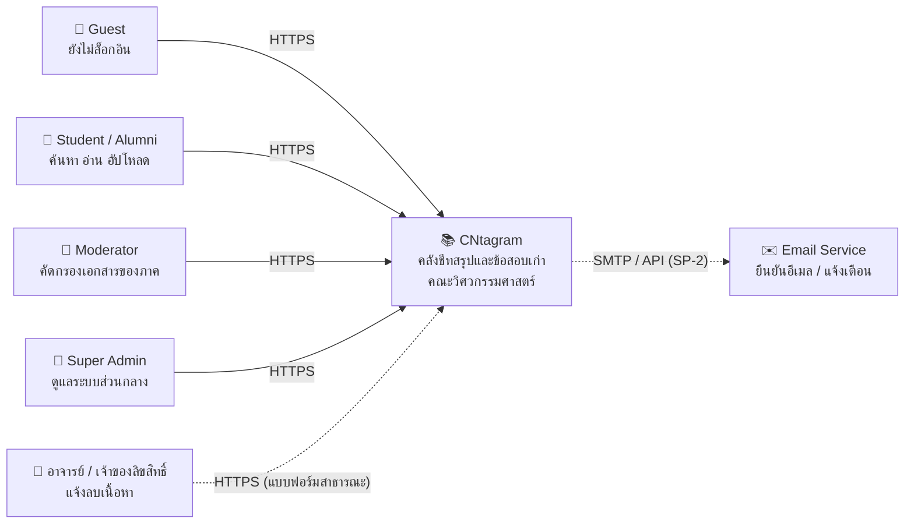
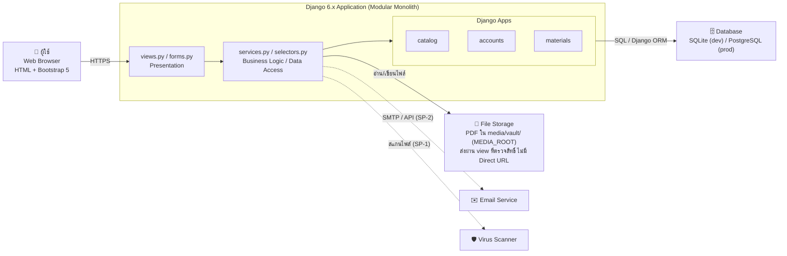

# C4 Model — CNtagram

ไดอะแกรมระดับ 1–2 ของ C4 Model ตาม [`lecture-notes/03`](../lecture-notes/03-software-architecture-and-decomposition.md#การถ่ายทอดสถาปัตยกรรมด้วยแบบจำลอง-c4-model)
ส่วนที่เป็นเส้นประคือสิ่งที่**ยังไม่ได้สร้าง** (รอ Spike/Story ใน [`requirements.md`](../requirements.md)) อัปเดตไฟล์นี้ใน PR เดียวกับที่เปลี่ยนสถาปัตยกรรม

## Level 1: System Context

## Level 2: Container

- Reverse proxy, application server และสถานที่ deploy ยังไม่ได้ตัดสินใจ (SP-4) จะเพิ่มลงไดอะแกรมนี้พร้อม ADR
- ทิศทาง dependency ระหว่าง app ดู [ADR 0001](../adr/0001-modular-monolith-and-app-boundaries.md) และการแยกชั้นในแต่ละ app ดู [ADR 0002](../adr/0002-service-layer-and-selectors.md)
- การเก็บไฟล์และ preview PDF (ไม่ตั้ง `MEDIA_URL`, iframe ผ่าน `materials:document_preview`) ดู [ADR 0003](../adr/0003-document-storage-and-protected-preview.md) — ต้องทบทวนอีกครั้งตอน deploy (SP-4)
