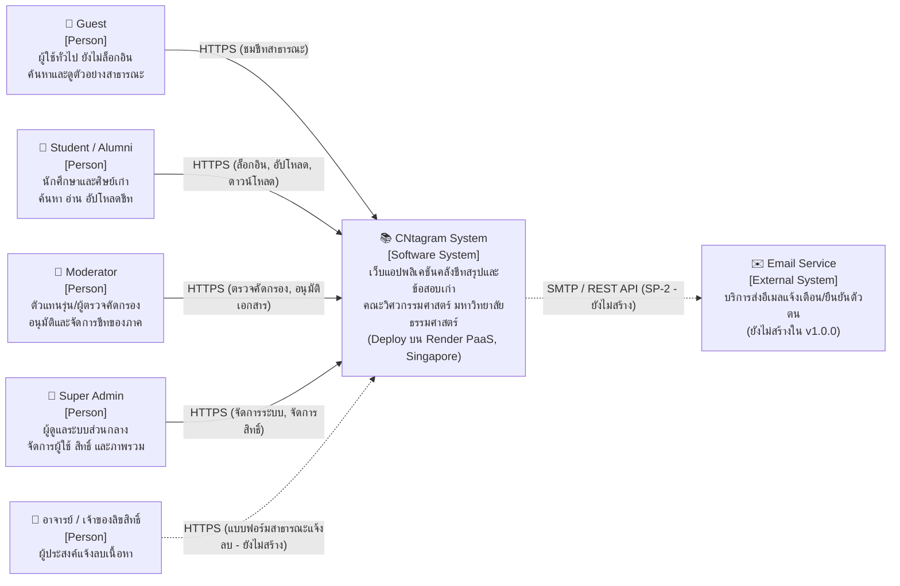
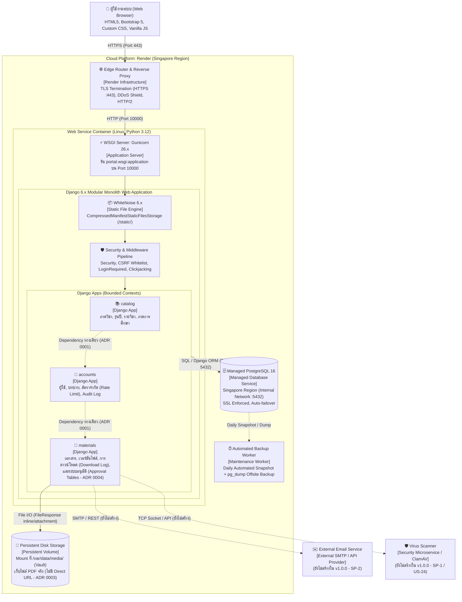

# C4 Model — CNtagram

ไดอะแกรมระดับ 1–2 ของ C4 Model ตาม [`lecture-notes/03`](../lecture-notes/03-software-architecture-and-decomposition.md#การถ่ายทอดสถาปัตยกรรมด้วยแบบจำลอง-c4-model)
ส่วนที่เป็นเส้นทึบคือระบบที่สร้างและ deploy จริง ส่วนที่เป็น**เส้นประ**คือสิ่งที่**ยังไม่ได้สร้างใน v1.0.0** (รอ Spike/Story ถัดไปใน [`requirements.md`](../requirements.md))

---

## Level 1: System Context Diagram

แสดงขอบเขตของระบบ CNtagram ผู้ใช้งานประเภทต่างๆ และระบบภายนอกที่เกี่ยวข้อง

### คำอธิบาย System Context (Level 1):
1. **ผู้ใช้งานที่ระบบรองรับจริงในปัจจุบัน (Active Users):**
   - **Guest**: เข้าถึงหน้าแรก ค้นหารายวิชา และดูตัวอย่างเอกสาร (Public Previews)
   - **Student / Alumni**: เข้าสู่ระบบผ่านบัญชีมหาวิทยาลัย อัปโหลดเอกสารใหม่ ดาวน์โหลดไฟล์ และจัดการโปรไฟล์
   - **Moderator**: ตัวแทนนักศึกษาประจำภาควิชาที่ได้รับสิทธิ์ ทำหน้าที่ตรวจคัดกรอง อนุมัติ หรือปฏิเสธเอกสารของภาคตนเอง
   - **Super Admin**: ผู้ดูแลระบบ มีสิทธิ์แต่งตั้ง/ถอดถอน Moderator และเข้าถึง Django Admin
2. **ระบบและส่วนที่ยังไม่ได้สร้างใน v1.0.0 (เส้นประ):**
   - **อาจารย์ / เจ้าของลิขสิทธิ์**: ฟอร์มสาธารณะสำหรับแจ้งละเมิดลิขสิทธิ์ (อยู่นอกขอบเขต MVP v1.0.0)
   - **Email Service**: ระบบส่งอีเมลแจ้งเตือนอัตโนมัติ (ข้ามไปทำในเวอร์ชันถัดไปตามข้อตกลง SP-2)

---

## Level 2: Container Diagram (Production Architecture)

แสดงสถาปัตยกรรมภายในและเทคโนโลยีที่ใช้จริงบน Production Environment ตามผลการศึกษาใน SP-4 ([ADR 0005](../adr/0005-production-deployment-and-backup.md))

### คำอธิบาย Container Level (Level 2):
1. **Web Browser (Client Layer):** ผู้ใช้เข้าชมผ่านเว็บเบราว์เซอร์ด้วยอินเทอร์เฟซ Bootstrap 5 รองรับ Responsive Design บนทุกอุปกรณ์
2. **Render Edge Router / Reverse Proxy:** รับคำขอ HTTPS (Port 443) จากอินเทอร์เน็ต ทำ TLS Termination และส่งต่อคำขอผ่าน Internal Network ไปยังพอร์ต 10000 ของ Web Container
3. **Gunicorn WSGI Server:** ทำหน้าที่เป็น WSGI HTTP Server สำหรับรันโปรเซสของ Django ในสภาพแวดล้อม Production
4. **WhiteNoise Static File Engine:** เสิร์ฟไฟล์คงที่ (CSS, JavaScript, รูปภาพ UI) โดยตรงจาก WSGI Process พร้อมทำ Content Hashing และบีบอัดไฟล์ (Gzip/Brotli) อัตโนมัติ
5. **Django Application & Apps Structure:**
   - สถาปัตยกรรมแบบ **Modular Monolith** แบ่ง App ตาม Bounded Context โดยมีทิศทาง Dependency ทางเดียว `catalog` ← `accounts` ← `materials` ([ADR 0001](../adr/0001-modular-monolith-and-app-boundaries.md))
   - ทุก App แยกชั้นการทำงานด้วย **Service Layer** และ **Selectors** ([ADR 0002](../adr/0002-service-layer-and-selectors.md))
   - ตารางอนุมัติเอกสาร (`MaterialApproval`, `ApprovalLog`) ถูกจัดเก็บไว้ในแอป `materials` ตาม [ADR 0004](../adr/0004-approval-tables-in-materials.md)
6. **Managed PostgreSQL Database:** ฐานข้อมูลเชิงสัมพันธ์หลักบน Render (Region: Singapore) รองรับ Concurrency และ Transaction Integrity
7. **Persistent Disk (Protected PDF Vault):** ที่จัดเก็บไฟล์เอกสาร PDF จริง โดยยึดหลัก [ADR 0003](../adr/0003-document-storage-and-protected-preview.md) คือ **ไม่ตั้ง `MEDIA_URL`** และไม่มี Direct URL เข้าถึงไฟล์ การเปิดอ่าน (Preview) และดาวน์โหลดต้องผ่านการตรวจสอบสิทธิ์ใน View ของ Django เสมอ
8. **Automated Backup Worker:** แผนสำรองข้อมูลอัตโนมัติประจำวัน (Daily Snapshot บน Managed DB ควบคู่กับการทำ Logical Dump ผ่าน `pg_dump`) ตามข้อตกลงใน [ADR 0005](../adr/0005-production-deployment-and-backup.md)
9. **เส้นประ (External Integrations):** ระบบส่งอีเมล (SP-2) และการสแกนไวรัสไฟล์อัปโหลด (SP-1 / US-24) ยังคงเป็นเส้นประเนื่องจากอยู่นอกกรอบเวลาของ v1.0.0

---

## เอกสารสถาปัตยกรรมที่เกี่ยวข้อง (Architectural Decision Records)
- [ADR 0001: Modular Monolith และขอบเขต Django Apps](../adr/0001-modular-monolith-and-app-boundaries.md)
- [ADR 0002: Service Layer และ Selectors](../adr/0002-service-layer-and-selectors.md)
- [ADR 0003: การเก็บไฟล์เอกสารและ Preview ผ่าน View ที่ตรวจสิทธิ์](../adr/0003-document-storage-and-protected-preview.md)
- [ADR 0004: ตารางการอนุมัติอยู่ใน app materials](../adr/0004-approval-tables-in-materials.md)
- [ADR 0005: การเลือกแพลตฟอร์ม Deploy, ฐานข้อมูล Production และกลยุทธ์การสำรองข้อมูล](../adr/0005-production-deployment-and-backup.md)
