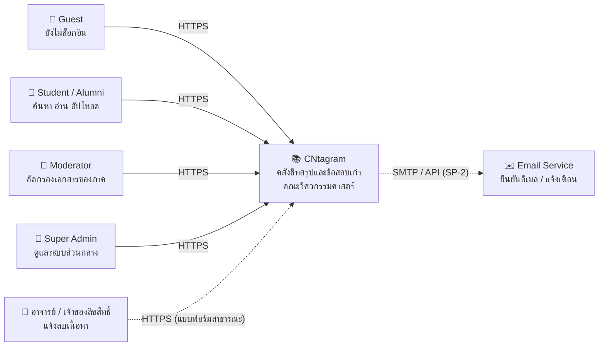
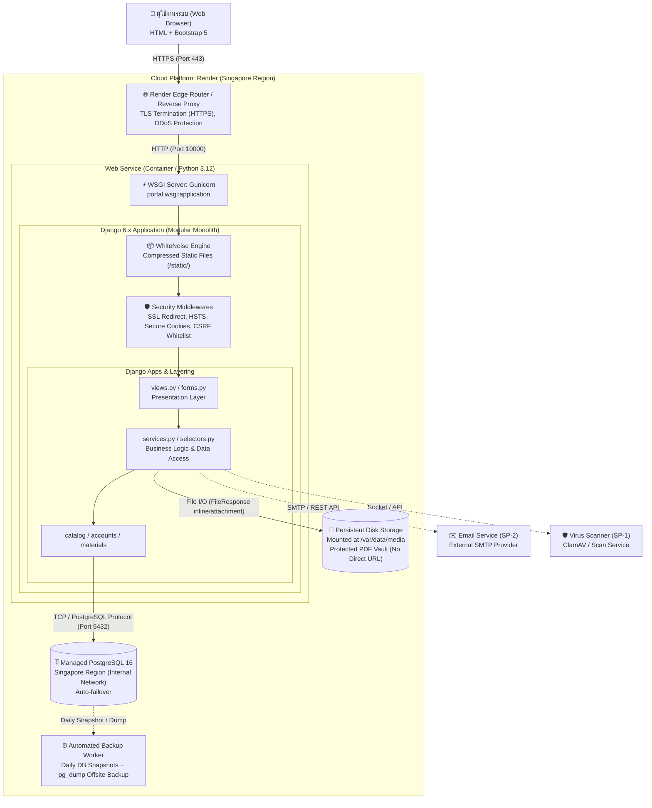

# C4 Model — CNtagram

ไดอะแกรมระดับ 1–2 ของ C4 Model ตาม [`lecture-notes/03`](../lecture-notes/03-software-architecture-and-decomposition.md#การถ่ายทอดสถาปัตยกรรมด้วยแบบจำลอง-c4-model)
ส่วนที่เป็นเส้นประคือสิ่งที่**ยังไม่ได้สร้าง** (รอ Spike/Story ใน [`requirements.md`](../requirements.md)) อัปเดตไฟล์นี้ใน PR เดียวกับที่เปลี่ยนสถาปัตยกรรม

## Level 1: System Context

---

## Level 2: Container (Production Architecture — ADR 0005)

### คำอธิบาย Container Level:
1. **Render Edge Router / Reverse Proxy**: รับคำขอจากเบราว์เซอร์ผ่าน HTTPS (Port 443) และทำ TLS Termination จากนั้นส่งต่อไปยัง Gunicorn ภายในคอนเทนเนอร์
2. **Gunicorn WSGI Server**: ตัวจัดการ WSGI Process สำหรับรับส่ง Request ระหว่าง Cloud Router และ Django Application
3. **WhiteNoise Engine**: เสิร์ฟ Static Files (CSS, JS, Fonts) ที่ผ่านการทำ Content Hashing และบีบอัด Gzip/Brotli โดยตรงจาก Application Process
4. **Django Core & Apps**: ทำงานแบบ Modular Monolith ตาม ADR 0001 และ ADR 0002 โดยแยก Service Layer และ Context Boundaries ชัดเจน
5. **Managed PostgreSQL**: ฐานข้อมูล Production ใน Region Singapore เชื่อมต่อผ่าน Internal Database URL เพื่อความปลอดภัยและความเร็วสูงสุด
6. **Persistent Disk Storage**: โฟลเดอร์เก็บเอกสาร PDF โดยคงกติกาตาม ADR 0003 อย่างเคร่งครัด (ห้ามมี Direct URL และทุกการเข้าถึงต้องผ่าน View ที่ตรวจสิทธิ์)
7. **Automated Backup Worker**: กลไกสำรองข้อมูลประจำวันทั้งแบบ Native Snapshot บน Managed DB และ Logical Backup (`pg_dump`)

---

## รายการงานที่ต้องเปิดเป็น Issue ต่อเนื่องจาก Spike (Follow-up Issues)
จากข้อสรุปใน SP-4 (#139) และ ADR 0005 มีรายการงานทางเทคนิคที่ต้องสร้างเป็น Issue ต่อไปใน Sprint 3:

1. **[Chore / Deploy] Production Settings Hardening & Build Pipeline**:
   - เพิ่ม `gunicorn`, `psycopg2-binary`, `dj-database-url`, `whitenoise` ใน `requirements.txt`
   - สร้างสคริปต์ `build.sh` (รัน `check --deploy`, `collectstatic`, `migrate`) และ `Procfile`
   - ปรับ `portal/settings.py` ให้อ่านค่าจาก Decouple และรองรับ `DEBUG = False`, `CSRF_TRUSTED_ORIGINS`, `ALLOWED_HOSTS`, `DATABASE_URL`
2. **[Ops] Setup Cloud Service & Managed PostgreSQL บน Render**:
   - ดำเนินการสมัคร/เปิด Web Service และ PostgreSQL Instance บน Render (Region: Singapore)
   - ตั้งค่า Environment Variables (`SECRET_KEY`, `DATABASE_URL`, `DJANGO_SUPERUSER_PASSWORD`, `ALLOWED_HOSTS`, `CSRF_TRUSTED_ORIGINS`)
   - ทดสอบเปิดใช้งานบน URL จริงผ่าน HTTPS
3. **[Ops] Disaster Recovery & Backup Routine**:
   - รันสคริปต์และทดสอบกู้คืนฐานข้อมูลจริงด้วย `pg_restore` บน Staging/Production DB
   - จัดทำเอกสาร Runbook คู่มือการกู้คืนระบบเมื่อเกิดภัยพิบัติ (Disaster Recovery Runbook)
4. **[CI] CI Deployment Trigger (Continuous Deployment)**:
   - ปรับ GitHub Actions ให้รองรับ Deploy Hook หรือ Auto-deploy เมื่อกิ่งหลัก (`main` หรือ `develop`) ถูก Merge
