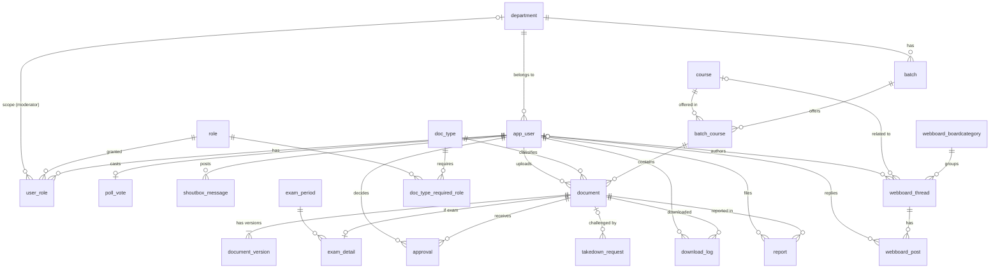

# ออกแบบฐานข้อมูล (3NF) — เว็บบอร์ดรวมชีทสรุปคณะวิศวะ

เอกสารนี้ใช้เป็น **SP-0 (ERD 3NF)** ของ Sprint 1 และอัปเดตใน PR เดียวกับที่แก้ `models.py` เสมอ
Requirement ที่ตารางเหล่านี้รองรับอยู่ใน [`requirements.md`](./requirements.md) (อ้างด้วยรหัส story เช่น US-5) ขอบเขต app และการแยกชั้นโค้ดดู [ADR 0001](./adr/0001-modular-monolith-and-app-boundaries.md) และ [ADR 0002](./adr/0002-service-layer-and-selectors.md)
สมมติฐาน: ใช้ RDBMS แบบ relational (MySQL/PostgreSQL) กับ Django และ FK ทุกเส้นเป็น `on_delete=PROTECT`
แนะนำ **PostgreSQL**: `user_role` ใช้ partial unique index ซึ่ง MySQL ไม่รองรับ (Django จะข้าม constraint นี้ จึงมีเช็กซ้ำใน model ด้วย)

---

## 1. ภาพรวมการตัดสินใจออกแบบ

| เรื่อง | ตัดสินใจ | เหตุผล |
|---|---|---|
| รหัสรุ่น `CN21` | **ไม่เก็บ** เก็บแค่ `department_id` + `number` แล้วประกอบ `code + number` ตอนแสดงผล | เป็นค่าที่คำนวณได้ จึงเก็บซ้ำแล้วจะขัด 3NF (ซ้ำกับ dept.code) |
| ปีเข้า/คณะ จากรหัสนักศึกษา | **ไม่เก็บ** เก็บแค่ `student_id` แล้วตัดตัวเลขตอนใช้ | `student_id → entry_year` เป็น transitive dependency |
| วิชา กับ วิชาในรุ่น | แยก `course` (ข้อมูลวิชา) ออกจาก `batch_course` (วิชาที่เปิดในรุ่น) | วิชาเดียว (เช่น CN101, SC135) ใช้ร่วมได้หลายรุ่น/หลายภาค ไม่ต้องซ้ำชื่อวิชา |
| Role | แยกตาราง `role` + `user_role` (M:N) พร้อม `department_id` | Moderator มีขอบเขตตามภาค และ 1 คนมีได้หลาย role |
| ชีทสรุป กับ ข้อสอบเก่า | ตาราง `document` ร่วมกัน + `exam_detail` (1:1) สำหรับข้อมูลเฉพาะข้อสอบ | หลีกเลี่ยง column ที่ว่างเป็นส่วนใหญ่ และรองรับ vault 2 แบบ |
| กฎอนุมัติ | เก็บเป็นข้อมูลใน `doc_type_required_role` ไม่ hardcode | เปลี่ยนกฎ (ข้อสอบต้อง Moderator + Admin) โดยไม่แก้โค้ด |
| ค่ากำหนด (รุ่น ≤ 23, ขนาดไฟล์ 50 MB) | ตาราง `system_setting` | ปรับได้โดยไม่ deploy ใหม่ |
| ไฟล์หลายเวอร์ชัน | ตาราง `document_version` | รองรับการเก็บประวัติเวอร์ชันไฟล์ (`Document.add_version()`) |
| จำนวนดาวน์โหลด | นับจาก `download_log` | ไม่เก็บตัวนับซ้ำ (ถ้าช้าค่อยเพิ่ม cache ทีหลังโดยเจตนา) |
| ลบข้อมูลผู้ใช้ (PDPA) | **anonymize** แถวเดิม ไม่ลบจริง | FK เป็น `PROTECT` จึงลบผู้ใช้ที่มีเอกสารไม่ได้ ล้างอีเมล/รหัส/ชื่อเล่นแทน แล้วปิด `is_active` |
| อีเมล / รหัสวิชา / รหัสภาค | เก็บเป็นรูปแบบเดียว (อีเมลตัวพิมพ์เล็ก, รหัสตัวพิมพ์ใหญ่) | กัน `Alice@x` กับ `alice@x`, `cn101` กับ `CN101` เป็นคนละค่าใน UNIQUE |

---

## 2. ERD

---

## 3. รายละเอียดตาราง

ตัวย่อ: **PK** = Primary Key, **FK** = Foreign Key, **UQ** = Unique, **NN** = Not Null
FK ทุกเส้นใช้ `ON DELETE PROTECT/RESTRICT` ยกเว้นที่ระบุไว้

### 3.1 โครงสร้างภาควิชา (Sprint 1)

**department**
| Column | Type | Constraint |
|---|---|---|
| id | BIGINT | PK |
| code | VARCHAR(5) | UQ, NN (เช่น CN, CE, ME, EE; เก็บตัวพิมพ์ใหญ่; รับแค่ A-Z 2-5 ตัว เพราะอยู่ใน path ไฟล์) |
| name_th | VARCHAR(100) | NN |
| name_en | VARCHAR(100) | NN |
| is_active | BOOLEAN | NN, default true |

**batch** (1 ภาค : N รุ่น)
| Column | Type | Constraint |
|---|---|---|
| id | BIGINT | PK |
| department_id | BIGINT | FK → department, NN |
| number | SMALLINT | NN, CHECK ≥ 1 (21, 22, …) |
| | | **UQ (department_id, number)** |

> รหัสรุ่น `CN21` = `department.code || batch.number` (คำนวณ ไม่เก็บ)

**course** (ข้อมูลวิชา — ไม่ผูกกับรุ่น)
| Column | Type | Constraint |
|---|---|---|
| id | BIGINT | PK |
| code | VARCHAR(10) | UQ, NN (CN101, SC135, AT326; เก็บตัวพิมพ์ใหญ่; A-Z ตามด้วยเลข 1-3 หลัก เพราะอยู่ใน path ไฟล์) |
| name_th | VARCHAR(150) | NULL |
| name_en | VARCHAR(150) | NN |

**batch_course** (วิชาที่เปิดในรุ่น — ตารางเชื่อม M:N)
| Column | Type | Constraint |
|---|---|---|
| id | BIGINT | PK |
| batch_id | BIGINT | FK → batch, NN |
| course_id | BIGINT | FK → course, NN |
| | | **UQ (batch_id, course_id)** |

### 3.2 ผู้ใช้และสิทธิ์ (Sprint 1)

**app_user** (ใช้ชื่อนี้เลี่ยงชนกับ `user` ของ DB; ใน Django คือ custom User model)
| Column | Type | Constraint |
|---|---|---|
| id | BIGINT | PK |
| student_id | VARCHAR(10) | UQ, NN (ระบบดึงจาก local part ของอีเมล ผู้ใช้ไม่กรอก; ตัวที่ 1–2 = ปีเข้า, 3–4 = คณะ ต้องเป็น `10`; superuser ที่ไม่ได้ใช้อีเมลนักศึกษาได้รหัสสำรอง `a` + เลข 9 หลัก, ผู้ใช้ที่ถูก anonymize ได้ `x` + เลข 9 หลัก) |
| email | VARCHAR(255) | UQ, NN (@student.tu.ac.th) |
| personal_email | VARCHAR(255) | UQ, NULL (ผูกสำหรับ Alumni) |
| password_hash | VARCHAR(255) | NN |
| nickname | VARCHAR(50) | NN (แสดงแทนอีเมล — PDPA) |
| department_id | BIGINT | FK → department, NN (ผู้ใช้กรอกตัวย่อภาค เช่น CN, CHE ตอนสมัคร/createsuperuser ระบบแปลงเป็น id; ภาควิชา admin ต้องสร้างไว้ก่อน ถ้าไม่มีจะแจ้งว่าไม่พบ) |
| email_verified_at | TIMESTAMP | NULL |
| pdpa_consent_at | TIMESTAMP | NN |
| is_active | BOOLEAN | NN |
| is_staff | BOOLEAN | NN, default false (เข้า Django admin) |
| is_superuser | BOOLEAN | NN, default false (จาก `PermissionsMixin`) |
| last_login | TIMESTAMP | NULL (จาก `AbstractBaseUser`) |
| created_at | TIMESTAMP | NN |

> **กฎของ app_user ที่บังคับใน model (DB ทำไม่ได้)**
> - ผู้ใช้ไม่ต้องกรอก `student_id` ระบบดึงจากส่วนหน้า `@` ของ `email` ให้เอง (`User.validate_student_email()` ใน `accounts/models.py` เป็นที่เดียวที่เก็บกฎ; `clean()` และ `create_user()` เรียกใช้ตัวนี้ ฟอร์มสมัครของ US-1 ต้องเรียกตัวเดียวกัน; ยกเว้น superuser)
> - ลำดับเช็ก `email`: ซ้ำไหม → โดเมนต้องเป็น `@student.tu.ac.th` → ส่วนหน้า `@` ต้องเป็นเลขอารบิก 10 หลัก → หลักที่ 3–4 ต้องเป็น `10` (ไม่ใช่ = ไม่ได้อยู่คณะวิศวะ สมัครไม่ได้) → ผ่านแล้วบันทึกรหัสลง `student_id`
> - `email` / `personal_email` เก็บตัวพิมพ์เล็กเสมอ, `personal_email` ว่างเก็บเป็น NULL (ตอนสมัครเช็กแค่รูปแบบอีเมลถูกต้อง และไม่ซ้ำเพราะเป็น UQ)
> - `student_id` เป็นเลขอารบิก 10 หลักเท่านั้น (ไม่รับเลขไทย) และไม่แสดงในฟอร์ม (`editable=False`)
> - `department` ผู้ใช้กรอกตัวย่อภาค (เช่น `CN`, `CHE`) ต้องมีในตาราง `department` ที่ Admin เพิ่มไว้และ `is_active`
> - `nickname` ห้ามซ้ำกับคำสงวน (admin, moderator, แอดมิน ฯลฯ)
> - `pdpa_consent_at` ต้องส่งมาจากการกดยอมรับจริง ระบบไม่เติมให้ (ยกเว้นสร้าง superuser ผ่าน CLI)
> - ลบผู้ใช้ตาม PDPA ใช้ `anonymize()` (ล้างข้อมูลระบุตัวตน + ปิดบัญชี)

**role**
| Column | Type | Constraint |
|---|---|---|
| id | SMALLINT | PK |
| code | VARCHAR(30) | UQ (`student`, `alumni`, `moderator`, `super_admin`) |
| name_th | VARCHAR(50) | NN |

> Guest ไม่ใช่ผู้ใช้ในระบบ จึงไม่มีแถวใน `role`

**user_role** (M:N ระหว่างผู้ใช้กับ role)
| Column | Type | Constraint |
|---|---|---|
| id | BIGINT | PK |
| user_id | BIGINT | FK → app_user, NN |
| role_id | SMALLINT | FK → role, NN |
| department_id | BIGINT | FK → department, **NULL** (ใช้เฉพาะ moderator = ภาคที่ดูแล; role อื่น = NULL) |
| granted_by | BIGINT | FK → app_user, NULL |
| granted_at | TIMESTAMP | NN |
| | | **UQ (user_id, role_id, department_id) WHERE department_id IS NOT NULL** |
| | | **UQ (user_id, role_id) WHERE department_id IS NULL** |

> เหตุที่ UQ แยกเป็น 2 เงื่อนไข: SQL ถือว่า `NULL ≠ NULL` ถ้ามี UQ ตัวเดียว `(user, student, NULL)` จะซ้ำได้
> กฎใน model: `department_id` ต้องมีค่าเมื่อ role = `moderator` และต้องเป็น NULL เมื่อเป็น role อื่น
> แต่งตั้ง Moderator หลายภาค (US-10) = เพิ่มแถว `user_role` 1 แถวต่อ 1 ภาค **ไม่มีตาราง M:N user–department แยก**
> แถว `role` ทั้ง 4 ค่า และ `user_role(super_admin)` ของ superuser คนแรก มาจาก seed ในงานย่อยของ US-3 (`createsuperuser` ตั้งแค่ `is_superuser` ไม่สร้าง `user_role`)

**user_counter** (ยอดสะสมผู้ใช้ที่เคยถูกสร้าง สำหรับ Dashboard ของ Super Admin, #65)
| Column | Type | Constraint |
|---|---|---|
| id | BIGINT | PK (มีแถวเดียว id = 1) |
| total | INTEGER | NN, ≥ 0 |

> signal `post_save` ของ `User` บวกทีละหนึ่งทุกครั้งที่สร้างผู้ใช้ ไม่ลดเมื่อลบ ตอนสร้างตารางตั้งค่าเริ่มจากจำนวนผู้ใช้ที่มีอยู่

### 3.3 เอกสารและไฟล์ (Sprint 1)

**doc_type**
| Column | Type | Constraint |
|---|---|---|
| id | SMALLINT | PK |
| code | VARCHAR(20) | UQ (`summary`, `exam`, `cheatsheet`, `slide`) |
| name_th | VARCHAR(50) | NN |
| vault | VARCHAR(10) | NN, CHECK in (`lecture`, `exam`) — `exam` = คลังข้อสอบรวมข้ามรุ่น, `lecture` = แยกตามรุ่น |

**exam_period**
| Column | Type | Constraint |
|---|---|---|
| id | SMALLINT | PK |
| code | VARCHAR(20) | UQ (`midterm`, `final`) |
| name_th | VARCHAR(50) | NN |

**document**
| Column | Type | Constraint |
|---|---|---|
| id | BIGINT | PK |
| batch_course_id | BIGINT | FK → batch_course, NN |
| doc_type_id | SMALLINT | FK → doc_type, NN |
| uploader_id | BIGINT | FK → app_user, NN |
| title | VARCHAR(200) | NN |
| description | TEXT | NN (ไม่บังคับกรอก เก็บเป็นสตริงว่าง) |
| status | VARCHAR(15) | NN, CHECK in (`pending`, `published`, `rejected`, `hidden`), default `pending` |
| created_at / updated_at | TIMESTAMP | NN |

**exam_detail** (1:1 กับ document ที่เป็นข้อสอบ)
| Column | Type | Constraint |
|---|---|---|
| document_id | BIGINT | PK, FK → document |
| exam_period_id | SMALLINT | FK → exam_period, NN |
| exam_year_be | SMALLINT | NN, CHECK 2500–2700 (ปี พ.ศ.) |

> `exam_detail` ผูกได้เฉพาะ document ที่ `doc_type.vault = 'exam'` (เช็กใน model)

**document_version**
| Column | Type | Constraint |
|---|---|---|
| id | BIGINT | PK |
| document_id | BIGINT | FK → document, NN |
| version_no | SMALLINT | NN |
| storage_path | VARCHAR(500) | UQ, NN (path สัมพัทธ์เท่านั้น ห้าม `/` นำหน้า `..` `\`; `vault/{dept}/{batch}/{course}/{type}/{uuid}.pdf`) |
| original_name | VARCHAR(255) | NN |
| size_bytes | BIGINT | NN, CHECK 0 < ค่า ≤ 50 MB (เพดานสูงสุด) |
| sha256 | VARCHAR(64) | NN, INDEX (hex ตัวพิมพ์เล็ก 64 ตัว) |
| scan_status | VARCHAR(10) | NN, CHECK in (`pending`, `clean`, `infected`), default `pending` |
| uploaded_at | TIMESTAMP | NN |
| | | **UQ (document_id, version_no)** |

> เวอร์ชันปัจจุบัน = `version_no` สูงสุดของ document นั้น
>
> - ออกเลขเวอร์ชันผ่าน `Document.add_version()` ซึ่งล็อกแถว document ก่อน กันเลขชนเมื่ออัปโหลดพร้อมกัน
> - ขนาดไฟล์ที่ยอมรับจริง = `system_setting.max_upload_mb` (ต้องไม่เกิน 50) CHECK ใน DB เป็นเพดานสูงสุดเท่านั้น
> - `original_name` ถูกล้าง path และอักขระควบคุมก่อนบันทึก
> - `storage_path` สัมพัทธ์กับ `MEDIA_ROOT` (โฟลเดอร์ `media/`) และเปิดได้ผ่าน view ที่ตรวจสิทธิ์เท่านั้น ([ADR 0003](./adr/0003-document-storage-and-protected-preview.md))

### 3.4 ตั้งค่าและกฎ (Sprint 1–2)

**system_setting**
| Column | Type | Constraint |
|---|---|---|
| key | VARCHAR(50) | PK (เช่น `legacy_batch_max` = 23, `max_upload_mb` = 50) |
| value | VARCHAR(100) | NN |

**doc_type_required_role** (กฎ: ประเภทเอกสารไหนต้องได้รับอนุมัติจาก role ใด)
| Column | Type | Constraint |
|---|---|---|
| id | BIGINT | PK (Django ใช้ PK เดี่ยว) |
| doc_type_id | SMALLINT | FK → doc_type, NN |
| role_id | SMALLINT | FK → role, NN |
| mode | VARCHAR(3) | NN, CHECK in (`any`, `all`), default `any` |
| | | **UQ (doc_type_id, role_id)** |

ตัวอย่างข้อมูล: `summary`/`slide`/`cheatsheet` → moderator + super_admin โหมด `any` (approver **1 คนจาก** role ใดก็ได้) · `exam` → moderator + super_admin โหมด `all` (ต้อง**ครบทั้งสอง**)

> กฎใน service (`materials.services.review_document`, US-9, [ADR 0004](./adr/0004-approval-tables-in-materials.md))
> - ทุกแถวของ doc_type เดียวกันควรใช้ `mode` เดียวกัน ถ้ามีแถวใดเป็น `all` จะถือว่าทั้ง doc_type เป็น `all`
> - doc_type ที่ไม่มีแถวกฎ = ไม่มีใครอนุมัติหรือปฏิเสธได้
> - ข้อสอบ (`vault = exam`) ของรุ่นที่ `batch.number ≤ system_setting.legacy_batch_max` (ค่าเริ่มต้น 23) ใช้กฎพิเศษ: super_admin คนเดียวพิจารณาได้และพอ
> - moderator ใช้สิทธิ์ได้เฉพาะเอกสารของภาคที่ตัวเองดูแล (`user_role.department_id`) · คนที่ถือหลาย role นับเป็นฝ่ายที่ยังไม่มีใครอนุมัติก่อน
> - ปฏิเสธ 1 ครั้งจากฝ่ายใดก็ได้ = `rejected`
> - หน้าจอถามสถานะได้จาก `materials.selectors.approval_progress` (เอกสารเดียว) หรือ `approval_progress_for` (หน้าคิว ไม่เกิน 3 query ไม่ว่ากี่แถว) คืน role ที่อนุมัติแล้ว / ยังรอ และ `approvable` (False = ไม่ใช่ `pending` หรือกฎไม่มี role ที่อนุมัติได้)

### 3.5 การอนุมัติ การดาวน์โหลด และการร้องเรียน (Sprint 1–3)

**approval**
| Column | Type | Constraint |
|---|---|---|
| id | BIGINT | PK |
| document_id | BIGINT | FK → document, NN |
| approver_id | BIGINT | FK → app_user, NN |
| approver_role_id | SMALLINT | FK → role, NN (ตัดสินในบทบาทใด) |
| decision | VARCHAR(10) | NN (`approved`, `rejected`) |
| reason | TEXT | NULL (บังคับเมื่อ rejected) |
| decided_at | TIMESTAMP | NN |
| | | **UQ (document_id, approver_id)** |

**download_log**
| Column | Type | Constraint |
|---|---|---|
| id | BIGINT | PK |
| document_id | BIGINT | FK → document, NN |
| user_id | BIGINT | FK → app_user, NN |
| downloaded_at | TIMESTAMP | NN |

**report** (ผู้ใช้ที่ล็อกอินแจ้งปัญหาเอกสารที่เผยแพร่แล้ว, US-32 / US-35)
| Column | Type | Constraint |
|---|---|---|
| id | BIGINT | PK |
| document_id | BIGINT | FK → document, NN |
| reporter_id | BIGINT | FK → app_user, NN |
| reason | TEXT | NN |
| reason_type | VARCHAR(20) | NN (`copyright`, `prohibited`, `incorrect`, `other`) |
| status | VARCHAR(20) | NN (`open`, `resolved`) |
| handled_by | BIGINT | FK → app_user, NULL |
| created_at / resolved_at | TIMESTAMP | NN / NULL |
| decision | VARCHAR(20) | NN, default empty; `remove` / `dismiss` / `request_changes` |
| resolution_reason | TEXT | NN, default empty |
| Constraints | — | unique open `(document_id, reporter_id)`, valid status/reason/decision |

**takedown_request** (แบบฟอร์มสาธารณะแจ้งลบเนื้อหาละเมิดลิขสิทธิ์, US-33 / US-35)
| Column | Type | Constraint |
|---|---|---|
| id | BIGINT | PK |
| reference | UUID | UNIQUE |
| claimant_name | VARCHAR(200) | NN |
| contact_email | VARCHAR(254) | NN |
| content_identifier | VARCHAR(500) | NN |
| reason | TEXT | NN |
| rights_confirmed | BOOLEAN | NN |
| document_id | BIGINT | FK → document, NULL |
| status | VARCHAR(20) | NN (`open`, `resolved`) |
| handled_by | BIGINT | FK → app_user, NULL |
| created_at / resolved_at | TIMESTAMP | NN / NULL |
| decision | VARCHAR(20) | NN, default empty; `remove` / `dismiss` / `request_changes` |
| resolution_reason | TEXT | NN, default empty |

### 3.6 ชุมชนและเว็บบอร์ดเรโทร (Sprint 3)

**poll_vote** (โพลหน้าแรกใน `accounts`, 1 คนโหวตได้ 1 ครั้ง, US-37)
| Column | Type | Constraint |
|---|---|---|
| id | BIGINT | PK |
| user_id | BIGINT | FK → app_user (`CASCADE`), UQ, NN |
| choice | VARCHAR(20) | NN (`summary`, `slide`, `exam`, `video`) |
| updated_at | TIMESTAMP | NN |

**shoutbox_message** (ข้อความ Shoutbox หน้าแรกใน `accounts`, US-36)
| Column | Type | Constraint |
|---|---|---|
| id | BIGINT | PK |
| user_id | BIGINT | FK → app_user (`CASCADE`), NN |
| message | VARCHAR(150) | NN |
| created_at | TIMESTAMP | NN, INDEX |

**webboard_boardcategory** (`webboard.BoardCategory`)
| Column | Type | Constraint |
|---|---|---|
| id | BIGINT | PK |
| name | VARCHAR(100) | NN |
| slug | VARCHAR(50) | UQ, NN |
| description | TEXT | NN (อนุญาตสตริงว่าง) |
| order | INTEGER | NN, ≥ 0, default 0 |

**webboard_thread** (`webboard.Thread`)
| Column | Type | Constraint |
|---|---|---|
| id | BIGINT | PK |
| category_id | BIGINT | FK → webboard_boardcategory (`CASCADE`), NN |
| course_id | BIGINT | FK → course (`SET_NULL`), NULL |
| author_id | BIGINT | FK → app_user (`SET_NULL`), NULL |
| title | VARCHAR(200) | NN |
| content | TEXT | NN |
| is_pinned | BOOLEAN | NN, default false |
| is_locked | BOOLEAN | NN, default false |
| view_count | INTEGER | NN, ≥ 0, default 0 |
| created_at / updated_at | TIMESTAMP | NN |

**webboard_post** (`webboard.Post`)
| Column | Type | Constraint |
|---|---|---|
| id | BIGINT | PK |
| thread_id | BIGINT | FK → webboard_thread (`CASCADE`), NN |
| author_id | BIGINT | FK → app_user (`SET_NULL`), NULL |
| content | TEXT | NN |
| created_at / updated_at | TIMESTAMP | NN |

---

## 4. กระบวนการ Normalize (ทีละขั้น)

### 4.0 ตั้งต้น: ตาราง Unnormalized (UNF)

ถ้าเอาข้อมูลจากตัวอย่างใน SRS v1 ([archive](./archive/requirements-srs-v1.pdf)) มาใส่ตารางเดียว จะได้ประมาณนี้

| file_name | dept_code | dept_name | batch_code | course_code | course_name | doc_type | exam_period | exam_year | uploader_email | uploader_roles | approvers |
|---|---|---|---|---|---|---|---|---|---|---|---|
| Cn200 56.pdf | CN | Computer Eng | CN21 | CN200 | Algorithms | exam | midterm | 2556 | 6710…@student.tu.ac.th | student, alumni | A, B |
| L01.pdf | CN | Computer Eng | CN21 | CN201 | OOP | slide | | | 6710…@student.tu.ac.th | student | A |

ปัญหา: ข้อมูลภาควิชา/วิชาซ้ำทุกแถว, `uploader_roles` และ `approvers` มีหลายค่าในช่องเดียว, `exam_*` ว่างเมื่อไม่ใช่ข้อสอบ

### 4.1 ขั้น 1NF — ทุกช่องเป็นค่าเดี่ยว (atomic) และไม่มีกลุ่มที่ซ้ำ

- `uploader_roles` ("student, alumni") และ `approvers` ("A, B") มีหลายค่าในช่องเดียว
  → แยกเป็นตารางลูก: **user_role** (user ↔ role) และ **approval** (document ↔ approver)
- ทุกตารางมี PK ที่ชัดเจน (`id`)

### 4.2 ขั้น 2NF — ไม่มี partial dependency (ทุก non-key ขึ้นกับ key ทั้งก้อน)

ตอนที่ key เป็นแบบประกอบ เช่น (`batch_id`, `course_code`, `file_name`):
- `course_name` ขึ้นกับ `course_code` อย่างเดียว ไม่ได้ขึ้นกับรุ่นหรือไฟล์ → แยกเป็น **course**
- `dept_name` ขึ้นกับ `dept_code` อย่างเดียว → แยกเป็น **department**
- ความสัมพันธ์รุ่น–วิชา เก็บใน **batch_course** (UQ `batch_id, course_id`)
- ข้อมูลเฉพาะรุ่น (**batch**) ผูกกับ **department**

### 4.3 ขั้น 3NF — ไม่มี transitive dependency (non-key ห้ามขึ้นกับ non-key อื่น)

| ที่เจอ | ปัญหา | แก้ |
|---|---|---|
| `batch_code` ("CN21") | = `dept.code` + `batch.number` เก็บซ้ำและอาจไม่ตรงกัน | ไม่เก็บ ประกอบตอนแสดงผล |
| `entry_year`, `faculty_code` ใน user | ได้จาก `student_id` (`student_id → entry_year`) | เก็บแค่ `student_id` |
| `vault` ใน document | ได้จาก `doc_type` (`doc_type_id → vault`) | ย้ายไปอยู่ **doc_type** |
| `required_approvers` ใน document | ขึ้นกับประเภทเอกสาร ไม่ใช่เอกสารเอง | ย้ายไป **doc_type_required_role** |
| `exam_period`, `exam_year` | ใช้เฉพาะข้อสอบ ทำให้ช่องว่างจำนวนมาก | แยกเป็น **exam_detail** (1:1) และ `exam_period` เป็น lookup |

### 4.4 ตรวจ BCNF (เพิ่มเติม)

ตารางที่มี candidate key มากกว่า 1 ชุด เช่น `app_user` (`id`, `student_id`, `email`) — ทุก determinant เป็น candidate key จึงผ่าน BCNF
`batch_course`, `user_role`, `approval` ใช้ UQ ประกอบ ไม่มี dependency ที่ผิดปกติ

### 4.5 จุดที่ตั้งใจไม่ normalize (ต้องรู้ไว้)

1. `document.status` เป็นค่า enum ในตาราง ไม่แยกเป็น lookup table (ค่าน้อยและตายตัว ลด join)
2. `approval.approver_role_id` — เก็บ "ตัดสินในบทบาทใด" เพราะผู้ใช้คนเดียวอาจมีหลาย role (ไม่ซ้ำซ้อน เพราะไม่ได้ derive จาก user ได้ตรงๆ)
3. `user_counter.total` — เก็บยอดสะสมแยกไว้ เพราะนับจาก `app_user` ไม่ได้หลังมีการลบผู้ใช้

---

## 5. Index (รองรับเป้าความเร็วหน้าค้นหาใน AC ของ US-7)

| Table | Index | เพื่ออะไร |
|---|---|---|
| department | UQ (code) | ค้นภาควิชา |
| batch | UQ (department_id, number) | ประกอบรหัสรุ่น |
| course | UQ (code) | ค้นด้วยรหัสวิชา (US-7) |
| batch_course | UQ (batch_id, course_id), IDX (course_id) | รวมวิชาเดียวกันจากทุกรุ่น |
| document | IDX (batch_course_id, status), IDX (doc_type_id, status), IDX (uploader_id) | ค้นหา/กรอง, คิวอนุมัติ |
| exam_detail | IDX (exam_period_id, exam_year_be) | กรองตามช่วงสอบ/ปี |
| document_version | UQ (document_id, version_no), UQ (storage_path), IDX (sha256) | กันเวอร์ชัน/ไฟล์ซ้ำ, ตรวจไฟล์ที่ถูกรายงาน |
| approval | UQ (document_id, approver_id) | กันอนุมัติซ้ำ |
| user_role | UQ (user_id, role_id, department_id), IDX (role_id, department_id) | หา Moderator ของภาค |
| download_log | IDX (document_id) | นับจำนวนดาวน์โหลด |
| report | IDX (document_id, status), IDX (status, created_at) | คิวเรื่องร้องเรียนและป้องกันรายงานซ้ำ |
| takedown_request | UQ (reference), IDX (status, created_at) | อ้างอิงคำร้องและคิวพิจารณา |
| shoutbox_message | IDX (created_at) | ดึงข้อความล่าสุดใน Shoutbox |

> **การค้นหาของ US-7** (`materials.selectors.search_documents`) ใช้ index ที่มีอยู่แล้วทั้งหมด จึงไม่ต้องเพิ่ม migration: เทียบ `course.code` แบบตรงตัว (ตัวพิมพ์ใหญ่) เพื่อใช้ UQ (code) → `batch_course` ผ่าน IDX (course_id) → `document` ผ่าน IDX (batch_course_id, status) / IDX (doc_type_id, status) ส่วนรุ่นไม่ได้เก็บรหัส `CN21` จึงกรองผ่าน `batch_course__batch` ผลค้นหาทั้งหน้าโหลดด้วย query เดียว (`select_related`) ตรวจด้วย `assertNumQueries(1)`

## 6. กฎทางธุรกิจที่ฐานข้อมูลบังคับให้เอง

- ลบ Department / Batch / Course ที่ยังมี batch_course หรือ document ผูกอยู่ไม่ได้ (FK RESTRICT/`PROTECT`)
- รุ่นซ้ำในภาคเดียวกัน, วิชาซ้ำในรุ่นเดียวกัน, ผู้อนุมัติซ้ำคนเดิมในเอกสารเดียวกัน, รายงานซ้ำที่ยังเปิดอยู่จากผู้ใช้คนเดิมในเอกสารเดียวกัน → ถูกบล็อกด้วย UQ
- `size_bytes` ≤ 0 หรือเกิน 50 MB, `exam_year_be` นอก 2500–2700, `batch.number` < 1, `status` นอกค่าที่กำหนด → ถูกบล็อกด้วย CHECK
- `storage_path` ซ้ำ → ถูกบล็อกด้วย UQ

**ที่ต้องเขียนใน application (DB ทำไม่ได้):**
- ใน **model** (`clean()`/`save()` ตรวจความถูกต้องของแถว): กฎของ `app_user` (โดเมนอีเมล = student_id), moderator ต้องมีภาค / role อื่นห้ามมีภาค, `exam_detail` เฉพาะข้อสอบ, ขนาดไฟล์ตาม `max_upload_mb`
- ใน **service** (`services.py` กฎธุรกิจที่ต้องดูข้อมูลอื่น): ผู้ใช้อัปโหลดเข้าได้เฉพาะภาควิชาตนเอง, กฎ "รุ่น ≤ `legacy_batch_max` ให้ Super Admin เท่านั้น", เช็กว่าครบ `doc_type_required_role` แล้วจึงเปลี่ยนสถานะเป็น `published`, ผู้อัปโหลดอนุมัติไฟล์ตัวเองไม่ได้, Super Admin ต้องมีอย่างน้อย 2 คน, การซ่อนเอกสาร (`hide_document`) และการตัดสินเรื่องร้องเรียน (`resolve_report`) เปลี่ยนสถานะเอกสารเป็น `hidden` ภายใน transaction เดียวกัน

## 7. ลำดับสร้างตาราง (ตาม Sprint ที่พัฒนาจริง)

- **Sprint 1:** `department`, `batch`, `course`, `batch_course`, `role`, `app_user`, `user_role`, `doc_type`, `exam_period`, `document`, `exam_detail`, `document_version`, `system_setting`, `approval`, `doc_type_required_role`, `download_log`
  ข้อมูลตั้งต้น: `role`, `doc_type` / `exam_period` / `system_setting`, รุ่น/วิชาตัวอย่างด้วย `seed_catalog`, และกฎอนุมัติด้วย `seed_approval_rules`
- **Sprint 2:** `user_counter` (#65 สำหรับนับยอดสะสมผู้ใช้)
- **Sprint 3:** `poll_vote`, `shoutbox_message` (วิดเจ็ตหน้าแรกใน `accounts`), `webboard_boardcategory`, `webboard_thread`, `webboard_post` (เว็บบอร์ดชุมชนใน `webboard`), `report`, `takedown_request` (ระบบเรื่องร้องเรียนและแจ้งลบใน `materials`)

## 8. Django app ↔ ตาราง

| App | Model | ตารางใน DB |
|---|---|---|
| `catalog` | Department, Batch, Course, BatchCourse, SystemSetting | `department`, `batch`, `course`, `batch_course`, `system_setting` |
| `accounts` | User, Role, UserRole, UserCounter, PollVote, ShoutboxMessage | `app_user`, `role`, `user_role`, `user_counter`, `poll_vote`, `shoutbox_message` |
| `materials` | DocType, DocTypeRequiredRole, ExamPeriod, Document, ExamDetail, DocumentVersion, Approval, DownloadLog, Report, TakedownRequest | `doc_type`, `doc_type_required_role`, `exam_period`, `document`, `exam_detail`, `document_version`, `approval`, `download_log`, `report`, `takedown_request` |
| `webboard` | BoardCategory, Thread, Post | `webboard_boardcategory`, `webboard_thread`, `webboard_post` |

- ตั้ง `AUTH_USER_MODEL = "accounts.User"` ก่อน `migrate` ครั้งแรก
- ลำดับการพึ่งพา: `catalog` ← `accounts` ← (`materials`, `webboard`)
- ตาราง `auth_group`, `auth_permission` และ M2M ของ `PermissionsMixin` ถูกสร้างโดย Django เพิ่มเติม ไม่อยู่ใน ERD นี้ (สิทธิ์ของระบบใช้ `role` + `user_role` เป็นหลัก)

## 9. ระบบเรื่องร้องเรียนและการตัดสิน (`Report` & `TakedownRequest`)

- `report`: ผู้ใช้ที่เข้าสู่ระบบแจ้งปัญหาเอกสารที่เผยแพร่แล้ว มี `document`, `reporter`, `reason_type`, `reason`, `status`, `created_at` และ unique constraint ต่อ `(document, reporter)` เมื่อสถานะเป็น `open`
- `takedown_request`: ผู้ไม่มีบัญชีแจ้งคำขอลบผ่านแบบฟอร์มสาธารณะ (`/materials/takedown/`) มี `reference` แบบ UUID, ชื่อ, อีเมล, ข้อมูลระบุเนื้อหา, เหตุผล และการยืนยันสิทธิ์; `document` อาจว่างจนกว่า Super Admin จะตรวจจับคู่เอกสารจริง
- ทั้งสองโมเดลมี `decision`, `resolution_reason`, `handled_by`, `resolved_at` เพื่อบันทึกผลการพิจารณา; ผล `remove` และ `request_changes` เปลี่ยนเอกสารเป็น `hidden` ภายใน transaction; ผล `dismiss` ไม่เปลี่ยนสถานะเอกสาร
- เฉพาะ Super Admin ตัดสินได้ (`/materials/reports/review/`) ส่วน Moderator ดูรายการรายงานที่ยังเปิดของภาคตัวเองได้ตามสิทธิ์ (`/materials/reports/`)
- กรณีคำร้องจากภายนอก ต้องระบุเอกสารที่ตรวจสอบแล้วก่อนตัดสินนำลงหรือให้แก้ไข
