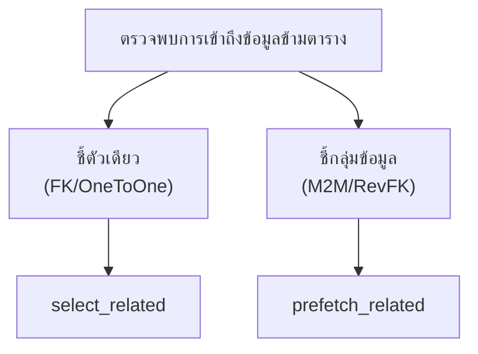

# Advanced Django ORM: Queries, Aggregation & Performance Optimization

> ที่มา: CN331 สัปดาห์ที่ 7 — Part 1 (Advanced Django ORM Queries & Aggregation) และ Part 2 (Database Performance & Query Optimization)
>
> เนื้อหาที่เกี่ยวข้อง: การป้องกัน Race Condition ระดับ Transaction ด้วย `select_for_update()` และการรวมคิวรีไว้ใน `selectors.py` → ดู [04-django-service-layer-and-transactions.md](04-django-service-layer-and-transactions.md)

---

## ทบทวนสถาปัตยกรรมข้อมูลหลัก (Core Case Study Models Recap)

```python
# Case Study Models Recap
class Department(models.Model):
    name = models.CharField(max_length=100)
    code = models.CharField(max_length=10, unique=True)

class Course(models.Model):
    title = models.CharField(max_length=200)
    code = models.CharField(max_length=10, unique=True)
    credits = models.PositiveIntegerField(default=3)
    max_capacity = models.PositiveIntegerField(default=40)
    department = models.ForeignKey(
        Department, on_delete=models.CASCADE, related_name="courses"
    )

class Enrollment(models.Model):
    student = models.ForeignKey(Student, on_delete=models.CASCADE, related_name="enrollments")
    course = models.ForeignKey(Course, on_delete=models.CASCADE, related_name="enrollments")
    grade = models.DecimalField(max_digits=3, decimal_places=2, null=True, blank=True)
```

**ความสัมพันธ์และความท้าทายในสัปดาห์นี้:**
- **One-to-Many**: `Department` → `Course` (วิชาสังกัดภาควิชา)
- **Many-to-Many via Enrollment**: นักศึกษาลงทะเบียนเรียนหลายวิชา และแต่ละวิชามีนักศึกษาหลายคน
- **คำถามเชิงธุรกิจที่ต้องตอบ**:
  - รายวิชาใดบ้างที่มีคนลงทะเบียนเต็มความจุ (`max_capacity`)?
  - จำนวนนักศึกษาเฉลี่ยต่อวิชาของภาควิชาคอมพิวเตอร์คือเท่าไร?
  - จะดึงรายชื่อวิชาพร้อมภาควิชาและรายชื่อนักศึกษาโดยไม่ให้เกิดการสืบค้น SQL นับร้อยครั้งได้อย่างไร?

> 🗄️ **Sprint Tracker Models** — โครงสร้างเสริมสำหรับโครงงาน: `Project` → `Sprint` → `Task` (`story_points`, `status`, `assignee`) ใช้สำหรับตัวอย่าง Dashboard และ Metrics

---

# PART 1: Advanced Django ORM Queries & Aggregation

*การสืบค้นข้อมูลขั้นสูง นิพจน์เชิงตรรกะ และการประมวลผลทางสถิติในระดับฐานข้อมูล*

## เบื้องหลังการทำงานของ Django QuerySet: แบบจำลองทางความคิด

**QuerySet คืออะไรในระดับสถาปัตยกรรม?**
- **Lazy Evaluation**: QuerySet เป็นตัวแทนของคำสั่ง SQL แต่**ยังไม่ส่งคำสั่งไปยังฐานข้อมูล**ในทันทีที่สร้าง
- **Query Construction Pipeline**: แต่ละครั้งที่เราเรียก `.filter()` หรือ `.exclude()` Django จะคืนค่า QuerySet ตัวใหม่ที่เพิ่มเงื่อนไข SQL (Chaining Pattern)
- **Execution on Demand**: SQL จะถูก Compile และส่งไปรันที่ Database เมื่อมีคำสั่งที่ต้องการข้อมูลจริงเท่านั้น

```
┌──────────────────────────────────┐
│        Python Execution          │
│  qs = Course.objects.filter(...) │
└────────────────┬─────────────────┘
                 │ เมื่อถูก Evaluate
                 ▼
┌──────────────────────────────────┐
│       Django SQL Compiler        │
│  แปลง Method Calls เป็น SQL WHERE │
└────────────────┬─────────────────┘
                 │ Execute SQL
                 ▼
┌──────────────────────────────────┐
│     Database Engine (RDBMS)      │
│  SELECT ... FROM ... WHERE ...   │
└──────────────────────────────────┘
```

> 💡 **Takeaway** — การเชื่อมต่อคำสั่ง (Method Chaining) เช่น `filter(...).exclude(...)` ไม่ได้ส่งคำสั่ง SQL ไปยังฐานข้อมูลหลายครั้ง แต่เป็นการประกอบคำสั่ง SQL เดียวที่สมบูรณ์ก่อนส่งไปประมวลผลเมื่อต้องการข้อมูลจริง

## เจาะลึก Field Lookups: เหนือกว่าการเปรียบเทียบค่าแบบธรรมดา

ใน Django ORM การเปรียบเทียบเงื่อนไขใน `.filter()` ไม่ได้ใช้เครื่องหมาย `==` หรือ `>` โดยตรง แต่ใช้ไวยากรณ์ `field__lookup`:

| Lookup Type | SQL Translation (โดยประมาณ) | คำอธิบาย & กรณีใช้งาน |
|---|---|---|
| `exact` / `iexact` | `WHERE title = '...'` / `ILIKE` | การจับคู่ตรงตัว (`iexact` ไม่สนใจตัวพิมพ์เล็ก-ใหญ่) |
| `contains` / `icontains` | `WHERE title LIKE '%...%'` | การค้นหาคำบางส่วนในข้อความ เช่น ค้นหาชื่อวิชา |
| `gt` / `gte` | `WHERE credits > 3` / `>= 3` | การเปรียบเทียบมากกว่า / มากกว่าหรือเท่ากับ |
| `lt` / `lte` | `WHERE max_capacity < 50` | การเปรียบเทียบน้อยกว่า / น้อยกว่าหรือเท่ากับ |
| `in` | `WHERE code IN ('CN331', ...)` | ตรวจสอบว่าค่าอยู่ในชุดข้อมูล (List, Tuple, หรือ QuerySet) |
| `startswith` / `endswith` | `WHERE code LIKE 'CN%'` | ค้นหาข้อความขึ้นต้นหรือลงท้ายด้วยชุดตัวอักษร |
| `range` | `WHERE credits BETWEEN 2 AND 4` | การระบุช่วงค่า (ตัวเลข หรือ วันที่/เวลา) |
| `isnull` | `WHERE grade IS NULL` / `NOT NULL` | ตรวจสอบค่าว่างในฐานข้อมูล (`isnull=True/False`) |

> 💡 **Best Practice ด้านประสิทธิภาพ** — ควรเลือกใช้ `startswith` หรือ `exact` เมื่อมี Database Index บนฟิลด์นั้น เพราะการใช้ `icontains` มักบังคับให้ฐานข้อมูลทำ Full Table Scan

## ตัวอย่างโค้ด: การประยุกต์ใช้ Field Lookups ในระบบลงทะเบียน

```python
# 1. Case-insensitive substring match
sw_courses = Course.objects.filter(
    title__icontains="software"
)

# 2. Filter: credits >= 3 and capacity <= 40
advanced_courses = Course.objects.filter(
    credits__gte=3,
    max_capacity__lte=40
)

# 3. Code starts with 'CN' and capacity between 20-50
cn_courses = Course.objects.filter(
    code__startswith="CN",
    max_capacity__range=(20, 50)
)

# 4. Find enrollments where grade is null
pending_grades = Enrollment.objects.filter(
    grade__isnull=True
)
```

**การรวมเงื่อนไขหลายชั้นแบบ AND:**
- เมื่อส่ง Parameters หลายตัวใน `.filter()` เช่น `filter(credits__gte=3, max_capacity__lte=40)` Django จะเชื่อมด้วย **AND** ใน SQL เสมอ
- **Chaining Filters**: การเขียนแยก:

  ```python
  qs = Course.objects.filter(credits__gte=3)
  qs = qs.filter(max_capacity__lte=40)
  ```

  ให้ผลลัพธ์เป็นคำสั่ง SQL เดียวกันทุกประการ
- **SQL Output**:

  ```sql
  SELECT * FROM course
  WHERE credits >= 3 AND max_capacity <= 40;
  ```

## การสืบค้นข้ามความสัมพันธ์ด้วย Double Underscore (`__`)

**Spanning Multi-Table Relationships:**
- หนึ่งในความสามารถที่ทรงพลังที่สุดของ Django ORM คือการกรองข้อมูลโดยอ้างอิงจากตารางที่มีความสัมพันธ์กัน
- ใช้สัญลักษณ์ `__` เพื่อเดินทางข้าม `ForeignKey`, `OneToOneField`, หรือ `ManyToManyField`
- Django จะวิเคราะห์ความสัมพันธ์และสร้าง SQL `JOIN` ให้โดยอัตโนมัติเบื้องหลัง

> ⚠️ **จุดที่ต้องระวัง** — อย่าสับสนระหว่าง `_` (Underscore เดี่ยวในชื่อฟิลด์) กับ `__` (Double Underscore ซึ่งเป็นตัวแยก Lookup/Relation ใน Django)

```python
# Find all courses belonging to CPE department
cpe_courses = Course.objects.filter(
    department__code="CPE"
)

# Generated SQL query:
# SELECT course.*
# FROM course
# INNER JOIN department
#   ON course.department_id = department.id
# WHERE department.code = 'CPE';

# Find students in CPE department via Enrollment
cpe_students = Student.objects.filter(
    enrollments__course__department__code="CPE"
).distinct()
```

## การสืบค้นข้ามความสัมพันธ์ย้อนกลับ (Reverse Lookups)

```python
# 1. From Department (Parent) to Course (Child)
# Departments offering 4-credit courses
depts_with_4cr = Department.objects.filter(
    courses__credits=4
).distinct()

# 2. Students who earned grade 4.00 in any course
top_students = Student.objects.filter(
    enrollments__grade=4.00
).distinct()

# 3. Courses enrolled by students with ID starting with 67
freshmen_courses = Course.objects.filter(
    enrollments__student__student_id__startswith="67"
).distinct()
```

**ทำไมต้องใช้ `.distinct()`?**
- เมื่อสืบค้นข้ามความสัมพันธ์แบบ One-to-Many หรือ Many-to-Many ผ่านคำสั่ง `JOIN` ผลลัพธ์อาจมีแถวของตารางหลักซ้ำกันหลายครั้ง (Duplicate Rows)
- ตัวอย่าง: ภาควิชา CPE มีวิชา 4 หน่วยกิต 3 วิชา → หากไม่ใส่ `.distinct()` วัตถุ Department ของ CPE จะโผล่มาใน QuerySet ถึง 3 ครั้ง!
- **กฎทอง**: เมื่อกรองข้ามความสัมพันธ์ย้อนกลับ (Reverse Relation) ที่เป็นแบบ To-Many ให้ใส่ `.distinct()` เสมอเพื่อป้องกันข้อมูลซ้ำ

## ข้อจำกัดของ `.filter()` ปกติ: ปัญหาตรรกะ OR และ NOT

> ❓ **โจทย์ทางธุรกิจ** — *"ต้องการค้นหารายวิชาที่สังกัดภาควิชา CPE **หรือ** เป็นรายวิชาที่มีหน่วยกิตเท่ากับ 4 **แต่ต้องไม่**เป็นวิชาที่ปิดรับการลงทะเบียน"*

**ข้อจำกัดของ Parameter ปกติ:**
- `Course.objects.filter(dept="CPE", credits=4)` → บังคับใช้ตรรกะ **AND** เท่านั้น
- ไม่สามารถเชื่อมสองเงื่อนไขด้วยตัวดำเนินการ **OR** ผ่าน Keyword Arguments ปกติได้
- คำสั่ง `.exclude()` ทำหน้าที่ NOT ได้ แต่ไม่สามารถจัดกลุ่มเงื่อนไขซับซ้อนด้วยวงเล็บ เช่น `(A OR B) AND (NOT C)` ได้

**ทางออก: `django.db.models.Q` Objects**
- `Q` คือคลาสที่ห่อหุ้มเงื่อนไข SQL ของ Django ORM
- รองรับการใช้ตัวดำเนินการระดับบิต (Bitwise Operators) เพื่อสร้างนิพจน์ตรรกะแบบผสมผสาน:
  - `|` แทนตรรกะ **OR**
  - `&` แทนตรรกะ **AND**
  - `~` แทนตรรกะ **NOT**
- ช่วยให้สร้างเงื่อนไขค้นหาที่มีโครงสร้างซับซ้อนและ Dynamic ได้อย่างแม่นยำ

## การประยุกต์ใช้ Q Objects: โค้ดและโครงสร้างตรรกะ

```python
from django.db.models import Q

# CPE department OR credits = 4
qs_or = Course.objects.filter(
    Q(department__code="CPE") | Q(credits=4)
)

# (CPE OR credits 4) AND (not full)
qs_complex = Course.objects.filter(
    (Q(department__code="CPE") | Q(credits=4)) &
    ~Q(max_capacity=0)
)

# Dynamic Search across multiple fields
search_term = "web"
qs_search = Course.objects.filter(
    Q(title__icontains=search_term) |
    Q(code__icontains=search_term) |
    Q(department__name__icontains=search_term)
).distinct()
```

**เบื้องหลังการแปลงเป็น SQL:**

```sql
-- SQL generated for qs_complex:
SELECT * FROM course
INNER JOIN department
  ON course.department_id = department.id
WHERE (department.code = 'CPE' OR course.credits = 4)
  AND NOT (course.max_capacity = 0);
```

> 💡 **Takeaway** — **Dynamic Query Construction**: เราสามารถเริ่มต้นจาก `query = Q()` เปล่า แล้ววนลูปเชื่อมต่อเงื่อนไข `query |= Q(...)` ตามตัวกรองที่ผู้ใช้เลือกบนหน้าเว็บได้อย่างยืดหยุ่น

## ปัญหา Race Conditions ในการอัปเดตข้อมูล (The Read-Modify-Write Trap)

**กับดักการอัปเดตข้อมูลใน Python Memory:**

```
Request 1 (User A): โหลด course (view_count=10)
Request 2 (User B): โหลด course (view_count=10)
Request 1 คำนวณ: 10 + 1 = 11
Request 2 คำนวณ: 10 + 1 = 11
บันทึกค่า 11 ทับกันในฐานข้อมูล!
ผลลัพธ์จริงควรเป็น 12 (Lost Update)
```

**✗ โค้ดที่ไม่ปลอดภัย (Race Condition)**

```python
course = Course.objects.get(id=1)
# Value fetched into Python memory (vulnerable)
course.view_count += 1
course.save()
```

**ทำไมสิ่งนี้จึงร้ายแรงใน Web Engineering?**
- เว็บเซิร์ฟเวอร์ (เช่น Gunicorn/Uvicorn) ทำงานแบบ Multi-Thread / Multi-Worker พร้อมกัน
- หากมีผู้ใช้เข้าดูรายวิชาหรือกดลงทะเบียนพร้อมกัน ข้อมูลจะถูกเขียนทับ ส่งผลให้ยอดนับสถิติหรือจำนวนที่นั่งเกิดความคลาดเคลื่อนทันที

## การแก้ปัญหาด้วย F Expressions: การดำเนินการระดับ Database Engine

```python
from django.db.models import F

# 1. Atomic update at database level (safe)
Course.objects.filter(id=1).update(
    view_count=F("view_count") + 1
)

# Generated SQL:
# UPDATE course SET view_count = view_count + 1
# WHERE id = 1;

# 2. Row-level comparison: enrolled >= capacity
# Find fully booked courses
full_courses = Course.objects.filter(
    enrolled_count__gte=F("max_capacity")
)

# 3. Update across field: increase capacity by 10%
Course.objects.update(
    max_capacity=F("max_capacity") * 1.1
)
```

**ข้อได้เปรียบทางวิศวกรรมของ F Expressions:**
- **Atomic Execution**: ฐานข้อมูลระดับ RDBMS มีกลไก Row-level Locking ทำให้การอัปเดต `view_count + 1` เป็น Atomic โดยสมบูรณ์ ไม่สูญหาย
- **Memory Efficiency**: ไม่จำเป็นต้องโหลด Model Instance ทั้งก้อนขึ้นมาบนหน่วยความจำของ Python
- **Network Efficiency**: ลดปริมาณข้อมูลที่ต้องส่งข้าม Network ระหว่าง Web App และ Database Server

> 💡 **Takeaway** — **กฎสำคัญ**: หากต้องการอัปเดตฟิลด์โดยอ้างอิงจากค่าเดิม หรือเปรียบเทียบค่าระหว่างสองคอลัมน์ในตารางเดียวกัน ให้ใช้ `F()` เสมอ

## การประมวลผลทางสถิติระดับตาราง: `aggregate()`

**ทำความเข้าใจ `aggregate()`:**
- คำสั่ง `.aggregate()` ใช้เพื่อประมวลผลข้อมูลสรุปภาพรวมของ**ทั้ง QuerySet**
- คืนค่ากลับมาเป็น **Python Dictionary** ทันที (ไม่ใช่ QuerySet อีกต่อไป เป็น Terminal Operation)
- ฟังก์ชันสถิติที่ใช้บ่อย: `Avg`, `Sum`, `Count`, `Min`, `Max` (จาก `django.db.models`)

```
┌───────────────────────┐
│    Course QuerySet    │
│  แถวที่ 1, 2, 3, ..., N │
└───────────┬───────────┘
            │ .aggregate()
            ▼
┌───────────────────────┐
│ Single Dictionary     │
│ {'avg_cred': 3.12,    │
│  'total': 45}         │
└───────────────────────┘
```

```python
from django.db.models import Avg, Sum, Count, Max, Min

# Whole-table summary dictionary
stats = Course.objects.aggregate(
    total_courses=Count("id"),
    average_credits=Avg("credits"),
    max_seats=Max("max_capacity"),
    total_seats=Sum("max_capacity")
)

# Result dictionary:
# {
#   'total_courses': 45,
#   'average_credits': 3.14,
#   'max_seats': 120,
#   'total_seats': 2250
# }

# Usage in View or Template:
avg_cr = stats["average_credits"]
```

## การจัดกลุ่มและเพิ่มแอตทริบิวต์รายแถว: `annotate()`

**ทำความเข้าใจ `annotate()`:**
- คำว่า "Annotate" แปลว่า *การจดบันทึก/เพิ่มคำอธิบายประกอบ*
- ใน Django ORM `.annotate()` ทำหน้าที่เสมือนคำสั่ง **`GROUP BY`** ใน SQL
- คำนวณค่าสถิติแนบเข้ากับ**แต่ละแถว (Each Object)** ใน QuerySet
- ผลลัพธ์ที่ได้ยังคงเป็น **QuerySet** ทำให้เราสามารถนำไป `.filter()` หรือ `.order_by()` ต่อได้

> 💡 **กรณีใช้งานที่พบบ่อย** — เช่น การนับจำนวนนักเรียนที่ลงทะเบียนในแต่ละวิชา, การนับจำนวน Task ที่เสร็จในแต่ละ Sprint, หรือยอดเกรดเฉลี่ยของนักเรียนแต่ละคน

```python
from django.db.models import Count, Avg

# Annotate each course with student_count
courses = Course.objects.annotate(
    student_count=Count("enrollments")
)

# Each instance now has .student_count attribute
for c in courses:
    print(f"{c.title}: {c.student_count} students")

# Filter on annotated value (like SQL HAVING)
popular_courses = Course.objects.annotate(
    student_count=Count("enrollments")
).filter(student_count__gt=30).order_by("-student_count")
```

## เปรียบเทียบความแตกต่างเชิงสถาปัตยกรรม: `aggregate()` vs `annotate()`

| มิติการเปรียบเทียบ | `aggregate()` | `annotate()` |
|---|---|---|
| **แนวคิดการทำงาน** | คำนวณสรุปค่าเดียวทั่วทั้งตาราง/QuerySet | คำนวณสรุปแยกตามรายแถวหรือกลุ่ม (`GROUP BY`) |
| **ผลลัพธ์ที่ส่งกลับ** | **Python Dictionary** ก้อนเดียว | **QuerySet** ที่มีฟิลด์จำลองเพิ่มในแต่ละ Object |
| **Chaining Pipeline** | **ไม่สามารถต่อคำสั่งได้** (Terminal Call) | **สามารถต่อคำสั่งได้** (`.filter()`, `.order_by()`) |
| **SQL เทียบเท่า** | `SELECT AVG(credits) FROM course;` | `SELECT course.*, COUNT(e.id) FROM ... GROUP BY course.id;` |
| **ตัวอย่างการใช้งาน** | แสดงค่าสถิติรวมบนแถบสรุปยอดบน Dashboard | แสดงตารางรายวิชาโดยมีคอลัมน์ "จำนวนคนสมัคร" ในแต่ละแถว |

> 💡 **Takeaway** — **เทคนิคการจำ**: `aggregate()` ยุบข้อมูลทั้งตารางเหลือ **1 Dictionary** สรุปยอด ส่วน `annotate()` คงจำนวนแถวไว้เท่าเดิมแต่เพิ่ม **Virtual Columns** ให้กับแต่ละแถว

## เทคนิคขั้นสูง: การทำ Conditional Annotation ด้วย `filter=Q(...)`

```python
from django.db.models import Count, Q

# Conditional count: grade >= 3.00 vs < 2.00
courses = Course.objects.annotate(
    honors_count=Count(
        "enrollments",
        filter=Q(enrollments__grade__gte=3.00)
    ),
    failing_count=Count(
        "enrollments",
        filter=Q(enrollments__grade__lt=2.00)
    )
)

# Instructor dashboard usage:
for c in courses:
    print(f"{c.code}: honors={c.honors_count}, at_risk={c.failing_count}")
```

**ทำไมวิธีนี้จึงมีประสิทธิภาพสูงสุด?:**
- **SQL FILTER Clause**: Django แปลง `Count(..., filter=Q(...))` เป็นคำสั่ง SQL สมัยใหม่:

  ```sql
  COUNT(e.id) FILTER (WHERE e.grade >= 3.00)
  -- or CASE WHEN on older engines
  ```
- **Single Database Round-trip**: ดึงข้อมูลทั้งยอดดีเด่นและยอดวิกฤตได้ในคำสั่ง SQL เดียวจบ
- ป้องกันการเขียน Python loop เพื่อวนนับเอง ซึ่งทำให้ประสิทธิภาพตกอย่างมหาศาล

## QUICK CHECK

- การทำงานของ Q Objects และ F Expressions *(สไลด์ไม่มีเนื้อหาคำถาม)*
- การเลือกใช้ระหว่าง `aggregate()` และ `annotate()` *(สไลด์ไม่มีเนื้อหาคำถาม)*

## สรุปสาระสำคัญ Part 1: กฎทองของการเขียน Advanced ORM

**✅ ข้อควรปฏิบัติ (Best Practices)**
1. **Push to Database**: มอบหมายงานคำนวณ สรุปผล กรอง และเรียงลำดับให้ Database Engine ทำเสมอ
2. **Use `Q` for Flexibility**: ห่อหุ้มเงื่อนไขค้นหาด้วย `Q` เมื่อต้องการตรรกะ OR หรือสร้าง Dynamic Search
3. **Use `F` for Concurrency**: หลีกเลี่ยง Read-Modify-Write trap ด้วยการใช้ `F()` ป้องกัน Race Conditions
4. **Annotate, Don't Loop**: เมื่อต้องการแสดงผลสถิติรายแถว ให้ใช้ `annotate()` แทนการเขียนลูปคำนวณใน Python

**❌ ข้อผิดพลาดที่พบบ่อย (Antipatterns)**
1. ดึงข้อมูลทั้งหมดด้วย `.all()` แล้วใช้ `len()` หรือคำนวณยอดรวมใน Python
2. ลืมใส่ `.distinct()` เมื่อใช้ Filter ข้ามความสัมพันธ์แบบ Many-to-Many
3. ใช้ `aggregate()` ผิดที่ จนผลลัพธ์ยุบเหลือ Dictionary ค่าเดียวแทนที่จะเป็นรายการ
4. ลืมไปว่า QuerySet มีคุณสมบัติ Lazy Evaluation

> 💡 **Takeaway** — **Engineering Mindset**: โค้ด Backend ที่ดีที่สุดไม่ใช่โค้ดที่รันฟังก์ชันใน Python ได้เร็วที่สุด แต่เป็นโค้ดที่สั่งการ Database ได้อย่างกระชับและส่งคำสั่งที่มีประสิทธิภาพสูงสุด

---

# PART 2: Database Performance & Query Optimization

*กลไก Lazy Evaluation, ปัญหา N+1 Queries และเทคนิค select_related vs prefetch_related*

## ความเข้าใจผิดเกี่ยวกับ ORM: "Django จัดการเรื่องประสิทธิภาพให้อัตโนมัติ"

**💣 ภาพลวงตาของความสะดวกสบาย (The ORM Illusion)**
- Django ORM ออกแบบมาให้อ่านเข้าใจง่ายคล้ายภาษาอังกฤษ จนทำให้นักพัฒนาลืมไปว่า**ทุกการเข้าถึงฟิลด์เชื่อมโยงอาจหมายถึงการส่งคำสั่งข้าม Network ไปยังฐานข้อมูล**
- บนเครื่องทดสอบ (Local Development) มีข้อมูลเพียงไม่กี่แถว การตอบสนองของระบบจึงดูรวดเร็วเสมือนไม่มีปัญหาใดๆ
- แต่บน Production เมื่อมีข้อมูล 10,000 แถว และมีผู้ใช้งานพร้อมกัน 500 คน ระบบจะล่มทันทีเนื่องจาก Database Connection เต็ม!

**ทำไมวิศวกรซอฟต์แวร์ต้องเข้าใจ Query Optimization?**
- **Network Latency**: เวลาที่สูญเสียไปกับการส่งคำสั่งไป-กลับข้ามระบบเครือข่าย (Round-trip Time: RTT) มีต้นทุนสูงกว่าการประมวลผลบน CPU เสมอ
- **Database Scalability**: RDBMS (PostgreSQL, MySQL) ขยายตัวในแนวราบ (Horizontal Scaling) ได้ยากกว่า Web Servers
- การลดจำนวน Query จาก 101 คำสั่งเหลือ 1 คำสั่ง ช่วยลดเวลาโหลดหน้าเว็บจาก 2,500ms เหลือเพียง 80ms!

## วงจรชีวิตของ QuerySet: อะไรเป็นตัวกระตุ้น (Evaluation Triggers)?

**เหตุการณ์ที่ไม่ทำให้เกิด SQL (Lazy):**
- การสร้าง QuerySet: `qs = Course.objects.filter(credits=3)`
- การสั่ง Filter หรือ Chaining ต่อ: `qs = qs.exclude(max_capacity=0)`
- การเรียงลำดับ: `qs = qs.order_by("title")`
- การส่งผ่านตัวแปร `qs` ข้ามฟังก์ชัน

> ✔️ **หลักการ Lazy** — บรรทัดข้างต้นไม่มีการเชื่อมต่อกับ Database เลยแม้แต่น้อย เป็นเพียงการกำหนดคุณลักษณะของ Query เท่านั้น

**เหตุการณ์ที่กระตุ้นให้เกิด SQL ทันที (Evaluation):**
1. **Iteration**: การวนลูป `for c in qs:`
2. **Type Casting**: การแปลงชนิดข้อมูล `list(qs)`, `tuple(qs)`
3. **Slicing พร้อมระบุ Step**: `qs[0:10:2]` (ถ้าไม่ระบุ step จะยังคง lazy)
4. **Boolean Checking**: การตรวจสอบค่าความจริง `if qs:`
5. **Serialization**: การแปลงเป็น JSON หรือส่งไป Render ใน Template ด้วย ``
6. **Terminal Methods**: `.count()`, `.exists()`, `.first()`, `.aggregate()`

## กลไก QuerySet Caching: จุดได้เปรียบและจุดควรระวัง

```python
# Case 1: 2 SQL queries executed (no cache reuse)
print(Course.objects.filter(credits=3).count())   # SQL 1: SELECT COUNT
for c in Course.objects.filter(credits=3):        # SQL 2: SELECT *
    print(c.title)

# Case 2: Only 1 SQL query executed (cache reused)
courses = Course.objects.filter(credits=3)
course_list = list(courses)  # Evaluates query and populates cache
print(len(course_list))      # Reads from cache (0 extra SQL!)
for c in course_list:        # Reads from cache (0 extra SQL!)
    print(c.title)

# Best Practices: When to use which?
Course.objects.filter(credits=3).count()   # Count only (No objects loaded)
len(course_list)                           # Count when already cached
Course.objects.filter(credits=3).exists()  # Existence check (No objects)
```

**ทำความเข้าใจ Query Cache:**
- เมื่อ QuerySet ถูก Evaluate ครั้งแรก Django จะบันทึก Model Instances ไว้ในหน่วยความจำ (`_result_cache`)
- หากวนลูปซ้ำบนตัวแปรเดิม Django จะดึงจาก Cache โดยไม่ส่ง SQL ซ้ำ
- **หลักการเลือกใช้คำสั่งให้เหมาะสม**:
  - **`.count()`**: ยิง `SELECT COUNT(*)` เสมอ (ไม่ใช้ Cache) เหมาะเมื่อต้องการเฉพาะตัวเลขยอดรวม
  - **`len(qs)`**: นับจาก Cache ในหน่วยความจำ ไม่เสียเวลาเชื่อมต่อฐานข้อมูลซ้ำ
  - **`.exists()`**: ตรวจสอบความมีอยู่โดยไม่โหลด Model Instances (หลีกเลี่ยงการใช้ `if qs:` เพราะจะโหลดทั้งตาราง)

## ผ่าโครงสร้างปัญหาคลาสสิก: The N+1 Query Problem

**นิยามของปัญหา N+1 Queries:**
- เกิดขึ้นเมื่อระบบส่งคำสั่ง SQL **1 ครั้ง**เพื่อดึงรายการหลัก (Parent Records จำนวน *N* แถว)
- จากนั้นในระหว่างการประมวลผลหรือวนลูปแสดงผล ระบบส่งคำสั่ง SQL เพิ่มอีก ***N* ครั้ง**เพื่อดึงข้อมูลที่เกี่ยวข้องของแต่ละแถว
- **จำนวนคำสั่งทั้งหมด**: 1 + *N* ครั้ง!
- หาก *N* = 100 แถว ระบบจะส่งคำสั่งไปยังฐานข้อมูลถึง **101 ครั้ง** สำหรับการแสดงผลหน้าเว็บเพียงหน้าเดียว!

```
Query 1 (ดึง Courses ทั้งหมด): SELECT * FROM course;   → ได้ผลลัพธ์ 50 วิชา
  ├─ Query 2:  SELECT * FROM dept WHERE id=1;
  ├─ Query 3:  SELECT * FROM dept WHERE id=2;
  ├─ ... อีก 48 Queries ...
  └─ Query 51: SELECT * FROM dept WHERE id=1;
```

## การตรวจจับโค้ดที่มีปัญหา N+1 ใน Django

```python
# views.py
def course_list_view(request):
    # Query 1: SELECT * FROM course;
    courses = Course.objects.all()
    return render(request, "courses.html", {"courses": courses})
```

```html
<!-- courses.html (Template) -->
<ul>
  
    <!-- Each course.department access triggers a new SQL query! -->
    <!-- N+1 Query Problem in action -->
    <li>{{ course.title }} - {{ course.department.name }}</li>
  
</ul>
```

**ทำไมสิ่งนี้จึงเกิดขึ้นโดยที่เราไม่รู้ตัว?**
- ตัวแปร `courses` ในตอนแรกเก็บเฉพาะข้อมูลในตาราง `Course` (รวมถึงฟิลด์ `department_id`)
- แต่ในตาราง `Course` **ไม่มีชื่อภาควิชา** (`name`) อยู่
- เมื่อ Django Template Engine ประมวลผลแท็ก `{{ course.department.name }}` ระบบจะตรวจสอบพบว่ายังไม่มีอ็อบเจกต์ `department` ในหน่วยความจำ จึงส่งคำสั่ง `SELECT * FROM department WHERE id = ...` ไปยังฐานข้อมูลใหม่ในทุกๆ รอบของลูป!

## เครื่องมือตรวจสอบประสิทธิภาพ: Django Debug Toolbar

**การติดตั้งและประโยชน์ของ Django Debug Toolbar:**
- เป็นเครื่องมือมาตรฐานระดับอุตสาหกรรมสำหรับนักพัฒนา Django
- แสดงแถบด้านข้างบนเบราว์เซอร์ แสดงรายละเอียด:
  - **SQL Panel**: จำนวนคำสั่ง SQL ทั้งหมด, เวลาที่ใช้, มีคำสั่งซ้ำซ้อนหรือไม่ (Duplicate Queries)
  - **Time Panel**: วิเคราะห์ว่าเวลาหมดไปกับ CPU หรือ Database
  - **Templates Panel**: แม่แบบใดถูกเรนเดอร์และใช้ Context อะไรบ้าง

```python
# Inspect query count in tests or debug shell
from django.db import connection, reset_queries

reset_queries()
# Execute code under test
courses = list(Course.objects.all())
for c in courses:
    _ = c.department.name

print(f"Total queries executed: {len(connection.queries)}")
# Print all executed SQL statements
for q in connection.queries:
    print(q["sql"])
```

> ❗ **คำเตือน** — `connection.queries` จะบันทึกคำสั่งก็ต่อเมื่อ `DEBUG = True` ใน `settings.py` เท่านั้น

## ทางออกที่ 1: `select_related()` สำหรับ Foreign Key แบบ Single-Object

```python
# views.py: Solve N+1 using select_related
def course_list_optimized(request):
    # Executes single SQL query with JOIN
    courses = Course.objects.select_related("department").all()
    return render(request, "courses.html", {"courses": courses})
```

**SQL ที่ Django สร้างขึ้นเบื้องหลัง:**

```sql
SELECT
    course.id, course.title, course.code, course.credits,
    course.max_capacity, course.department_id,
    department.id, department.name, department.code
FROM course
INNER JOIN department
  ON (course.department_id = department.id);
```

**หลักการทำงานของ `select_related()`:**
- ใช้กลไกการทำ **SQL JOIN** (โดยทั่วไปคือ `INNER JOIN` หรือ `LEFT OUTER JOIN`)
- ดึงข้อมูลของทั้งสองตารางมาพร้อมกันตั้งแต่คำสั่งแรก
- สร้าง Model Instance ของทั้ง `Course` และ `Department` ขึ้นมาผูกกันในหน่วยความจำทันที
- **ใช้ได้กับความสัมพันธ์แบบ Single-Valued เท่านั้น**:
  - `ForeignKey` (แบบชี้ไปหา Parent)
  - `OneToOneField`
- ✗ **ไม่สามารถใช้กับ `ManyToManyField` หรือ Reverse ForeignKey ได้**

## ทางออกที่ 2: `prefetch_related()` สำหรับความสัมพันธ์แบบ Many

```python
# Fetch courses with reverse FK enrollments
courses = Course.objects.prefetch_related("enrollments").all()

for c in courses:
    # Zero extra SQL queries! Prefetched in memory
    for e in c.enrollments.all():
        print(e.student_id)
```

**SQL ที่ Django สร้างขึ้น (2 Queries อิสระ):**

```sql
-- Query 1: Fetch all courses
SELECT * FROM course;

-- Query 2: Fetch enrollments for all courses in batch
SELECT * FROM enrollment
WHERE course_id IN (1, 2, 3, 4, ...);
```

**หลักการทำงานของ `prefetch_related()`:**
- ไม่ใช้ SQL JOIN เพื่อป้องกันข้อมูลบวมซ้ำซ้อนมหาศาล (Cartesian Explosion) จากการเชื่อมโยงข้อมูลแบบ Many-to-Many
- ใช้วิธีส่งคำสั่ง SQL แยกกัน 2 ชุดอย่างชาญฉลาด โดยนำ ID ของตารางหลักไปสืบค้นด้วย `WHERE ... IN (...)`
- จากนั้น Django จะทำหน้าที่จับคู่อ็อบเจกต์เข้าด้วยกันในหน่วยความจำของ Python โดยอัตโนมัติ
- **ใช้สำหรับ**:
  - `ManyToManyField`
  - Reverse `ForeignKey` (เช่น จาก `Course` ไปหาลูกๆ ใน `enrollments`)

## ตารางเปรียบเทียบเชิงลึก: `select_related` vs `prefetch_related`

| คุณลักษณะ | `select_related()` | `prefetch_related()` |
|---|---|---|
| **กลไกในระดับ SQL** | **SQL JOIN** (`INNER` หรือ `LEFT OUTER`) | **Separate SQL Queries** ด้วยเงื่อนไข `IN (...)` |
| **จำนวน Query ที่เกิดขึ้น** | **1 Query ถ้วน** เสมอ | **1 + K Queries** (K คือจำนวนความสัมพันธ์) |
| **ชนิดความสัมพันธ์ที่รองรับ** | **Single-valued** (`ForeignKey`, `OneToOne`) | **Multi-valued** (`ManyToMany`, Reverse FK) |
| **จุดที่ข้อมูลถูกเชื่อมโยง** | ในระดับ **Database Engine** (ผ่าน JOIN) | ในระดับ **Python Process Memory** |
| **ตัวอย่างการใช้งาน** | `.select_related("department")` | `.prefetch_related("enrollments")` |

> 💡 **Takeaway** — **หลักการตัดสินใจ**: *"ความสัมพันธ์ชี้ไปยังเป้าหมายเดียว (Single) ให้ใช้ `select_related`, ชี้ไปยังกลุ่มข้อมูล (Many) ให้ใช้ `prefetch_related`"*

## การผสานพลัง: Chaining Multi-Hop Pre-fetching

```python
# Multi-hop relations to prefetch:
# Course -> Department (FK)
# Course -> Enrollments -> Student -> User

optimized_courses = Course.objects.select_related(
    "department"
).prefetch_related(
    "enrollments__student__user"
).all()

# Loop through optimized objects:
for c in optimized_courses:
    # Zero extra queries in template loop
    dept = c.department.name
    for e in c.enrollments.all():
        username = e.student.user.username
```

**การวิเคราะห์ประสิทธิภาพ:**
- หากเขียนแบบไม่ Optimize สำหรับ 50 รายวิชาที่มีการลงทะเบียน 200 รายการ จะเกิดคำสั่ง SQL มากกว่า **450 ครั้ง!**
- แต่เมื่อใช้การ Chaining ร่วมกัน:
  - **Query 1**: ดึง `Course` JOIN `Department`
  - **Query 2**: ดึง `Enrollment` JOIN `Student` JOIN `User` ของทุกรายวิชาที่พบ
- **จำนวน Query ทั้งหมดเหลือเพียง 2 ครั้งถ้วน!**
- ความเร็วของระบบเพิ่มขึ้นหลายสิบเท่าตัว

## การจำกัดคอลัมน์เพื่อความเบาของหน่วยความจำ: `only()`, `defer()` และ `values()`

```python
# 1. only(): Select specific columns only
courses = Course.objects.only("id", "title")
# SQL: SELECT id, title FROM course;

# 2. defer(): Exclude heavy columns
courses = Course.objects.defer("syllabus_pdf", "description")

# 3. values() & values_list(): Skip model instantiation
# Returns dicts (fastest)
course_data = Course.objects.filter(credits=3).values("id", "title")
# [{'id': 1, 'title': 'Software Eng'}, ...]

# Returns flat list of strings
course_titles = Course.objects.values_list("title", flat=True)
# ['Software Eng', 'Database Systems', ...]
```

**ทำไมต้องข้าม Model Instance?**
- การสร้าง Python Object สำหรับแต่ละแถวมี Overhead ด้าน CPU และ Memory สูง
- หากเราต้องการข้อมูลเพื่อส่งออกเป็น JSON API หรือ Dropdown List ตัวเลือก การใช้ `values()` หรือ `values_list()` จะเร็วกว่าการดึง Model ปกติ 3–5 เท่า
- ✗ **ข้อควรระวัง**: หากเรียกฟิลด์ที่ถูก `defer()` ไว้ในภายหลัง Django จะแอบยิง SQL ไปดึงฟิลด์นั้นรายตัวทันที

## QUICK CHECK

- การเลือกใช้วิธีเพิ่มประสิทธิภาพคิวรี *(สไลด์ไม่มีเนื้อหาคำถาม)*
- การวิเคราะห์วงจรชีวิตของ Lazy QuerySet *(สไลด์ไม่มีเนื้อหาคำถาม)*

## สรุปสาระสำคัญ Part 2: เช็คลิสต์ตรวจสอบความเร็วระบบฐานข้อมูล

**📋 Production Readiness Checklist**
1. **No N+1 in Loops**: ตรวจสอบทุก Template ที่มีลูป `` ว่ามีการเข้าถึงฟิลด์ข้ามโมเดลหรือไม่
2. **Pairing Relationships**:
   - FK / OneToOne → `select_related()`
   - M2M / Reverse FK → `prefetch_related()`
3. **Profile with Toolbar**: ติดตั้ง Django Debug Toolbar และสังเกตแท็บ SQL เสมอในขณะพัฒนา
4. **Use `.exists()` & `.count()`**: ไม่ใช้ `if len(qs) > 0` เพื่อตรวจสอบว่ามีข้อมูลหรือไม่


