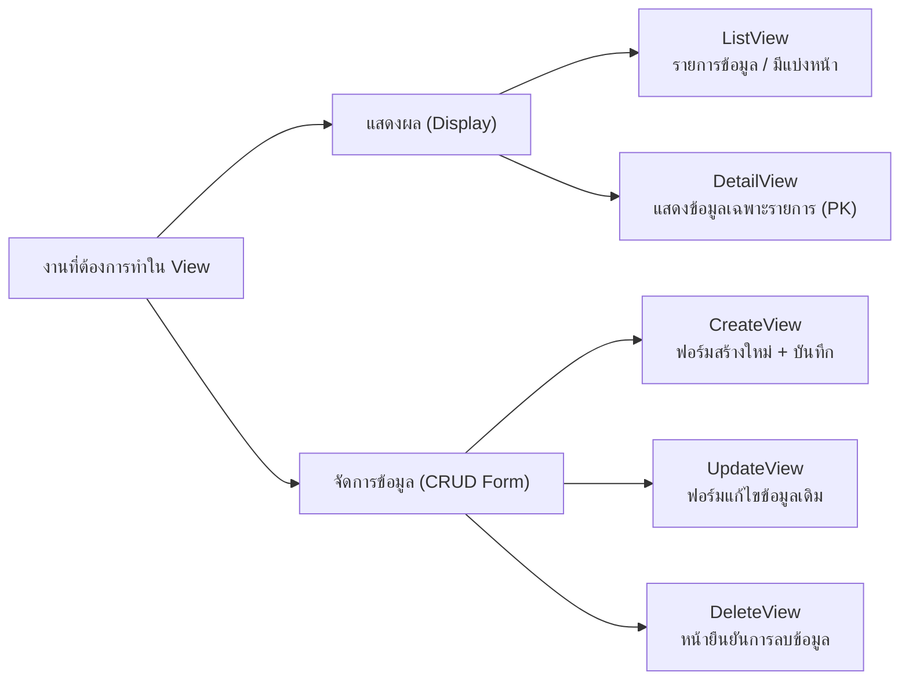

# Class-Based Views & Generic Views

> ที่มา: CN331 สัปดาห์ที่ 7 — Part 3 (Class-Based Views & Generic Views)
>
> *สถาปัตยกรรมวิวเชิงวัตถุ, Generic CRUD Views และการสืบทอดด้วย Mixins*
>
> เนื้อหาที่เกี่ยวข้อง: การทำให้ View บาง (Skinny Views) ด้วย Service Layer → ดู [04-django-service-layer-and-transactions.md](04-django-service-layer-and-transactions.md)

---

## การเปลี่ยนกระบวนทัศน์: Function-Based Views (FBV) สู่ Class-Based Views (CBV)

**Function-Based Views (FBVs):**
- เป็นรูปแบบที่เข้าใจง่าย ตรงไปตรงมา (Procedural Flow)
- รับ `request` เข้ามา แยกแยะเงื่อนไข `if request.method == "POST":` แล้วคืนค่า `HttpResponse`
- ✗ **ข้อเสีย**: เมื่อระบบมีขนาดใหญ่ จะพบว่าโค้ดแสดงรายการ (List), แสดงรายละเอียด (Detail), และจัดการฟอร์ม (CRUD) ถูกเขียนซ้ำซาก ขัดแย้งกับหลัก DRY

**Class-Based Views (CBVs):**
- ยกระดับการจัดการวิวด้วยการออกแบบเชิงวัตถุ (**Object-Oriented Programming**)
- แยกแยะ HTTP Methods (`GET`, `POST`, `PUT`) ออกเป็นแต่ละเมธอดในคลาส ไม่ต้องเขียน `if-else`
- ใช้การสืบทอดคุณสมบัติ (**Inheritance**) และ **Mixins** เพื่อนำโค้ดกลับมาใช้ซ้ำได้อย่างสง่างาม

> 💡 **Takeaway** — ทั้ง FBV และ CBV ไม่ได้มาแทนที่กันอย่างสมบูรณ์แบบ วิศวกรซอฟต์แวร์ต้องเลือกใช้ให้ตรงกับบริบทของปัญหา

## ตารางเปรียบเทียบการตัดสินใจทางวิศวกรรม: FBV vs CBV

| มิติการตัดสินใจ | Function-Based Views (FBVs) | Class-Based Views (CBVs) |
|---|---|---|
| **กระบวนทัศน์ (Paradigm)** | Procedural, Linear Code Flow | Object-Oriented, Declarative |
| **ความง่ายในการอ่านโค้ด** | โค้ดทั้งหมดอยู่ในฟังก์ชันเดียว อ่านจากบนลงล่างได้ทันที | ต้องเข้าใจ Hierarchy การสืบทอดของ Django Base Classes |
| **การนำกลับมาใช้ซ้ำ (DRY)** | ทำซ้ำได้ยาก ต้องพึ่งพา Decorator และ Helper functions | นำกลับมาใช้ซ้ำได้สูงมากผ่าน Class Inheritance และ Mixins |
| **การจัดการ HTTP Methods** | ใช้เงื่อนไข `if request.method == "POST":` | แยกเมธอด `get()`, `post()`, `delete()` อัตโนมัติ |
| **กรณีการใช้งานที่เหมาะสม** | งานเฉพาะทางที่มีตรรกะซับซ้อน (Custom One-Off flows) | งานจัดการข้อมูลพื้นฐานแบบ CRUD มาตรฐาน (90% ของเว็บทั่วไป) |

## รากฐานของ CBV: คลาสพื้นฐาน `View` และการแมป URL

```python
# views.py
from django.views import View
from django.http import HttpResponse

class CourseDashboardView(View):
    def get(self, request):
        # Handles HTTP GET request
        return HttpResponse("Dashboard Overview")

    def post(self, request):
        # Handles HTTP POST request
        return HttpResponse("Process Dashboard Action")
```

**การแมปใน `urls.py`:**

```python
from django.urls import path
from .views import CourseDashboardView

urlpatterns = [
    # Always call .as_view() for CBVs
    path("dashboard/", CourseDashboardView.as_view(), name="dashboard"),
]
```

**เบื้องหลังกลไก `.as_view()`:**
- Django URL dispatcher ถูกสร้างขึ้นมาเพื่อรับตัวแปรชนิดฟังก์ชัน (Callable Function)
- เมธอด `.as_view()` ทำหน้าที่สร้าง Instance ของคลาสขึ้นมา และคืนค่ากลับไปเป็นฟังก์ชัน Handler
- ภายใน `as_view()` จะมีเมธอด `dispatch()` ซึ่งทำหน้าที่ตรวจสอบชนิดคำขอ (HTTP Method) แล้วส่งต่อไปยังเมธอด `get()`, `post()` ที่ตรงกัน
- หากมีคำขอที่ไม่ได้นิยามไว้ (เช่น `PUT`) Django จะตอบกลับเป็น `405 Method Not Allowed` ให้อัตโนมัติ

## วิวแสดงข้อมูลทั่วไป: `TemplateView`

```python
# views.py
from django.views.generic import TemplateView

class AboutUsView(TemplateView):
    template_name = "about.html"

    def get_context_data(self, **kwargs):
        # Inject extra context variables
        context = super().get_context_data(**kwargs)
        context["semester"] = "1/2569"
        context["instructor"] = "Aj. Jack"
        return context
```

**หรือประกาศตรงๆ ใน `urls.py`:**

```python
path("about/", TemplateView.as_view(template_name="about.html")),
```

**ทำความรู้จัก Generic Display Views:**
- Django มีคลาสสำเร็จรูป (**Generic Class-Based Views**) ที่ครอบคลุมรูปแบบงานที่วิศวกรต้องทำซ้ำๆ
- `TemplateView`: เหมาะสำหรับหน้าเว็บที่มีเนื้อหาคงที่หรือต้องการแค่เรนเดอร์ Template พร้อมบริบทเล็กน้อย (เช่น หน้า About, FAQ, Contact)
- ไม่จำเป็นต้องเขียนฟังก์ชัน `render(request, "about.html", context)` เองอีกต่อไป

## วิวแสดงรายการข้อมูล: `ListView`

```python
from django.views.generic import ListView
from .models import Course

class CourseListView(ListView):
    model = Course
    template_name = "courses/course_list.html"
    context_object_name = "courses"  # Default is object_list
    paginate_by = 10                 # Automatic pagination!
    ordering = ["-credits", "title"]

    def get_queryset(self):
        # Optimized query with select_related
        return Course.objects.select_related("department").filter(
            credits__gte=1
        )
```

**พลังมหัศจรรย์ของ `ListView`:**
- **Convention over Configuration**: หากไม่ระบุ `template_name` Django จะมองหาไฟล์ `<app_label>/<model>_list.html` ให้เอง
- **Pagination out-of-the-box**: เพียงระบุ `paginate_by = 10` Django จะแบ่งหน้าให้อัตโนมัติ และส่งตัวแปร `page_obj` ไปยัง Template
- **`get_queryset()`**: เมธอดสำคัญสำหรับวิศวกรซอฟต์แวร์ในการนำเทคนิค `select_related` หรือการกรองตามเงื่อนไขมาเชื่อมต่อ

## วิวแสดงรายละเอียดเฉพาะรายการ: `DetailView`

```python
from django.views.generic import DetailView
from .models import Course

class CourseDetailView(DetailView):
    model = Course
    template_name = "courses/course_detail.html"
    context_object_name = "course"  # Default is object
    pk_url_kwarg = "pk"             # URL parameter name for PK

    def get_queryset(self):
        # Prefetch related data for detail page
        return Course.objects.select_related("department").prefetch_related(
            "enrollments__student__user"
        )
```

**การกำหนดใน `urls.py`:**

```python
# URL route pattern with pk parameter
path("courses/<int:pk>/", CourseDetailView.as_view(), name="course_detail"),
```

**กลไกการทำงานของ `DetailView`:**
- ดึงค่า `pk` จาก URL แล้วเรียกคำสั่ง `get(pk=pk)` ให้โดยอัตโนมัติ
- **Built-in 404 Handling**: หากไม่พบข้อมูลที่มี ID ตรงกัน ระบบจะสร้างข้อผิดพลาด `Http404` ให้โดยอัตโนมัติ โดยไม่เกิด Unhandled Exception ที่ทำให้เซิร์ฟเวอร์ขัดข้อง
- สามารถเปลี่ยนชื่อตัวแปรที่ใช้รับค่าใน URL ได้ผ่านแอตทริบิวต์ `pk_url_kwarg`

## การส่งข้อมูลเสริมไปยังเทมเพลต: โอเวอร์ไรด์ `get_context_data()`

```python
from django.db.models import Avg, Count

class CourseDetailView(DetailView):
    model = Course
    template_name = "courses/course_detail.html"

    def get_context_data(self, **kwargs):
        # 1. Call parent method to get base context
        context = super().get_context_data(**kwargs)

        # 2. Compute additional dashboard statistics
        current_course = self.object
        context["enrollment_count"] = current_course.enrollments.count()
        context["avg_grade"] = current_course.enrollments.aggregate(
            avg=Avg("grade")
        )["avg"]

        # 3. Return enriched context dictionary
        return context
```

**ทำความเข้าใจข้อแตกต่างสำคัญ:**
- **`get_queryset()`**: มีหน้าที่รับผิดชอบ**การดึงและกรองวัตถุหลัก**ของ View นั้นๆ (เช่น กรองวิชาที่เปิดสอน)
- **`get_context_data()`**: มีหน้าที่รับผิดชอบ**การเตรียมตัวแปรเสริม**เพื่อส่งต่อให้ Template นำไปแสดงผล (เช่น สถิติเพิ่มเติม, ข้อมูลผู้ใช้)
- **กฎสำคัญ**: ต้องเรียก `super().get_context_data(**kwargs)` เสมอ ไม่เช่นนั้นตัวแปรหลัก (เช่น `course` หรือ `courses`) จะสูญหายไปจากเทมเพลต

## วิวสร้างข้อมูลใหม่: `CreateView`

```python
from django.views.generic.edit import CreateView
from django.urls import reverse_lazy
from .models import Course

class CourseCreateView(CreateView):
    model = Course
    fields = ["title", "code", "credits", "max_capacity", "department"]
    template_name = "courses/course_form.html"
    success_url = reverse_lazy("course_list")

    def form_valid(self, form):
        # Validate and save model instance
        # Attach current user as creator
        form.instance.created_by = self.request.user
        return super().form_valid(form)
```

**ทำไมต้องใช้ `reverse_lazy()`?**
- เมื่อกำหนดแอตทริบิวต์ระดับคลาส (Class-level attribute) ไพทอนจะประมวลผลคำสั่งตั้งแต่ช่วงโหลดโมดูล (Module Loading Time)
- ในขณะนั้น URL Patterns ของโปรเจกต์อาจยังไม่ถูกลงทะเบียนเสร็จสมบูรณ์
- การใช้ `reverse()` แบบปกติจึงอาจทำให้เกิดข้อผิดพลาด `NoReverseMatch`
- **`reverse_lazy()`** ช่วยหน่วงเวลาการค้นหา URL ออกไป จนกว่าจะมีการใช้งานจริงหลังจากบันทึกข้อมูลสำเร็จ

## วิวแก้ไขและลบข้อมูล: `UpdateView` และ `DeleteView`

```python
from django.views.generic.edit import UpdateView, DeleteView
from django.urls import reverse_lazy
from .models import Course

class CourseUpdateView(UpdateView):
    model = Course
    fields = ["title", "credits", "max_capacity"]
    template_name = "courses/course_form.html"
    success_url = reverse_lazy("course_list")

class CourseDeleteView(DeleteView):
    model = Course
    template_name = "courses/course_confirm_delete.html"
    success_url = reverse_lazy("course_list")
```

**การใช้ประโยชน์จากแม่แบบร่วมกัน:**
- สังเกตว่าทั้ง `CreateView` และ `UpdateView` สามารถใช้เทมเพลตเดียวกันได้คือ `course_form.html`
- ในกรณีของ `UpdateView` ฟอร์มจะถูกเติมค่าเดิมของวัตถุที่มี `pk` ตรงกันมาให้อัตโนมัติ (Pre-populated)
- ในกรณีของ `DeleteView` เมื่อได้รับคำขอ GET จะแสดงหน้ายืนยันการลบ และเมื่อกดยืนยัน (POST) จะลบวัตถุออกจากฐานข้อมูลและ Redirect ไปยัง `success_url`

## การควบคุมความปลอดภัยด้วย Mixins: `LoginRequiredMixin`

```python
from django.contrib.auth.mixins import LoginRequiredMixin, UserPassesTestMixin
from django.views.generic import CreateView
from .models import Course

# Mixin must be on the leftmost position!
class SecureCourseCreateView(LoginRequiredMixin, CreateView):
    model = Course
    fields = ["title", "code", "credits", "department"]
    template_name = "courses/course_form.html"
    # Redirect target for unauthenticated users
    login_url = "/accounts/login/"
    redirect_field_name = "next"
```

**Mixin คืออะไรในกระบวนทัศน์ OOP?:**
- Mixin คือคลาสเสริมขนาดเล็กที่ไม่ได้ออกแบบมาให้ทำงานเดี่ยวๆ แต่ถูกสร้างขึ้นเพื่อ "ผสมผสาน" ความสามารถเฉพาะเรื่องเข้ากับคลาสอื่น
- ใน FBV เราใช้ Decorator เช่น `@login_required`
- ใน CBV เราใช้การสืบทอดคุณสมบัติร่วมกับ `LoginRequiredMixin`
- มีฟังก์ชันเสริมเช่น `UserPassesTestMixin` สำหรับการตรวจสอบเงื่อนไขขั้นสูง (เช่น ตรวจสอบว่าเป็นอาจารย์ประจำวิชาหรือไม่)

## กับดักสำคัญ: ลำดับการสืบทอดและ Method Resolution Order (MRO)

**✗ ห้ามทำเด็ดขาด: Mixin อยู่ทางขวา**

```python
# INCORRECT: Mixin must be on the left!
class UnsafeView(CreateView, LoginRequiredMixin):
    model = Course
    ...
```

**✓ โครงสร้างที่ถูกต้อง: Mixin อยู่ทางซ้ายสุด**

```python
# CORRECT: Mixin evaluated first via MRO
class SafeView(LoginRequiredMixin, CreateView):
    model = Course
    ...
```

**ทำความเข้าใจ Python MRO (C3 Linearization):**
- ภาษา Python ค้นหาเมธอดจาก**ซ้ายไปขวา**ตามลำดับในวงเล็บสืบทอด
- ทั้ง `LoginRequiredMixin` และ `CreateView` ต่างก็มีเมธอด `dispatch()`
- หากวาง `CreateView` ไว้ลำดับแรกสุด Python จะเรียกใช้งานเมธอด `dispatch()` ของ View ก่อน ทำให้ขั้นตอนการตรวจสอบสิทธิ์ของ Mixin **ถูกข้ามไปโดยสิ้นเชิง!**
- **กฎเหล็ก**: Mixin ต้องอยู่หน้า Base View เสมอ!

## QUICK CHECK: การโอเวอร์ไรด์เมธอดใน Class-Based Views

วิศวกรซอฟต์แวร์ต้องการสร้างหน้าเว็บ `CourseListView` โดยมีเงื่อนไขว่า *"ต้องการกรองให้แสดงเฉพาะวิชาที่สังกัดภาควิชาของผู้ใช้ที่กำลังล็อกอินอยู่เท่านั้น"* วิศวกรควรเขียนตรรกะการกรองนี้ไว้ที่เมธอดใด?

- A. `def get_context_data(self, **kwargs)`
- B. `def form_valid(self, form)`
- C. `def as_view(self)`
- D. `def get_queryset(self)`

**คำตอบที่ถูกต้อง: D** — เหตุผล: เมธอด `get_queryset(self)` ออกแบบมาเพื่อกำหนดและกรองวัตถุหลักของ `ListView` โดยเฉพาะ สามารถเข้าถึงผู้ใช้ปัจจุบันผ่าน `self.request.user` แล้วคืนค่า QuerySet ที่กรองแล้ว ส่วน `get_context_data()` ใช้ส่งตัวแปรเสริมไป Template และ `form_valid()` ใช้ใน Editing Views

## QUICK CHECK: การควบคุมสิทธิ์และความปลอดภัยตามลำดับสืบทอด MRO

*(สไลด์ไม่มีเนื้อหาคำถาม)*

## สรุปสาระสำคัญ Part 3: แผนผังการเลือกใช้ Class-Based Views



> 💡 **Takeaway** — การใช้ Generic CBVs ช่วยลดจำนวนบรรทัดของโค้ดลงได้มากกว่า 60% ในขณะที่เพิ่มความเสถียรและความสามารถในการทดสอบ (Testability)
