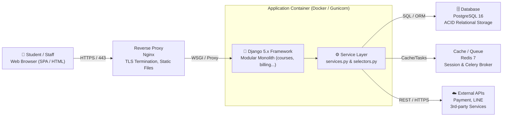

# Software Architecture & System Decomposition

> ที่มา: CN331 สัปดาห์ที่ 10 — Part 1 (Software Architecture & System Decomposition) และ Part 4 กิจกรรมปฏิบัติการที่ 1
>
> *หลักการออกแบบสถาปัตยกรรมระบบ, C4 Model, ขอบเขตโมดูล Django Apps และการควบคุมทิศทาง Dependency*
>
> ลำดับถัดไป: การจัดเลเยอร์ภายใน App ด้วย Service Layer & Selectors → ดู [04-django-service-layer-and-transactions.md](04-django-service-layer-and-transactions.md)

---

## บริบทโครงการศึกษา: University Course Portal & Learning Hub

**🏛️ ขอบเขตระบบที่กำลังขยายตัวใน Sprint 2**
- **Academic Catalog**: จัดการข้อมูลภาควิชา รายวิชา และหลักสูตร (`courses`)
- **Enrollment Engine**: ลงทะเบียน จองที่นั่ง คัดกรอง Prerequisite และโควตา (`enrollments`)
- **Financial & Billing**: คิดคำนวณค่าธรรมเนียม ตัดเงินผ่าน Payment Gateways (`billing`)
- **Notification System**: แจ้งเตือนนักศึกษาผ่าน Email, LINE Notify, SMS (`notifications`)

**⚠️ ปัญหาที่พบหลังจบ Sprint 1**
- **Coupled Code**: โมเดล `Course` เรียกใช้ตาราง `Payment` ข้ามไปมาโดยตรง
- **God Views**: ฟังก์ชัน `enroll_course` มีความยาว 180 บรรทัด รวมทั้ง Validation, Transaction, Payment และ Line API ในที่เดียว
- **Hard to Test**: ไม่สามารถเขียน Unit Test ตรวจสอบระบบคิดเงินได้เลยถ้าไม่รัน Mock Web Server

> 💡 **Takeaway** — **Architecture Matters**: หากปราศจากโครงสร้างที่ชัดเจน เมื่อมีฟีเจอร์เพิ่มขึ้น ความเร็วของทีม (Team Velocity) จะลดลงเกือบเป็นศูนย์เพราะเสียเวลากับการแก้บั๊กที่กระทบเป็นลูกโซ่

## สถาปัตยกรรมซอฟต์แวร์คืออะไร? (Architecture vs. Design vs. Code)

**🧭 นิยามของ Software Architecture**
- **High-Level Structure**: โครงสร้างระดับสูงสุดของระบบ ประกอบด้วย Components, หน้าที่ความรับผิดชอบ และความสัมพันธ์ระหว่างกัน
- **Decisions Hard to Change**: Martin Fowler นิยามสถาปัตยกรรมว่าคือ *"สิ่งที่เปลี่ยนแปลงได้ยากในภายหลังและส่งผลต่อความอยู่รอดของระบบ"*
- **Non-Functional Requirements (NFRs)**: ตอบสนองต่อคุณภาพ เช่น Scalability, Maintainability, Security, และ Testability

**🧩 ลำดับชั้นจาก Architecture สู่ Code**
- **System Architecture**: การจัดโครงสร้างระดับ Macro เช่น Multi-tier, Microservices, หรือ Monolith
- **Software Design**: การออกแบบระดับ Micro เช่น การแบ่งโมดูล การออกแบบ Service Layer และโครงสร้างคลาส
- **Code / Implementation**: การเขียนคำสั่งจริงในภาษาโปรแกรม เช่น Python, SQL, HTML

| ระดับ (Level) | คำถามสำคัญ | ตัวอย่างการตัดสินใจ | ความยากในการเปลี่ยน |
|---|---|---|---|
| **Architecture** | ระบบโดยรวมทำงานร่วมกันอย่างไร? | เลือกระหว่าง Monolith vs Microservices | สูงมาก (หลักเดือน) |
| **Design** | โมดูลนี้แบ่งคลาสและอ็อบเจกต์อย่างไร? | ใช้ Service Layer หรือแยก Domain Models | ปานกลาง (หลักวัน/สัปดาห์) |
| **Code** | อัลกอริทึมนี้เขียนอย่างไร? | ใช้ List Comprehension หรือ Loop | ต่ำ (หลักนาที/ชั่วโมง) |

## วิวัฒนาการสถาปัตยกรรม: Monolith, Microservices หรือ Modular Monolith?

**📦 Classic Monolith**
- รันโค้ดทั้งหมดใน 1 Process และ 1 Database
- **ข้อดี**: Deploy ง่าย, ทำ Transaction ง่าย, Debug ไว
- **ข้อเสีย**: หากไร้วินัย โค้ดจะพันกันจนกลายเป็น "Big Ball of Mud"

**🧱 Microservices**
- แยกเป็นหลายบริการ อิสระต่อกันผ่าน Network/HTTP
- **ข้อดี**: สเกลแยกทีมได้, เทคโนโลยีหลากหลาย
- **ข้อเสีย**: Overhead มหาศาล! ปัญหา Distributed Transactions & Network Latency

**🗂️ Modular Monolith**
- รันใน 1 Process เดียวกัน แต่แยกขอบเขตโมดูลชัดเจน
- **จุดเด่น**: โครงสร้างเรียบร้อยแบบ Microservices แต่ Deploy ง่ายแบบ Monolith!
- **คำแนะนำ**: เหมาะสมที่สุดสำหรับโปรเจกต์นักศึกษาและ Startup

> 💡 **Takeaway** — **Martin Fowler's Monolith First Law**: อย่าเพิ่งเริ่มระบบด้วย Microservices จนกว่าขนาดทีมหรือทราฟฟิกจะต้องการมันจริง ๆ สำหรับ Django โครงสร้างแบบ **Modular Monolith** (แยก Apps ให้เป็นสัดส่วน) คือทางเลือกที่มีประสิทธิภาพและคล่องตัวสูงสุด

## การถ่ายทอดสถาปัตยกรรมด้วยแบบจำลอง C4 Model

**🔍 C4 Model คืออะไร?**

คิดค้นโดย Simon Brown เพื่อแก้ปัญหาไดอะแกรมสถาปัตยกรรมที่ไม่ชัดเจน โดยเปรียบเทียบเสมือน **Google Maps** ที่ซูมดูรายละเอียดได้ 4 ระดับ:

1. **Level 1: System Context**: ซูมออกสุด แสดงระบบกับผู้ใช้งานและ External Systems
2. **Level 2: Container**: แสดงแอปที่รันได้ เช่น Web App, Database, Cache, Storage
3. **Level 3: Component**: ซูมดูภายใน Container แยกย่อยเป็น Django Apps, Services
4. **Level 4: Code**: ระดับคลาส ฟังก์ชัน หรือ UML Class Diagram

**✅ ระดับที่วิศวกรต้องส่งมอบในสัปดาห์นี้**
- **Level 1 (Context)**: ใครคือนักศึกษา/อาจารย์? ระบบเชื่อมต่อกับอะไร (ธนาคาร, LINE, Mailgun)?
- **Level 2 (Container)**: แสดง Deployment จริง เช่น Nginx → Gunicorn → Django → DB & Redis
- **ไดอะแกรมที่ดี**: ระบุ Technology Stack และโปรโตคอลการสื่อสาร (HTTPS, TCP, WS) ชัดเจน

> 💡 **Takeaway** — **Communication Tool**: ไดอะแกรมไม่ใช่รูปวาดสวยงามเพื่อประดับสไลด์ แต่เป็นเครื่องมือสื่อสารทางเทคนิคที่ทำให้ทุกคนในทีมเห็นภาพสถาปัตยกรรมตรงกันก่อนเริ่มลงมือเขียนโค้ด

## ภาพรวมสถาปัตยกรรมระบบ: C4 Container Diagram



> 💡 **Takeaway** — **Multi-Tier Separation**: ผู้ใช้ติดต่อผ่าน Reverse Proxy เข้าสู่ Application Tier โดยมี Service Layer เป็นตัวกลางประสานงานกับ Database และ External Services อย่างเป็นระบบ

## Django Project กับ Django Apps: หลักการ Single Responsibility

**📁 โครงสร้าง Django Project vs App**
- **Django Project**: คือคอนฟิกูเรชันโดยรวมของทั้งระบบ เช่น `settings.py`, Root `urls.py`, และ WSGI deployment
- **Django App**: คือโมดูลอิสระที่มีหน้าที่ชัดเจนเพียงเรื่องเดียว (Single Responsibility Principle - SRP)
- **คำถามทดสอบ App ที่ดี**: สามารถอธิบายหน้าที่ของ App นั้นได้ในหนึ่งประโยคโดยไม่มีคำว่า "และ (and)" หรือไม่?

**💣 สัญญาณเตือนภัยของ App ที่ออกแบบผิดพลาด**
- **The "All-in-One" App**: การสร้าง App เดียวชื่อ `main` หรือ `core` แล้วยัด Models ทั้งหมด 20 ตัวลงไป
- **Micro-App Extremism**: การซอย App ละเอียดเกินไป เช่น 1 Model ต่อ 1 App จนมี 15 Apps ทำให้การนำเข้าข้อมูล (Imports) ซับซ้อนเกินจำเป็น
- **Healthy Granularity**: ควรจัดกลุ่มตามโดเมนทางธุรกิจ (Bounded Context) เช่น `courses`, `enrollments`, `billing`

> 💡 **Takeaway** — **Domain Boundary Rule**: ออกแบบ App ให้สอดคล้องกับขอบเขตข้อมูล (Domain Boundaries) เพื่อให้สามารถแยกทีมทำงานขนานกันในแต่ละ Sprint ได้โดยไม่เกิดความขัดแย้งของไฟล์ (Merge Conflicts)

## การแบ่งโฟลเดอร์และขอบเขตความรับผิดชอบของ Django Apps

```text
course_portal/                 # Project Root
|-- config/                    # Project Settings
|   |-- settings/
|   |-- urls.py
|   +-- wsgi.py
|-- apps/                      # Application Namespace
|   |-- accounts/              # User, Profiles, Auth
|   |-- courses/               # Catalog, Departments
|   |   |-- models.py
|   |   |-- services.py        # Business logic/mutations
|   |   |-- selectors.py       # Querying/Read logic
|   |   |-- views.py
|   |   +-- urls.py
|   |-- enrollments/           # Registration, Quotas
|   +-- billing/               # Invoices, Payments
+-- manage.py
```

**🧩 กฎการแบ่งความรับผิดชอบ (Layer Rules)**
- **`apps/accounts`**: ดูแลเฉพาะการยืนยันตัวตน สิทธิ์ผู้ใช้ และโปรไฟล์
- **`apps/courses`**: จัดการโครงสร้างหลักสูตรและข้อมูลรายวิชา (ไม่มีโค้ดการจ่ายเงิน!)
- **`apps/enrollments`**: จัดการการลงทะเบียนและเงื่อนไข Prerequisites
- **`apps/billing`**: จัดการใบเสร็จและการชำระเงิน

> 💡 **Takeaway** — **Directional Dependency**: การอ้างอิงข้อมูลต้องเป็นทิศทางเดียว (Unidirectional) เสมอ เช่น `billing` เรียกดู `enrollments` ได้ แต่ `courses` ต้องไม่ขึ้นต่อ `billing`

## การแก้ปัญหา Circular Dependencies ในระบบ Django

**🔄 ปัญหาการนำเข้าแบบวงกลม (Circular Import)**

เกิดขึ้นเมื่อ App A นำเข้า App B และ App B ก็นำเข้า App A:
- `courses.models` ต้องการ `Enrollment` เพื่อคำนวณจำนวนผู้ลงทะเบียน
- `enrollments.models` ต้องการ `Course` เพื่อสร้าง Foreign Key
- ✗ **ผลลัพธ์**: เกิดข้อผิดพลาด `ImportError` ในขณะสตาร์ตระบบ

**🛠️ ทางออกตามมาตรฐานวิศวกรรม**
1. **Lazy String Model Reference**: ใช้ชื่อโมเดลแบบสตริงใน ForeignKey:

   ```python
   course = models.ForeignKey(
       'courses.Course', on_delete=models.CASCADE)
   ```
2. **Move Logic to Services**: ย้าย Business Logic ที่ผูกระหว่างสอง App ไปไว้ใน `services.py`
3. **Use Custom AppConfig**: กำหนดการเชื่อมต่อระบบในเมธอด `ready()` ของ `apps.py`

> 💡 **Takeaway** — **Architecture Smell**: การเกิด Circular Imports ในโปรเจกต์เป็นสัญญาณเตือนว่าขอบเขตของ App (App Boundaries) เริ่มปะปนกัน และจำเป็นต้องทำ Refactoring โดยด่วน

## QUICK CHECK: การกำหนดขอบเขตระบบและการแก้ปัญหา Circular Dependencies

*(สไลด์ไม่มีเนื้อหาคำถาม)*

## สรุปใจความสำคัญของ Part 1 (System Decomposition Takeaways)

**✔ เสาหลักด้านสถาปัตยกรรมระบบ**
- **C4 Model**: ใช้ Context & Container Diagram ถ่ายทอดภาพรวมของระบบให้ทีมและผู้ประเมินเข้าใจตรงกัน
- **Modular Monolith**: แบ่ง Django Project ออกเป็นหลายๆ Apps ที่มีขอบเขต (Bounded Context) อิสระต่อกัน
- **Unidirectional Flow**: ขจัดปัญหา Circular Dependency ด้วยการใช้ String References และย้าย Logic ข้ามโมดูลไปยัง Service

**✔ เสาหลักด้านขอบเขตความรับผิดชอบ**
- **Single Responsibility**: แต่ละ Django App ต้องรับผิดชอบโดเมนธุรกิจเดียวที่นิยามได้ชัดเจน
- **App Granularity**: ไม่รวมทุกอย่างใน App เดียว และไม่ซอย App ถี่เกินไปจนจัดการยาก
- **Clear Interfaces**: การติดต่อข้ามโมดูลต้องทำผ่าน Service ฟังก์ชัน ไม่เขียนคิวรีทะลุโมเดล

**ลำดับถัดไป**: เจาะลึกการจัดเลเยอร์ใน Django ด้วย **Service Layer** และ **Selector Pattern**

---

## กิจกรรมปฏิบัติการที่ 1: การวาดไดอะแกรมสถาปัตยกรรมระบบ (C4 Model)

**📐 เป้าหมายของกิจกรรมที่ 1**

ให้แต่ละกลุ่มร่วมกันจัดทำไดอะแกรมสถาปัตยกรรมระบบของโปรเจกต์กลุ่มตนเอง:
- **C4 Level 1: System Context Diagram**: แสดงผู้ใช้งานทุกกลุ่ม (Role) และระบบภายนอกทั้งหมดที่ระบบต้องสื่อสารด้วย
- **C4 Level 2: Container Diagram**: แสดงองค์ประกอบเซิร์ฟเวอร์จริง (Web Browser, Reverse Proxy, Django App, Database, Cache/Storage) พร้อมระบุโปรโตคอล

**🛠️ เครื่องมือและสิ่งที่ต้องส่งมอบ**
- **เครื่องมือแนะนำ**: draw.io, Miro, หรือ PlantUML/Mermaid
- **สิ่งที่ต้องส่งมอบ**:
  1. บันทึกไฟล์รูปภาพไว้ในโฟลเดอร์ `docs/architecture/` บน GitHub Repo
  2. นำภาพไดอะแกรมมาแสดงบนไฟล์ `README.md` หน้าแรกของ Repository

> 💡 **Takeaway** — **Evaluation Criteria**: ความชัดเจนของทิศทางลูกศร การระบุชื่อเทคโนโลยี (Technology Stack) กำกับบนทุกโหนด และความสอดคล้องกับโครงสร้างโค้ดที่รันได้จริง

---

## ตารางสังเคราะห์องค์ความรู้: Software Architecture & Decomposition

สรุปแก่นความคิดรวบยอดประจำสัปดาห์ที่ 10 สำหรับการทบทวนและการประยุกต์ใช้จริง (ตอนที่ 1):

| มโนทัศน์หลัก | เป้าหมายทางวิศวกรรม | การประยุกต์ใช้จริงใน Django | ข้อควรระวังสำคัญ |
|---|---|---|---|
| **Modular Monolith** | บำรุงรักษาง่าย ไม่เพิ่ม Network Overhead แบบ Microservices | แยก Apps ตาม Bounded Context เช่น `courses`, `billing` | ระวัง Circular Imports |
| **C4 Model** | สื่อสารสถาปัตยกรรมระบบในระดับที่เหมาะสม | Container Diagram: Browser → Nginx → Django → DB | อย่าใส่โค้ดใน Container |
| **App Boundaries** | แยกโดเมนข้อมูลเพื่อลด Merge Conflicts | ผูกความสัมพันธ์ด้วย String References ใน ForeignKey | ทิศทาง Dependency ทางเดียว |
| **Architecture Records** | บันทึกประวัติและข้อแลกเปลี่ยนการออกแบบ | จัดเก็บไฟล์ Markdown ในโฟลเดอร์ `docs/adr/` | อัปเดตผ่าน Pull Request |

> 💡 **Takeaway** — **Architecture Rule**: Presentation → Business Logic → Data Access ทิศทางการเรียกใช้ต้องลงล่างเท่านั้น

## กฎเหล็กทางสถาปัตยกรรมสำหรับวิศวกรซอฟต์แวร์ (Rules of Thumb)

**☑️ ข้อพึงกระทำ (Do's)**
- **Keep Views Skinny**: วิวควรทำหน้าที่เพียงแปลความต้องการของผู้ใช้และเรียก Service
- **Wrap Transactions in Services**: คลุมขั้นตอนการทำงานที่กระทบหลายตารางด้วย `@transaction.atomic` เสมอ
- **Slice Stories Vertically**: ซอย User Story ให้มีชิ้นงานที่ทดสอบได้จริงตั้งแต่หน้าบ้านถึงหลังบ้าน
- **Pay Tech Debt Early**: จัดสรรโควตา 20% ของทุก Sprint สำหรับงาน Refactoring

**❌ ข้อห้ามเด็ดขาด (Don'ts)**
- ✗ **No Outbound Side-effects in Models**: ห้ามส่งอีเมลหรือตัดเงินในเมธอด `save()` ของ Model
- ✗ **No Circular Imports**: อย่าให้ App สองตัวเรียกใช้โมเดลของกันและกันแบบสองทาง
- ✗ **No Over-committing**: อย่าวางแผนงานใน Sprint 2 เกินความเร็วจริงที่ทำได้ใน Sprint 1
- ✗ **No Unreviewed PRs**: ห้ามกด Merge โค้ดเข้ากิ่ง `main` โดยไม่มีเพื่อนในกลุ่มตรวจ

> 💡 **Takeaway** — **Simplicity is the Ultimate Sophistication**: สถาปัตยกรรมที่ยอดเยี่ยมไม่ใช่สถาปัตยกรรมที่ซับซ้อนที่สุด แต่คือสถาปัตยกรรมที่เรียบง่ายที่สุดที่สามารถตอบสนองความต้องการของระบบได้อย่างมีประสิทธิภาพ
