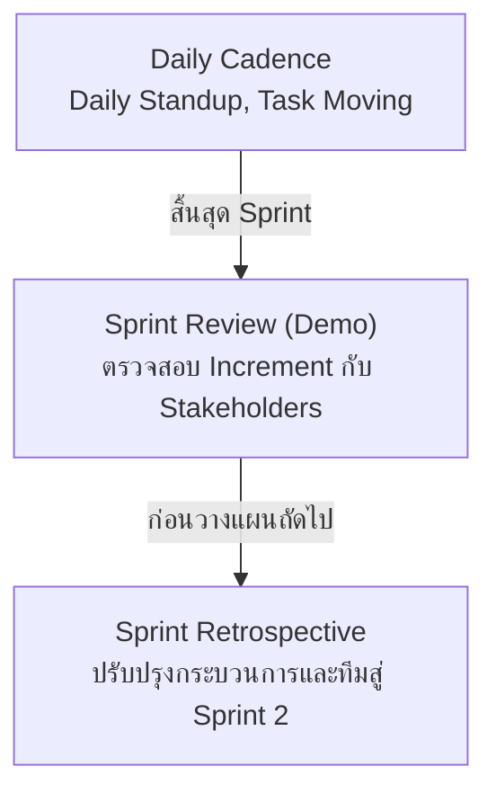

# Agile Scrum: Sprint Execution, Ceremonies & Sprint Planning

> ที่มา:
> - CN331 สัปดาห์ที่ 7 — Part 4 (Sprint 1 Ceremonies & Midterm Preparation): *การดำเนินงาน Sprint 1, พิธีกรรม Review/Retro, การวัดผล Velocity*
> - CN331 สัปดาห์ที่ 10 — Part 3 (Agile Sprint 2 Planning & Project Governance): *การวางแผนรอบ Sprint 2, การปรับเทียบ Velocity, การจัดการ Technical Debt และ GitHub Projects* และ Part 4 กิจกรรมปฏิบัติการที่ 3

---

# ส่วนที่ 1: Sprint 1 Execution & Ceremonies (Week 7)

## การขับเคลื่อนการทำงานใน Sprint 1: จากแผนงานสู่การปฏิบัติจริง

**ความท้าทายในสัปดาห์ที่ 7 ของโครงงาน:**
- ในสัปดาห์ที่ 6 แต่ละทีมได้แบ่ง Story Points, กำหนด DoD และเปิดตัว Sprint 1 บน GitHub Projects
- สัปดาห์นี้คือช่วงเวลาของการ**ปิดรอบ Sprint 1** (Execution, Review & Retrospective)
- ประเด็นที่ทีมต้องประเมินและทบทวนจริงในทางปฏิบัติ:
  - มี User Stories ใดที่ประเมิน Story Points ต่ำเกินไปจนส่งมอบไม่ทันหรือไม่?
  - กระบวนการ Review และรวมโค้ดผ่าน Pull Request เกิดความล่าช้าหรือไม่?
  - ชิ้นงานที่พัฒนาขึ้นมีคุณภาพครบถ้วนตามเกณฑ์ Definition of Done (DoD) หรือไม่?



## การประชุมประจำวัน (Daily Scrum / Standup): กฎเหล็กและหัวใจสำคัญ

**3 คำถามทองคำประจำวัน:**
1. **What did I do yesterday?** — เมื่อวานนี้ฉันทำอะไรสำเร็จไปแล้วบ้างเพื่อช่วยให้ทีมบรรลุ Sprint Goal?
2. **What will I do today?** — วันนี้ฉันวางแผนจะทำอะไรต่อไปเพื่อช่วยให้ทีมบรรลุ Sprint Goal?
3. **Are there any blockers / impediments?** — มีอุปสรรค สิ่งกีดขวาง หรือปัญหาทางเทคนิคใดที่ทำให้ฉันทำงานไม่ได้หรือไม่?

**⚠️ กฎเหล็กของ Daily Standup**
- **Time-boxed 15 นาที**: ยืนประชุมเสมอเพื่อป้องกันการคุยยาวเยิ่นเย้อ
- **Not a Status Report to Boss**: ไม่ใช่การรายงานความคืบหน้าให้ผู้บังคับบัญชา แต่เป็นการประสานงานและอัปเดตสถานะร่วมกันภายในทีมพัฒนา
- **No Problem Solving in the Meeting**: หากพบอุปสรรค (Blocker) ให้บันทึกรับทราบและแยกไปปรึกษานอกรอบเฉพาะผู้ที่เกี่ยวข้อง (16th Minute Discussion) เพื่อไม่ให้กระทบเวลาของคนอื่น

> 💡 **Takeaway** — Daily Standup ช่วยเปลี่ยนสถานะ "รู้ตัวว่าทำไม่ทันในวันส่งงาน" เป็น "รู้ตัวล่วงหน้าตั้งแต่วันแรกๆ ที่เริ่มติดปัญหา"

## การติดตามความก้าวหน้าของทีม: กราฟเบิร์นดาวน์ (Burndown Chart)

**องค์ประกอบของ Burndown Chart:**
- **แกน X**: วันทำงานในรอบ Sprint (เช่น วันที่ 1 ถึง 10)
- **แกน Y**: จำนวน Story Points รวมของงานที่**ยังคงเหลืออยู่** (Remaining Effort)
- **Ideal Line (เส้นประสีเทา)**: เส้นการเผางานในอุดมคติ ลากเป็นเส้นตรงจากยอดรวมทั้งหมดลงสู่ 0 ในวันสุดท้าย
- **Actual Line (เส้นทึบสีน้ำเงิน)**: สถานะงานที่ทำเสร็จจริงในแต่ละวัน (งานจะลดลงต่อเมื่อตรงตาม DoD เท่านั้น)

```
Story Points
 40 ┤●━━━━●
    │ ╲     ╲___       Actual
    │   ╲       ╲___●
    │     ╲           │
    │       ╲  Ideal   ╲
    │         ╲         ●
    │           ╲        ╲
  0 ┼─────────────────────●──▶ Days
                        Day 10
```

> 📈 **การคำนวณ Velocity** — **Team Velocity** = จำนวน Story Points ของชิ้นงานที่เสร็จสมบูรณ์ 100% ตามเกณฑ์ DoD ในรอบ Sprint นั้นๆ

## การวิเคราะห์รูปแบบกราฟ Burndown (Diagnosing Team Traps)

ลักษณะของเส้น Actual Line สามารถสะท้อนสุขภาพและปัญหาที่ซ่อนอยู่ภายในทีมได้อย่างชัดเจน:

| รูปแบบที่ปรากฏ | อาการของทีม (Symptoms) | สาเหตุ & แนวทางแก้ไข |
|---|---|---|
| **เส้นราบนิ่ง (Flat Line)** | กราฟคงที่ติดต่อกันหลายวัน ไม่มีงานใดถูกปิดสำเร็จ | งานแต่ละชิ้นมีขนาดใหญ่เกินไป (ขาดการแตกเป็น Tasks ย่อย) หรือสมาชิกต่างคนต่างเปิดงานใหม่พร้อมกันโดยไม่มีงานใดเสร็จสมบูรณ์ |
| **เส้นดิ่งฮวบ (Late Drop)** | งานคงค้างตลอดทั้งสัปดาห์ แล้วลดฮวบลงในวันสุดท้ายก่อนส่ง | สมาชิกไม่อัปเดตสถานะงานบนบอร์ดอย่างต่อเนื่อง หรือรอรวมโค้ดและทดสอบพร้อมกันในนาทีสุดท้าย เสี่ยงต่อการเกิด Bug |
| **เส้นชันขึ้น (Scope Creep)** | จำนวน Story Points รวมเพิ่มสูงขึ้นเรื่อยๆ ระหว่างรอบ | เกิดภาวะ **Scope Creep** มีการรับงานใหม่เข้ามาแทรกกลางคัน โดยไม่ได้เจรจาตัดงานเดิมออกตามข้อตกลง |

> 💡 **Takeaway** — กฎของ Scrum คือ *"งานที่ทำเสร็จไปแล้ว 99% มีค่าเท่ากับ 0 Story Points จนกว่าจะผ่าน Definition of Done ทั้งหมด"*

## พิธีกรรมที่ 1: การนำเสนอส่งมอบผลงาน (Sprint 1 Review / Demo)

**วัตถุประสงค์หลัก:**
- สาธิตชิ้นงานที่ใช้งานได้จริง (**Working Software**) ให้กับผู้มีส่วนได้ส่วนเสีย (Product Owner, อาจารย์, เพื่อนร่วมชั้น)
- รับฟังความคิดเห็น (Feedback) และข้อเสนอแนะเพื่อนำไปปรับปรุง Product Backlog

**✗ สิ่งที่ไม่ควรทำใน Sprint Review**
- เปิดสไลด์บรรยายโค้ดแทนการทดสอบระบบจริง
- สาธิตฟังก์ชันบนเครื่องส่วนตัวโดยยังไม่ได้ผสานเข้ากับ Branch หลัก
- อ้างว่างานเสร็จสมบูรณ์แต่ยังไม่ผ่านการทดสอบตามเกณฑ์ DoD

**✓ แนวปฏิบัติที่ถูกต้องใน Sprint Review**
1. **Live Demonstration**: สาธิตการใช้งานระบบจริงบนเบราว์เซอร์ตามขั้นตอนของ User Story
2. **Verify Against DoD**: ตรวจสอบร่วมกับ PO ว่างานแต่ละชิ้นผ่าน Acceptance Criteria และ Definition of Done ครบทุกข้อ
3. **Inspect & Adapt**: ปรับแก้ความสำคัญของฟีเจอร์ใน Product Backlog ตามสิ่งที่เรียนรู้จากการสาธิต

## พิธีกรรมที่ 2: การสะท้อนคิดและปรับปรุงกระบวนการ (Sprint Retrospective)

**Sprint Review vs Sprint Retrospective:**
- **Sprint Review**: มุ่งเน้นที่ **"ผลงานที่สร้าง" (Product)** → เราพัฒนาชิ้นงานอะไรสำเร็จบ้าง ฟังก์ชันตรงตามความต้องการหรือไม่
- **Sprint Retrospective**: มุ่งเน้นที่ **"กระบวนการและทีมงาน" (Process & People)** → เราทำงานร่วมกันอย่างไร พบอุปสรรคใด และจะปรับปรุงเครื่องมือหรือการสื่อสารอย่างไรในรอบถัดไป

| | Focus | Audience |
|---|---|---|
| **Sprint Review** | **WHAT** did we build? | Team + Stakeholders |
| **Sprint Retrospective** | **HOW** did we build it? | Scrum Team Only |

> 🛡️ **รากฐานสำคัญ: Psychological Safety** — การทำ Retrospective จะล้มเหลวทันทีหากกลายเป็นการกล่าวโทษกัน (Blame Game) สมาชิกทุกคนต้องยึดมั่นใน **Prime Directive**: *"เราเชื่อมั่นว่าทุกคนทำหน้าที่อย่างเต็มความสามารถแล้ว ด้วยความรู้ ทักษะ และทรัพยากรที่มีอยู่ในเวลานั้น"*

> 💡 **Takeaway** — ทีมที่ไม่มี Retrospective คือทีมที่ไม่เคยเติบโตขึ้นเลยตลอดทั้งโครงการ

## กรอบการทำ Retrospective ยอดนิยม: Start / Stop / Continue และ 4Ls

**🔄 Start / Stop / Continue**
- **Start (เริ่มทำ)**: พฤติกรรมหรือเครื่องมือใหม่ๆ ที่ทีมควรนำมาใช้ เช่น เริ่มทำ Pair Programming ในงานยากๆ
- **Stop (หยุดทำ)**: สิ่งที่ไม่ก่อให้เกิดประโยชน์หรือบั่นทอนทีม เช่น ส่ง Pull Request ก้อนใหญ่เกิน 500 บรรทัด
- **Continue (ทำต่อไป)**: สิ่งที่ทีมทำได้ดีเยี่ยมใน Sprint 1 และควรยึดถือต่อไป เช่น การ Standup ตรงเวลาทุกเช้า

**❤️ The 4Ls Framework**
- **Liked (สิ่งที่ประทับใจ)**: ฟังก์ชันหรือบรรยากาศที่ดีในทีม
- **Learned (สิ่งที่ได้เรียนรู้)**: เทคนิคใหม่ๆ เช่น `select_related` หรือการเขียน Unit Tests
- **Lacked (สิ่งที่ขาดหายไป)**: ข้อกำหนดฟีเจอร์ที่ไม่ชัดเจน ขาดคำแนะนำจาก PO
- **Longed For (สิ่งที่ปรารถนา)**: การมีชุดข้อมูลทดสอบที่ดีกว่านี้ หรือเวลาพักผ่อน

> 💡 **Takeaway** — **Actionable Improvements**: ทุกการทำ Retro ต้องสรุปออกมาเป็นข้อตกลงที่จับต้องได้ 1–2 ข้อ (Action Items) และบรรจุลงใน Sprint 2 Backlog

## QUICK CHECK: ความแตกต่างระหว่าง Sprint Review และ Sprint Retrospective

*(สไลด์ไม่มีเนื้อหาคำถาม)*

---

# ส่วนที่ 2: Sprint 2 Planning & Project Governance (Week 10)

## บทเรียนจากรอบแรกสู่รอบถัดไป: Why Sprint 2 is the Make-or-Break Sprint

**🕘 ทบทวนบทเรียนจาก Sprint 1**
- **Over-optimism**: ทุกทีมมักประเมินความสามารถของตนเองสูงเกินจริงใน Sprint 1 (วางแผน 40 แต้ม แต่ส่งมอบได้จริงเพียง 18 แต้ม)
- **Unplanned Friction**: อุปสรรคทางเทคนิคที่คาดไม่ถึงและการสลับบริบท (Context Switching) ทำให้ความเร็วของทีมลดลง
- **Code Rot & Quick Fixes**: โค้ดที่เร่งรีบเขียนเพื่อดันฟีเจอร์แรกให้ทันกำหนด เริ่มส่งกลิ่น (Code Smells) และสะสมหนี้ทางเทคนิค

**🔥 ความท้าทายใน Sprint 2**
- **Sprint 2 คือจุดชี้ขาด**: หากทีมไม่ปรับแผนการทำงานในสัปดาห์นี้ โครงการจะมีงานคั่งค้างจนไม่สามารถส่งมอบงาน Final Presentation ในสัปดาห์ที่ 14 ได้
- **Reality-Based Planning**: เลิกใช้ "ความรู้สึก" ในการวางแผน และหันมาใช้**ข้อมูลจริงเชิงประจักษ์ (Empirical Data)** จากผลงาน Sprint 1

> 💡 **Takeaway** — **Agile is Empirical**: หัวใจของ Agile ไม่ใช่การทำงานให้เสร็จตามแผนเดิมที่ตั้งไว้ แต่คือการปรับแผนตามความเป็นจริงได้อย่างรวดเร็วและชาญฉลาด (Inspect & Adapt)

## การปรับเทียบความเร็วของทีม (Velocity Recalibration)

**⏱️ Team Velocity คืออะไร?**

จำนวน **Story Points** รวมของ User Stories ที่ทีมสามารถทำเสร็จสมบูรณ์ตามข้อกำหนด **Definition of Done (DoD)** ภายใน 1 รอบ Sprint
- ✗ **ห้ามนับคะแนนครึ่ง ๆ กลาง ๆ**: หาก Story ขนาด 5 แต้ม ทำเสร็จไป 90% แต่ยังไม่ได้ Merge หรือทดสอบไม่ผ่าน แต้มที่ได้ใน Sprint นั้นคือ **0 แต้ม**!
- ความเร็วของทีมเกิดจากการวัดผลจริง ไม่ใช่การคาดหวัง

**🧮 สูตรการปรับเทียบสำหรับ Sprint 2**

สมมุติผลงาน Sprint 1 ของทีมเป็นดังนี้:
- แต้มที่วางแผนไว้ (Planned): 35 แต้ม
- แต้มที่เสร็จจริงตาม DoD (Actual): 20 แต้ม

**แนวทางสำหรับ Sprint 2**:
- ความเร็วอ้างอิงของทีมคือ **20 แต้ม** (ไม่ใช่ 35!)
- ห้ามวางแผนงานใน Sprint 2 เกิน 20-22 แต้มโดยเด็ดขาด
- การรับงานเกินกำลังจะนำไปสู่การอดนอน โค้ดไร้คุณภาพ และระบบพังทลาย

> 💡 **Takeaway** — **Predictability over Speed**: ในมุมมองของวิศวกรรมซอฟต์แวร์ ทีมที่ส่งมอบงานได้สม่ำเสมอ 20 แต้มทุกสัปดาห์ มีคุณค่าและน่าเชื่อถือมากกว่าทีมที่สัญญากับลูกค้าว่าจะทำ 50 แต้มแต่ส่งมอบได้จริงเพียง 15 แต้ม

## หนี้ทางเทคนิคคืออะไร? (Ward Cunningham's Technical Debt Metaphor)

**💳 อุปมาของ Technical Debt**

คิดค้นโดย Ward Cunningham (หนึ่งในผู้ร่วมเขียน Agile Manifesto):
- **การกู้หนี้ (Borrowing)**: การเลือกเขียนโค้ดแบบเร่งรีบ ไม่สนใจโครงสร้าง เพื่อให้ฟีเจอร์เสร็จทันเดดไลน์
- **ดอกเบี้ย (Interest)**: ทุกครั้งที่ต้องแก้ไขหรือเพิ่มฟังก์ชันใหม่ ทีมต้องเสียเวลามากขึ้นเพราะต้องคอยหลบเลี่ยงบั๊กและโครงสร้างที่ย่ำแย่
- **การล้มละลาย (Bankruptcy)**: เมื่อดอกเบี้ยสะสมจนสูงเกินไป การเพิ่มฟีเจอร์แม้เพียงจุดเดียวอาจทำให้ระบบล่มทั้งระบบ จนต้องรื้อทำใหม่ทั้งหมด

```
ต้นทุน (Effort)
    ▲                         ╱ หนี้ทางเทคนิคสูง (เส้นโค้งพุ่งขึ้นแบบทวีคูณ)
    │                       ╱
    │              ______╱____  โครงสร้างสะอาด (เส้นตรงเพิ่มขึ้นช้าๆ)
    │      _______╱──────
    │  ───╱
    │___╱
    └──────────────────────────▶ เวลา (Time)
```

**ข้อคิด**: ในช่วงแรก โค้ดชุ่ยอาจดูเหมือนทำเสร็จไวกว่า แต่เมื่อเวลาผ่านไป ต้นทุนในการบำรุงรักษาจะพุ่งขึ้นเป็นเท่าทวีคูณ

> 💡 **Takeaway** — **Pay Down the Debt**: ใน Sprint 2 ทุกทีมต้องจัดสรรเวลาอย่างน้อย **20% ของ Story Points** สำหรับการชำระหนี้ทางเทคนิค (Refactoring) มิฉะนั้นโปรเจกต์จะไม่สามารถพัฒนาต่อใน Sprint 3 ได้

## การเขียน User Stories สำหรับงาน Refactoring & Architecture

**📋 การแปลงหนี้ทางเทคนิคเป็น Backlog Item**

อย่าซุกปัญหาหนี้ทางเทคนิคไว้ใต้พรม แต่จงทำให้งาน Refactoring โปร่งใสและตรวจสอบได้บนกระดานบอร์ด:
- **Technical Story Format**:
  - **Title**: *"Refactor: Extract Course Enrollment into Service Layer"*
  - **Value**: เพื่อลดความซ้ำซ้อนของโค้ด และทำให้ระบบรองรับการทดสอบ Unit Test ได้
  - **Points**: ตีแต้มประมาณการเหมือนกับ Feature ปกติ (เช่น 3 หรือ 5 แต้ม)

**✅ ตัวอย่าง Acceptance Criteria สำหรับงานปรับโครงสร้าง**
- ✓ ย้าย Logic ทั้งหมดออกจาก `enroll_view` ไปไว้ใน `apps.enrollments.services`
- ✓ ครอบการทำงานด้วย `@transaction.atomic`
- ✓ ฟังก์ชัน View เดิมมีความยาวลดลงเหลือไม่เกิน 20 บรรทัด
- ✓ การทำงานหน้าเว็บบนเบราว์เซอร์ยังคงได้ผลลัพธ์เหมือนเดิม 100% (Regression-free)

> 💡 **Takeaway** — **Visibility Creates Alignment**: การใส่ Refactoring Story ลงใน Sprint Backlog ทำให้ Product Owner (หรืออาจารย์ผู้ตรวจ) รับรู้ว่าทีมกำลังลงทุนในคุณภาพระยะยาวเพื่อความมั่นคงของระบบ

## การกำหนดเป้าหมายรอบการทำงาน: Sprint 2 Goal

**🎯 Sprint Goal คืออะไร?**

คำแถลงสั้น ๆ 1 ประโยคที่สรุป **คุณค่าสูงสุด (Primary Value)** ที่ทีมมุ่งมั่นจะส่งมอบในรอบ Sprint นี้:
- **Why it matters**: ช่วยให้ทีมไม่หลงทาง เมื่อต้องเลือกระหว่างงานหลายชิ้นที่มีเวลาจำกัด ทีมจะรู้ว่างานชิ้นใดสำคัญที่สุดต่อ Sprint Goal
- ✗ **Sprint Goal ที่แย่**: *"ทำงานหมายเลข 1 ถึง 8 ให้เสร็จตามบอร์ด"* (เป็นเพียงรายการงาน ไม่ใช่เป้าหมาย)
- ✓ **Sprint Goal ที่ดี**: *"ระบบสามารถให้นักศึกษาลงทะเบียนรายวิชา ตรวจสอบเงื่อนไข Prerequisite และตัดเงินค่าธรรมเนียมได้สำเร็จอย่างปลอดภัย"*

**✅ เกณฑ์การประเมิน Sprint Goal ของทีม**
1. **User-Centric**: มุ่งเน้นไปที่สิ่งที่ผู้ใช้งาน (Student/Teacher) สามารถทำได้จริง
2. **Measurable / Testable**: สามารถสาธิตการทำงาน (Live Demo) ให้ดูได้ในวัน Sprint Review
3. **Achievable within Velocity**: แต้มรวมของงานที่สนับสนุนเป้าหมายต้องไม่เกิน Velocity อ้างอิงของทีม

> 💡 **Takeaway** — **Team Cohesion**: สมาชิกในทีมอาจรับผิดชอบคนละ Task แต่ทุกคนต้องมีเป้าหมายร่วมกันในการผลักดันให้ Sprint Goal สำเร็จ

## ความพร้อมและความสำเร็จ: Definition of Ready (DoR) vs Done (DoD)

ข้อตกลงร่วมกันของทีมวิศวกรเพื่อสร้างมาตรฐานคุณภาพที่ชัดเจนในสองช่วงจังหวะสำคัญ:

| มิติการเปรียบเทียบ | Definition of Ready (DoR) | Definition of Done (DoD) |
|---|---|---|
| **จังหวะเวลา** | ตรวจสอบ **"ก่อนดึงงานเข้า Sprint"** | ตรวจสอบ **"ก่อนปิดงานเป็นสำเร็จ"** |
| **คำถามสำคัญ** | งานชัดเจนพอที่จะเริ่มลงมือเขียนโค้ดหรือยัง? | งานมีคุณภาพครบถ้วนพร้อมส่งมอบจริงหรือยัง? |
| **เกณฑ์ตัวอย่าง** | • มี User Story (As a... I want... So that...)<br>• มี Acceptance Criteria ครบถ้วน<br>• ประเมิน Story Points ร่วมกันทั้งทีม<br>• มี Mockup หรือฟอร์มข้อมูลที่ตกลงกันแล้ว | • โค้ดผ่าน Review & Approve บน GitHub PR<br>• ปราศจาก Circular Imports และ N+1 Queries<br>• แยก Logic ลง Service Layer ปราศจาก Fat Views<br>• ทดสอบฟังก์ชัน Local/Staging ผ่านเรียบร้อย<br>• บันทึกเอกสารคู่มือหรือ ADR ครบถ้วน |

> 💡 **Takeaway** — **Quality Gates**: DoR ป้องกันไม่ให้รับงานคลุมเครือเข้ามา ส่วน DoD ป้องกันไม่ให้ส่งมอบงานที่มีบั๊กแฝง

## เทคนิคการซอยงาน Backlog: Vertical Slicing vs Horizontal Slicing

**🥞 การซอยงานแนวนอน (Horizontal - ผิดวิธี)**

แบ่งงานตามเลเยอร์ทางเทคนิค เช่น:
- Task 1: ออกแบบตาราง Database ทั้งหมด (3 วัน)
- Task 2: เขียน Backend Views ทั้งหมด (3 วัน)
- Task 3: ออกแบบหน้าจอ HTML ทั้งหมด (3 วัน)

✗ **ข้อเสียร้ายแรง**: หากเวลาหมดที่วันที่ 5 ระบบจะใช้งานไม่ได้เลยสักฟังก์ชันเดียว ไม่สามารถสาธิตงานหรือส่งมอบชิ้นงานได้

**🎂 การซอยงานแนวตั้ง (Vertical - ถูกวิธี)**

ตัดแบ่งเป็นแผ่นเค้กที่ผ่าทุกเลเยอร์ตั้งแต่ UI ถึง Database สำหรับฟีเจอร์ย่อย 1 อย่าง:
- Story A: ค้นหารายวิชาและแสดงผล (DB + View + HTML)
- Story B: กดยืนยันลงทะเบียน (DB + Service + HTML)

✓ **ข้อดี**: ทุก Story ที่ทำเสร็จเป็นระบบที่รันได้จริง (Working Increment) และนำไปให้ผู้ใช้ทดสอบได้ทันที

> 💡 **Takeaway** — **Always Slice Vertically**: ออกแบบ User Stories ให้ตัดผ่านทุกเลเยอร์เสมอ เพื่อรับประกันว่าทุกแต้มที่ส่งมอบมีคุณค่าที่จับต้องได้จริง

## QUICK CHECK: การซอยย่อยงาน Backlog แบบ Vertical Slicing

*(สไลด์ไม่มีเนื้อหาคำถาม)*

## การบริหารจัดการ Sprint 2 บน GitHub Projects & Issues

**🐙 เครื่องมือมาตรฐานบน GitHub**
- **Milestone**: สร้าง Milestone ชื่อ `Sprint 2` พร้อมกำหนดวันเริ่มและวันปิดรอบอย่างชัดเจน
- **GitHub Project Board (Table / Board View)**:
  - จัดคอลัมน์มาตรฐาน: *Todo, In Progress, In Review, Done*
  - เพิ่ม Custom Fields: **Story Points** (ตัวเลข) และ **Track** (Feature / Tech Debt)
- **Issue Templates**: ใช้ Markdown Template สำหรับ Feature Story และ Bug Report เพื่อบังคับใส่ Acceptance Criteria

**🔀 กฎระเบียบของ Git Branch & Pull Requests**
- **Branch Naming**: ตั้งชื่อตาม Issue เช่น `feature/issue-42-enroll-service` หรือ `refactor/issue-45-selectors`
- **PR Linking**: ใส่คำสั่ง `Closes #42` ในข้อความ Pull Request เพื่อให้ GitHub ปิด Issue อัตโนมัติเมื่อ Merge
- **Peer Review Rule**: ทุก PR ต้องได้รับการรีวิวและ Approve จากเพื่อนร่วมทีมอย่างน้อย 1 คนก่อนกด Merge เสมอ!

> 💡 **Takeaway** — **Single Source of Truth**: หากงานใดไม่ได้อยู่บน GitHub Project Board จะถือว่างานนั้นไม่มีอยู่จริงในการประเมินผลของวิชา

## รายการตรวจสอบสำหรับการประชุม Sprint 2 Planning (Checklist)

**📋 สิ่งที่ทีมต้องทำร่วมกันในคาบปฏิบัติการ**
- [ ] สรุปตัวเลข **Actual Velocity จาก Sprint 1** (นับเฉพาะงานที่ Done จริง)
- [ ] กำหนด **Sprint 2 Goal** ที่ชัดเจน 1 ประโยค
- [ ] คัดเลือก User Stories จาก Product Backlog เข้าสู่ Sprint 2 โดยยอดแต้มรวมต้องไม่เกิน Velocity อ้างอิง
- [ ] เพิ่ม **Refactoring / Architecture Story** อย่างน้อย 1-2 รายการ เพื่อปรับปรุงโค้ดสู่โครงสร้าง Service Layer
- [ ] ตรวจสอบว่าทุก Story สอดคล้องกับเกณฑ์ **Definition of Ready (DoR)**

**💻 สิ่งที่ต้องบันทึกบนระบบ GitHub**
- [ ] สร้าง Milestone `Sprint 2` บน GitHub Repo
- [ ] ผูกทุก Issue ที่เลือกเข้ากับ Milestone `Sprint 2`
- [ ] ใส่ค่า Story Points ให้ครบทุก Issue บน Project Board
- [ ] มอบหมายผู้รับผิดชอบหลัก (Assignee) สำหรับงานชิ้นแรกที่กำลังจะเริ่มทำ
- [ ] ตรวจสอบความถูกต้องของ Git Branch Protection บนกิ่ง `main`

> 💡 **Takeaway** — **Sprint Launch**: เมื่อตรวจสอบครบทุกข้อ ทีมพร้อมกดเริ่มรอบการทำงาน (Start Sprint) และเข้าสู่การลงมือพัฒนาในคาบปฏิบัติการทันที

## QUICK CHECK: การปรับเทียบ Velocity และการจัดการหนี้ทางเทคนิคใน Sprint 2

*(สไลด์ไม่มีเนื้อหาคำถาม)*

## สรุปใจความสำคัญของ Part 3 (Agile Sprint 2 Takeaways)

**✔ เสาหลักด้านการวางแผน**
- **Empirical Velocity**: ใช้แต้มจริงที่เสร็จตาม DoD ใน Sprint 1 เป็นฐาน ห้ามวางแผนงานเกินกำลัง
- **Sprint 2 Goal**: รวมพลังทีมสู่คุณค่าชิ้นสำคัญชิ้นเดียวที่สาธิตได้จริง
- **Vertical Slicing**: ซอยย่อย User Stories ให้ผ่านทุกชั้นเพื่อส่งมอบ Working Increment

**✔ เสาหลักด้านคุณภาพและหนี้ทางเทคนิค**
- **Pay Tech Debt Early**: แบ่งโควตา 20% สำหรับงาน Refactoring สถาปัตยกรรมสู่ Service Layer
- **Definition of Ready (DoR)**: กรองงานก่อนดึงเข้า Sprint ป้องกันงานคลุมเครือ
- **Definition of Done (DoD)**: ตรวจสอบคุณภาพและ Review PR อย่างเข้มงวดก่อนปิดงาน

**ลำดับถัดไป**: สู่ภาคปฏิบัติการในห้องเรียน (Lab Practice) และตารางสังเคราะห์องค์ความรู้

---

## กิจกรรมปฏิบัติการที่ 3: เปิดตัวรอบการทำงาน Sprint 2 บน GitHub

**🚀 ขั้นตอนการปฏิบัติการของกลุ่ม**
1. สรุปผล **Sprint 1 Retrospective** บันทึกลงใน `docs/sprint1_retro.md`
2. ตั้งค่า Milestone `Sprint 2` บน GitHub
3. ดึง User Stories เข้าสู่ Sprint 2 ให้มียอดแต้มรวมสอดคล้องกับ Velocity
4. บันทึก **Sprint 2 Goal** ไว้ที่ด้านบนสุดของ GitHub Project Board
5. เริ่มหยิบงานชิ้นแรกจากคอลัมน์ *Todo* ย้ายไป *In Progress*

**🐙 ผลลัพธ์ที่ต้องปรากฏบนระบบ (Sprint 2 Artifacts)**
- **Retrospective Record**: ไฟล์ `docs/sprint1_retro.md` สรุป Action Items
- **Active Milestone**: Milestone `Sprint 2` พร้อมกำหนดวันส่งมอบและผูก Issues
- **Pinned Sprint Goal**: บันทึกเป้าหมายหลัก 1 ประโยคไว้บน GitHub Project Board
- **Active In-Progress**: หยิบงานชิ้นแรกย้ายเข้าคอลัมน์ *In Progress* พร้อมผู้รับผิดชอบ

> 💡 **Takeaway** — **Engineering Discipline**: ทีมที่บริหารจัดการทั้งคุณภาพสถาปัตยกรรมและวินัยในกระบวนการ Agile จะสามารถควบคุมทิศทางและส่งมอบงานได้อย่างมีประสิทธิภาพและยั่งยืน

---

## ตารางสังเคราะห์องค์ความรู้: Sprint Governance (ตอนที่ 2 — ส่วน Agile)

| มโนทัศน์หลัก | เป้าหมายทางวิศวกรรม | การประยุกต์ใช้จริงใน Django | ข้อควรระวังสำคัญ |
|---|---|---|---|
| **Velocity Calibration** | วางแผนรอบการทำงานตามข้อมูลจริง | นำ Actual Points จาก Sprint 1 เป็นฐานวางแผน Sprint 2 | ห้ามนับงานไม่เสร็จตาม DoD |

*(แถว Service Layer / Selectors / Row Locking ของตารางนี้อยู่ใน [04-django-service-layer-and-transactions.md](04-django-service-layer-and-transactions.md))*

> 💡 **Takeaway** — **Agile Rule**: ส่งมอบงานอย่างสม่ำเสมอตามเกณฑ์ Definition of Done มีคุณค่ามากกว่าการรับงานเกินกำลัง
