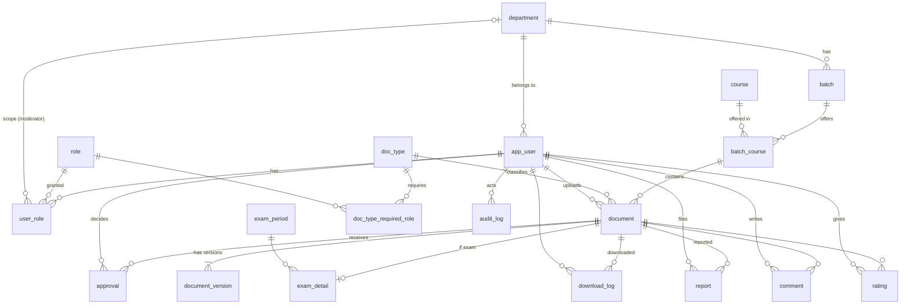

# ออกแบบฐานข้อมูล (3NF) — เว็บบอร์ดรวมชีทสรุปคณะวิศวะ

เอกสารนี้ใช้เป็น **SP-0 (ERD 3NF)** ของ Sprint 1
สมมติฐาน: ใช้ RDBMS แบบ relational (MySQL/PostgreSQL) กับ Django ตาม SRS (`on_delete=PROTECT`)
แนะนำ **PostgreSQL**: `user_role` ใช้ partial unique index ซึ่ง MySQL ไม่รองรับ (Django จะข้าม constraint นี้ จึงมีเช็กซ้ำใน model ด้วย)

---

## 1. ภาพรวมการตัดสินใจออกแบบ

| เรื่อง | ตัดสินใจ | เหตุผล |
|---|---|---|
| รหัสรุ่น `CN21` | **ไม่เก็บ** เก็บแค่ `department_id` + `number` แล้วประกอบ `code + number` ตอนแสดงผล | เป็นค่าที่คำนวณได้ จึงเก็บซ้ำแล้วจะขัด 3NF (ซ้ำกับ dept.code) |
| ปีเข้า/คณะ จากรหัสนักศึกษา | **ไม่เก็บ** เก็บแค่ `student_id` แล้วตัดตัวเลขตอนใช้ | `student_id → entry_year` เป็น transitive dependency |
| วิชา กับ วิชาในรุ่น | แยก `course` (ข้อมูลวิชา) ออกจาก `batch_course` (วิชาที่เปิดในรุ่น) | วิชาเดียว (เช่น CN101, SC135) ใช้ร่วมได้หลายรุ่น/หลายภาค ไม่ต้องซ้ำชื่อวิชา |
| Role | แยกตาราง `role` + `user_role` (M:N) พร้อม `department_id` | Moderator มีขอบเขตตามภาค และ 1 คนมีได้หลาย role |
| ชีทสรุป กับ ข้อสอบเก่า | ตาราง `document` ร่วมกัน + `exam_detail` (1:1) สำหรับข้อมูลเฉพาะข้อสอบ | หลีกเลี่ยง column ที่ว่างเป็นส่วนใหญ่ และรองรับ vault 2 แบบ |
| กฎอนุมัติ | เก็บเป็นข้อมูลใน `doc_type_required_role` ไม่ hardcode | เปลี่ยนกฎ (ข้อสอบต้อง Moderator + Admin) โดยไม่แก้โค้ด |
| ค่ากำหนด (รุ่น ≤ 23, ขนาดไฟล์ 50 MB) | ตาราง `system_setting` | ปรับได้โดยไม่ deploy ใหม่ |
| ไฟล์หลายเวอร์ชัน | ตาราง `document_version` | FR-2.2 อัปโหลดเวอร์ชันแก้ไขได้ ประวัติไม่หาย |
| จำนวนดาวน์โหลด | นับจาก `download_log` | ไม่เก็บตัวนับซ้ำ (ถ้าช้าค่อยเพิ่ม cache ทีหลังโดยเจตนา) |
| ลบข้อมูลผู้ใช้ (PDPA) | **anonymize** แถวเดิม ไม่ลบจริง | FK เป็น `PROTECT` จึงลบผู้ใช้ที่มีเอกสารไม่ได้ ล้างอีเมล/รหัส/ชื่อเล่นแทน แล้วปิด `is_active` |
| อีเมล / รหัสวิชา / รหัสภาค | เก็บเป็นรูปแบบเดียว (อีเมลตัวพิมพ์เล็ก, รหัสตัวพิมพ์ใหญ่) | กัน `Alice@x` กับ `alice@x`, `cn101` กับ `CN101` เป็นคนละค่าใน UNIQUE |

---

## 2. ERD

---

## 3. รายละเอียดตาราง

ตัวย่อ: **PK** = Primary Key, **FK** = Foreign Key, **UQ** = Unique, **NN** = Not Null
FK ทุกเส้นใช้ `ON DELETE PROTECT/RESTRICT` ยกเว้นที่ระบุไว้

### 3.1 โครงสร้างภาควิชา (Sprint 1)

**department**
| Column | Type | Constraint |
|---|---|---|
| id | BIGINT | PK |
| code | VARCHAR(5) | UQ, NN (เช่น CN, CE, ME, EE; เก็บตัวพิมพ์ใหญ่) |
| name_th | VARCHAR(100) | NN |
| name_en | VARCHAR(100) | NN |
| is_active | BOOLEAN | NN, default true |

**batch** (1 ภาค : N รุ่น)
| Column | Type | Constraint |
|---|---|---|
| id | BIGINT | PK |
| department_id | BIGINT | FK → department, NN |
| number | SMALLINT | NN, CHECK ≥ 1 (21, 22, …) |
| | | **UQ (department_id, number)** |

> รหัสรุ่น `CN21` = `department.code || batch.number` (คำนวณ ไม่เก็บ)

**course** (ข้อมูลวิชา — ไม่ผูกกับรุ่น)
| Column | Type | Constraint |
|---|---|---|
| id | BIGINT | PK |
| code | VARCHAR(10) | UQ, NN (CN101, SC135, AT326; เก็บตัวพิมพ์ใหญ่) |
| name_th | VARCHAR(150) | NULL |
| name_en | VARCHAR(150) | NN |

**batch_course** (วิชาที่เปิดในรุ่น — ตารางเชื่อม M:N)
| Column | Type | Constraint |
|---|---|---|
| id | BIGINT | PK |
| batch_id | BIGINT | FK → batch, NN |
| course_id | BIGINT | FK → course, NN |
| | | **UQ (batch_id, course_id)** |

### 3.2 ผู้ใช้และสิทธิ์ (Sprint 1)

**app_user** (ใช้ชื่อนี้เลี่ยงชนกับ `user` ของ DB; ใน Django คือ custom User model)
| Column | Type | Constraint |
|---|---|---|
| id | BIGINT | PK |
| student_id | CHAR(10) | UQ, NN (ระบบดึงจาก local part ของอีเมล ผู้ใช้ไม่กรอก; ตัวที่ 1–2 = ปีเข้า, 3–4 = คณะ ต้องเป็น `10`) |
| email | VARCHAR(255) | UQ, NN (@student.tu.ac.th) |
| personal_email | VARCHAR(255) | UQ, NULL (ผูกสำหรับ Alumni) |
| password_hash | VARCHAR(255) | NN |
| nickname | VARCHAR(50) | NN (แสดงแทนอีเมล — PDPA) |
| department_id | BIGINT | FK → department, NN (ผู้ใช้กรอกตัวย่อภาค เช่น CN, CHE ตอนสมัคร/createsuperuser ระบบแปลงเป็น id; ภาควิชา admin ต้องสร้างไว้ก่อน ถ้าไม่มีจะแจ้งว่าไม่พบ) |
| email_verified_at | TIMESTAMP | NULL |
| pdpa_consent_at | TIMESTAMP | NN |
| is_active | BOOLEAN | NN |
| is_staff | BOOLEAN | NN, default false (เข้า Django admin) |
| is_superuser | BOOLEAN | NN, default false (จาก `PermissionsMixin`) |
| last_login | TIMESTAMP | NULL (จาก `AbstractBaseUser`) |
| created_at | TIMESTAMP | NN |

> **กฎของ app_user ที่บังคับใน model (DB ทำไม่ได้)**
> - ผู้ใช้ไม่ต้องกรอก `student_id` ระบบดึงจากส่วนหน้า `@` ของ `email` ให้เอง (`User.validate_student_email()` ใน `accounts/models.py` เป็นที่เดียวที่เก็บกฎ; ฟอร์มสมัครและ `clean()` เรียกใช้ตัวเดียวกัน; ยกเว้น superuser)
> - ลำดับเช็ก `email`: ซ้ำไหม → โดเมนต้องเป็น `@student.tu.ac.th` → ส่วนหน้า `@` ต้องเป็นเลขอารบิก 10 หลัก → หลักที่ 3–4 ต้องเป็น `10` (ไม่ใช่ = ไม่ได้อยู่คณะวิศวะ สมัครไม่ได้) → ผ่านแล้วบันทึกรหัสลง `student_id`
> - `email` / `personal_email` เก็บตัวพิมพ์เล็กเสมอ, `personal_email` ว่างเก็บเป็น NULL (ตอนสมัครเช็กแค่รูปแบบอีเมลถูกต้อง และไม่ซ้ำเพราะเป็น UQ)
> - `student_id` เป็นเลขอารบิก 10 หลักเท่านั้น (ไม่รับเลขไทย) และไม่แสดงในฟอร์ม (`editable=False`)
> - `department` ผู้ใช้กรอกตัวย่อภาค (เช่น `CN`, `CHE`) ต้องมีในตาราง `department` ที่ Admin เพิ่มไว้และ `is_active`
> - `nickname` ห้ามซ้ำกับคำสงวน (admin, moderator, แอดมิน ฯลฯ)
> - `pdpa_consent_at` ต้องส่งมาจากการกดยอมรับจริง ระบบไม่เติมให้ (ยกเว้นสร้าง superuser ผ่าน CLI)
> - ลบผู้ใช้ตาม PDPA ใช้ `anonymize()` (ล้างข้อมูลระบุตัวตน + ปิดบัญชี)

**role**
| Column | Type | Constraint |
|---|---|---|
| id | SMALLINT | PK |
| code | VARCHAR(30) | UQ (`student`, `alumni`, `moderator`, `super_admin`) |
| name_th | VARCHAR(50) | NN |

> Guest ไม่ใช่ผู้ใช้ในระบบ จึงไม่มีแถวใน `role`

**user_role** (M:N ระหว่างผู้ใช้กับ role)
| Column | Type | Constraint |
|---|---|---|
| id | BIGINT | PK |
| user_id | BIGINT | FK → app_user, NN |
| role_id | SMALLINT | FK → role, NN |
| department_id | BIGINT | FK → department, **NULL** (ใช้เฉพาะ moderator = ภาคที่ดูแล; role อื่น = NULL) |
| granted_by | BIGINT | FK → app_user, NULL |
| granted_at | TIMESTAMP | NN |
| | | **UQ (user_id, role_id, department_id) WHERE department_id IS NOT NULL** |
| | | **UQ (user_id, role_id) WHERE department_id IS NULL** |

> เหตุที่ UQ แยกเป็น 2 เงื่อนไข: SQL ถือว่า `NULL ≠ NULL` ถ้ามี UQ ตัวเดียว `(user, student, NULL)` จะซ้ำได้
> กฎใน model: `department_id` ต้องมีค่าเมื่อ role = `moderator` และต้องเป็น NULL เมื่อเป็น role อื่น

### 3.3 เอกสารและไฟล์ (Sprint 1)

**doc_type**
| Column | Type | Constraint |
|---|---|---|
| id | SMALLINT | PK |
| code | VARCHAR(20) | UQ (`summary`, `exam`, `cheatsheet`, `slide`) |
| name_th | VARCHAR(50) | NN |
| vault | VARCHAR(10) | NN, CHECK in (`lecture`, `exam`) — `exam` = คลังข้อสอบรวมข้ามรุ่น, `lecture` = แยกตามรุ่น |

**exam_period**
| Column | Type | Constraint |
|---|---|---|
| id | SMALLINT | PK |
| code | VARCHAR(20) | UQ (`midterm`, `final`) |
| name_th | VARCHAR(50) | NN |

**document**
| Column | Type | Constraint |
|---|---|---|
| id | BIGINT | PK |
| batch_course_id | BIGINT | FK → batch_course, NN |
| doc_type_id | SMALLINT | FK → doc_type, NN |
| uploader_id | BIGINT | FK → app_user, NN |
| title | VARCHAR(200) | NN |
| description | TEXT | NN |
| status | VARCHAR(15) | NN, CHECK in (`pending`, `published`, `rejected`, `hidden`) |
| created_at / updated_at | TIMESTAMP | NN |

**exam_detail** (1:1 กับ document ที่เป็นข้อสอบ)
| Column | Type | Constraint |
|---|---|---|
| document_id | BIGINT | PK, FK → document |
| exam_period_id | SMALLINT | FK → exam_period, NN |
| exam_year_be | SMALLINT | NN, CHECK 2500–2700 (ปี พ.ศ.) |

> `exam_detail` ผูกได้เฉพาะ document ที่ `doc_type.vault = 'exam'` (เช็กใน model)

**document_version**
| Column | Type | Constraint |
|---|---|---|
| id | BIGINT | PK |
| document_id | BIGINT | FK → document, NN |
| version_no | SMALLINT | NN |
| storage_path | VARCHAR(500) | UQ, NN (path สัมพัทธ์เท่านั้น ห้าม `/` นำหน้า `..` `\`; `vault/{dept}/{batch}/{course}/{type}/{uuid}.pdf`) |
| original_name | VARCHAR(255) | NN |
| size_bytes | BIGINT | NN, CHECK 0 < ค่า ≤ 50 MB (เพดานสูงสุด) |
| sha256 | CHAR(64) | NN, INDEX (hex ตัวพิมพ์เล็ก 64 ตัว) |
| scan_status | VARCHAR(10) | NN (`pending`, `clean`, `infected`) |
| uploaded_at | TIMESTAMP | NN |
| | | **UQ (document_id, version_no)** |

> เวอร์ชันปัจจุบัน = `version_no` สูงสุดของ document นั้น
>
> - ออกเลขเวอร์ชันผ่าน `Document.add_version()` ซึ่งล็อกแถว document ก่อน กันเลขชนเมื่ออัปโหลดพร้อมกัน
> - ขนาดไฟล์ที่ยอมรับจริง = `system_setting.max_upload_mb` (ต้องไม่เกิน 50) CHECK ใน DB เป็นเพดานสูงสุดเท่านั้น
> - `original_name` ถูกล้าง path และอักขระควบคุมก่อนบันทึก

### 3.4 ตั้งค่าและกฎ (Sprint 1–2)

**system_setting**
| Column | Type | Constraint |
|---|---|---|
| key | VARCHAR(50) | PK (เช่น `legacy_batch_max` = 23, `max_upload_mb` = 50) |
| value | VARCHAR(100) | NN |

**doc_type_required_role** (กฎ: ประเภทเอกสารไหนต้องได้รับอนุมัติจาก role ใด)
| Column | Type | Constraint |
|---|---|---|
| doc_type_id | SMALLINT | PK-part, FK → doc_type |
| role_id | SMALLINT | PK-part, FK → role |

ตัวอย่างข้อมูล: `summary`/`slide`/`cheatsheet` → ต้องการ approver **1 คนจาก** moderator หรือ super_admin · `exam` → ต้องการ **ทั้ง** moderator **และ** super_admin
(ต้องเพิ่ม column `mode` = `any` หรือ `all` ถ้าอยากเก็บกฎ "อย่างใดอย่างหนึ่ง" ให้อยู่ในข้อมูลทั้งหมด)

### 3.5 การอนุมัติและการตรวจสอบ (Sprint 2)

**approval**
| Column | Type | Constraint |
|---|---|---|
| id | BIGINT | PK |
| document_id | BIGINT | FK → document, NN |
| approver_id | BIGINT | FK → app_user, NN |
| approver_role_id | SMALLINT | FK → role, NN (ตัดสินในบทบาทใด) |
| decision | VARCHAR(10) | NN (`approved`, `rejected`) |
| reason | TEXT | NULL (บังคับเมื่อ rejected) |
| decided_at | TIMESTAMP | NN |
| | | **UQ (document_id, approver_id)** |

**download_log**
| Column | Type | Constraint |
|---|---|---|
| id | BIGINT | PK |
| document_id | BIGINT | FK → document, NN |
| user_id | BIGINT | FK → app_user, NN |
| downloaded_at | TIMESTAMP | NN |

**report**
| Column | Type | Constraint |
|---|---|---|
| id | BIGINT | PK |
| document_id | BIGINT | FK → document, NN |
| reporter_id | BIGINT | FK → app_user, NN |
| reason | TEXT | NN |
| status | VARCHAR(15) | NN (`open`, `hidden`, `rechecking`, `resolved`) |
| handled_by | BIGINT | FK → app_user, NULL |
| created_at / resolved_at | TIMESTAMP | NN / NULL |

**audit_log** (เขียนอย่างเดียว ห้ามแก้/ลบ)
| Column | Type | Constraint |
|---|---|---|
| id | BIGINT | PK |
| actor_id | BIGINT | FK → app_user, NN |
| action | VARCHAR(40) | NN (`approve`, `reject`, `hide`, `delete`, `grant_role`, …) |
| target_type | VARCHAR(30) | NN |
| target_id | BIGINT | NN |
| reason | TEXT | NN |
| created_at | TIMESTAMP | NN |

> `target_type` + `target_id` เป็น polymorphic reference จึงไม่มี FK จริง (เลือกเพราะ log ต้องเก็บได้ทุกชนิด และต้องไม่หายแม้ target ถูกลบ) ข้อเสียคือ DB ไม่บังคับความถูกต้องให้ ต้องควบคุมที่ service layer

### 3.6 ชุมชน (Sprint 3+)

**comment**: `id` PK · `document_id` FK · `user_id` FK · `body` · `is_pinned` · `created_at`
**rating**: PK (`document_id`, `user_id`) · `stars` CHECK 1–5 · `review` · `created_at`

---

## 4. กระบวนการ Normalize (ทีละขั้น)

### 4.0 ตั้งต้น: ตาราง Unnormalized (UNF)

ถ้าเอาข้อมูลจากตัวอย่างใน SRS มาใส่ตารางเดียว จะได้ประมาณนี้

| file_name | dept_code | dept_name | batch_code | course_code | course_name | doc_type | exam_period | exam_year | uploader_email | uploader_roles | approvers |
|---|---|---|---|---|---|---|---|---|---|---|---|
| Cn200 56.pdf | CN | Computer Eng | CN21 | CN200 | Algorithms | exam | midterm | 2556 | 6710…@student.tu.ac.th | student, alumni | A, B |
| L01.pdf | CN | Computer Eng | CN21 | CN201 | OOP | slide | | | 6710…@student.tu.ac.th | student | A |

ปัญหา: ข้อมูลภาควิชา/วิชาซ้ำทุกแถว, `uploader_roles` และ `approvers` มีหลายค่าในช่องเดียว, `exam_*` ว่างเมื่อไม่ใช่ข้อสอบ

### 4.1 ขั้น 1NF — ทุกช่องเป็นค่าเดี่ยว (atomic) และไม่มีกลุ่มที่ซ้ำ

- `uploader_roles` ("student, alumni") และ `approvers` ("A, B") มีหลายค่าในช่องเดียว
  → แยกเป็นตารางลูก: **user_role** (user ↔ role) และ **approval** (document ↔ approver)
- ทุกตารางมี PK ที่ชัดเจน (`id`)

### 4.2 ขั้น 2NF — ไม่มี partial dependency (ทุก non-key ขึ้นกับ key ทั้งก้อน)

ตอนที่ key เป็นแบบประกอบ เช่น (`batch_id`, `course_code`, `file_name`):
- `course_name` ขึ้นกับ `course_code` อย่างเดียว ไม่ได้ขึ้นกับรุ่นหรือไฟล์ → แยกเป็น **course**
- `dept_name` ขึ้นกับ `dept_code` อย่างเดียว → แยกเป็น **department**
- ความสัมพันธ์รุ่น–วิชา เก็บใน **batch_course** (UQ `batch_id, course_id`)
- ข้อมูลเฉพาะรุ่น (**batch**) ผูกกับ **department**

### 4.3 ขั้น 3NF — ไม่มี transitive dependency (non-key ห้ามขึ้นกับ non-key อื่น)

| ที่เจอ | ปัญหา | แก้ |
|---|---|---|
| `batch_code` ("CN21") | = `dept.code` + `batch.number` เก็บซ้ำและอาจไม่ตรงกัน | ไม่เก็บ ประกอบตอนแสดงผล |
| `entry_year`, `faculty_code` ใน user | ได้จาก `student_id` (`student_id → entry_year`) | เก็บแค่ `student_id` |
| `vault` ใน document | ได้จาก `doc_type` (`doc_type_id → vault`) | ย้ายไปอยู่ **doc_type** |
| `required_approvers` ใน document | ขึ้นกับประเภทเอกสาร ไม่ใช่เอกสารเอง | ย้ายไป **doc_type_required_role** |
| `exam_period`, `exam_year` | ใช้เฉพาะข้อสอบ ทำให้ช่องว่างจำนวนมาก | แยกเป็น **exam_detail** (1:1) และ `exam_period` เป็น lookup |

### 4.4 ตรวจ BCNF (เพิ่มเติม)

ตารางที่มี candidate key มากกว่า 1 ชุด เช่น `app_user` (`id`, `student_id`, `email`) — ทุก determinant เป็น candidate key จึงผ่าน BCNF
`batch_course`, `user_role`, `approval` ใช้ UQ ประกอบ ไม่มี dependency ที่ผิดปกติ

### 4.5 จุดที่ตั้งใจไม่ normalize (ต้องรู้ไว้)

1. `audit_log.target_type/target_id` — polymorphic reference ไม่มี FK (เหตุผลในหัวข้อ 3.5)
2. `document.status` เป็นค่า enum ในตาราง ไม่แยกเป็น lookup table (ค่าน้อยและตายตัว ลด join)
3. `approval.approver_role_id` — เก็บ "ตัดสินในบทบาทใด" เพราะผู้ใช้คนเดียวอาจมีหลาย role (ไม่ซ้ำซ้อน เพราะไม่ได้ derive จาก user ได้ตรงๆ)

---

## 5. Index (ตาม NFR-1)

| Table | Index | เพื่ออะไร |
|---|---|---|
| department | UQ (code) | ค้นภาควิชา |
| batch | UQ (department_id, number) | ประกอบรหัสรุ่น |
| course | UQ (code) | ค้นด้วยรหัสวิชา (FR-3.1) |
| batch_course | UQ (batch_id, course_id), IDX (course_id) | รวมวิชาเดียวกันจากทุกรุ่น |
| document | IDX (batch_course_id, status), IDX (doc_type_id, status), IDX (uploader_id) | ค้นหา/กรอง, คิวอนุมัติ |
| exam_detail | IDX (exam_period_id, exam_year_be) | กรองตามช่วงสอบ/ปี |
| document_version | UQ (document_id, version_no), UQ (storage_path), IDX (sha256) | กันเวอร์ชัน/ไฟล์ซ้ำ, ตรวจไฟล์ที่ถูกรายงาน |
| approval | UQ (document_id, approver_id) | กันอนุมัติซ้ำ |
| user_role | UQ (user_id, role_id, department_id), IDX (role_id, department_id) | หา Moderator ของภาค |
| download_log | IDX (document_id) | นับจำนวนดาวน์โหลด |
| audit_log | IDX (actor_id), IDX (target_type, target_id), IDX (created_at) | filter หน้า Audit Log |

## 6. กฎทางธุรกิจที่ฐานข้อมูลบังคับให้เอง

- ลบ Department / Batch / Course ที่ยังมี batch_course หรือ document ผูกอยู่ไม่ได้ (FK RESTRICT/`PROTECT`)
- รุ่นซ้ำในภาคเดียวกัน, วิชาซ้ำในรุ่นเดียวกัน, ผู้อนุมัติซ้ำคนเดิมในเอกสารเดียวกัน → ถูกบล็อกด้วย UQ
- `size_bytes` ≤ 0 หรือเกิน 50 MB, `exam_year_be` นอก 2500–2700, `batch.number` < 1, `stars` นอก 1–5, `status` นอกค่าที่กำหนด → ถูกบล็อกด้วย CHECK
- `storage_path` ซ้ำ → ถูกบล็อกด้วย UQ

**ที่ต้องเขียนใน application (DB ทำไม่ได้):** ผู้ใช้อัปโหลดเข้าได้เฉพาะภาควิชาตนเอง, กฎ "รุ่น ≤ `legacy_batch_max` ให้ Super Admin เท่านั้น", เช็กว่าครบ `doc_type_required_role` แล้วจึงเปลี่ยนสถานะเป็น `published`, Super Admin ต้องมีอย่างน้อย 2 คน, กฎของ `app_user` (โดเมนอีเมล = student_id), moderator ต้องมีภาค / role อื่นห้ามมีภาค, `exam_detail` เฉพาะข้อสอบ, ขนาดไฟล์ตาม `max_upload_mb`

## 7. ลำดับสร้างตาราง (ตรงกับ Sprint)

- **Sprint 1:** department, batch, course, batch_course, role, app_user, user_role, doc_type, exam_period, document, exam_detail, document_version, system_setting
  *(map กับ US-1 → app_user/role, US-3 → department, US-4 → batch/course/batch_course, US-5 → document ชุดนี้)*
- **Sprint 2:** doc_type_required_role, approval, download_log, audit_log, report
- **Sprint 3+:** comment, rating, email verification token, คำขอถอนไฟล์ของ Alumni

## 8. Django app ↔ ตาราง

| App | Model | ตารางใน DB |
|---|---|---|
| `catalog` | Department, Batch, Course, BatchCourse, SystemSetting | department, batch, course, batch_course, system_setting |
| `accounts` | User, Role, UserRole | app_user, role, user_role |
| `materials` | DocType, ExamPeriod, Document, ExamDetail, DocumentVersion | doc_type, exam_period, document, exam_detail, document_version |

- แอป `materials` ชื่อเดิมคือ `documents` ชื่อตารางไม่เปลี่ยนเพราะตั้ง `db_table` ไว้ทุก model ตรงกับ ERD
- ตั้ง `AUTH_USER_MODEL = "accounts.User"` ก่อน `migrate` ครั้งแรก
- ลำดับ migration: `catalog` → `accounts` → `materials`
- ตาราง `auth_group`, `auth_permission` และ M2M ของ `PermissionsMixin` ถูกสร้างโดย Django เพิ่มเติม ไม่อยู่ใน ERD นี้ (สิทธิ์ของระบบใช้ `role` + `user_role` เป็นหลัก)